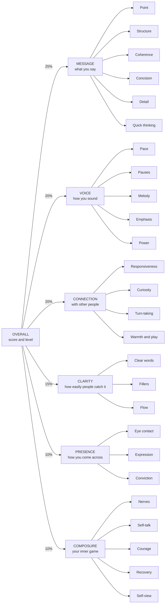
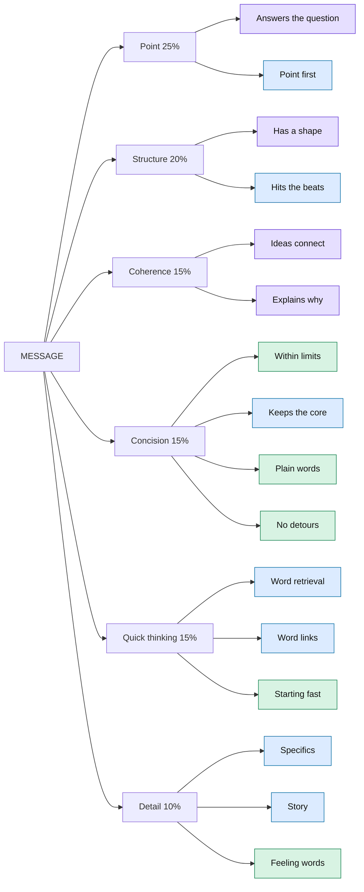
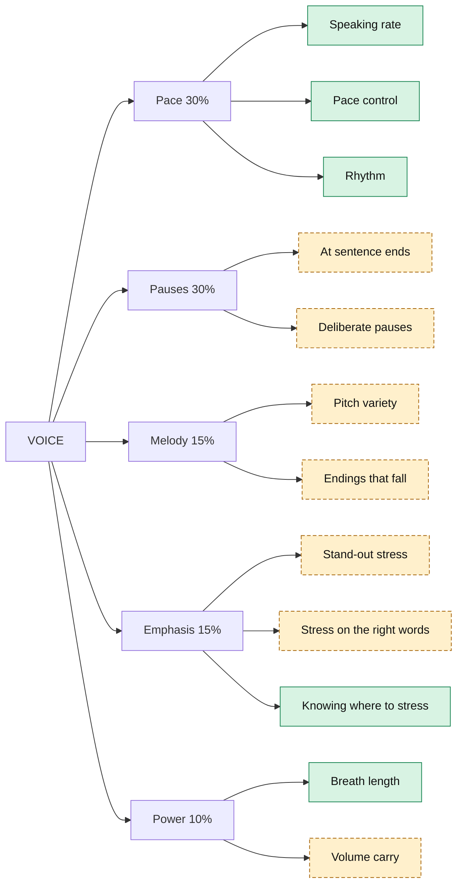
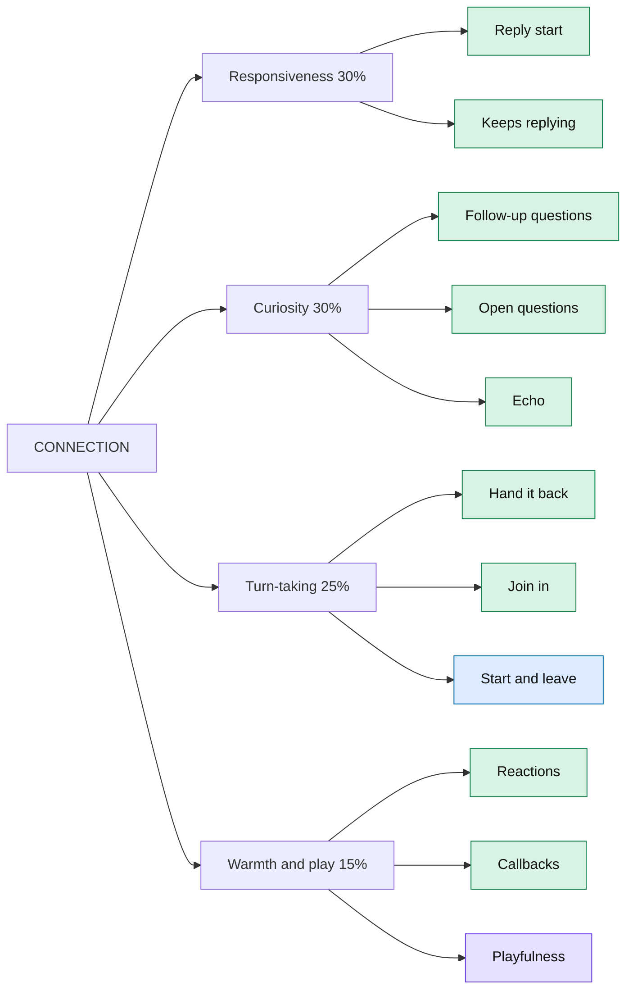
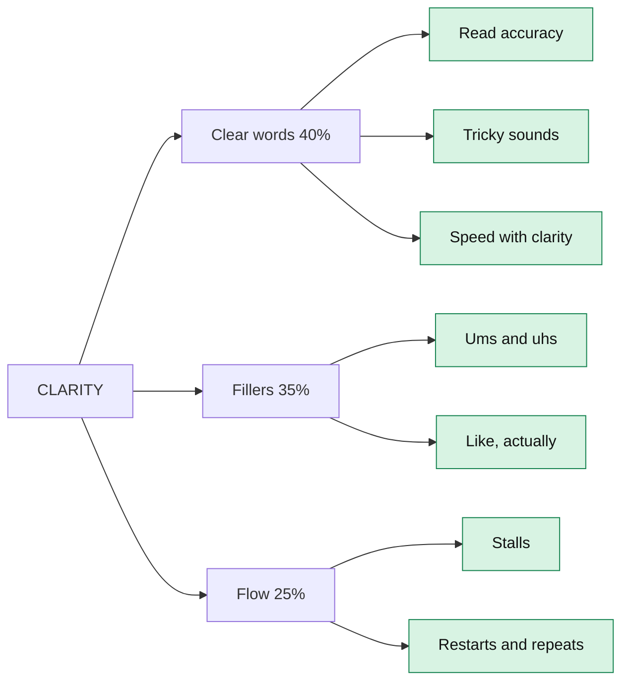
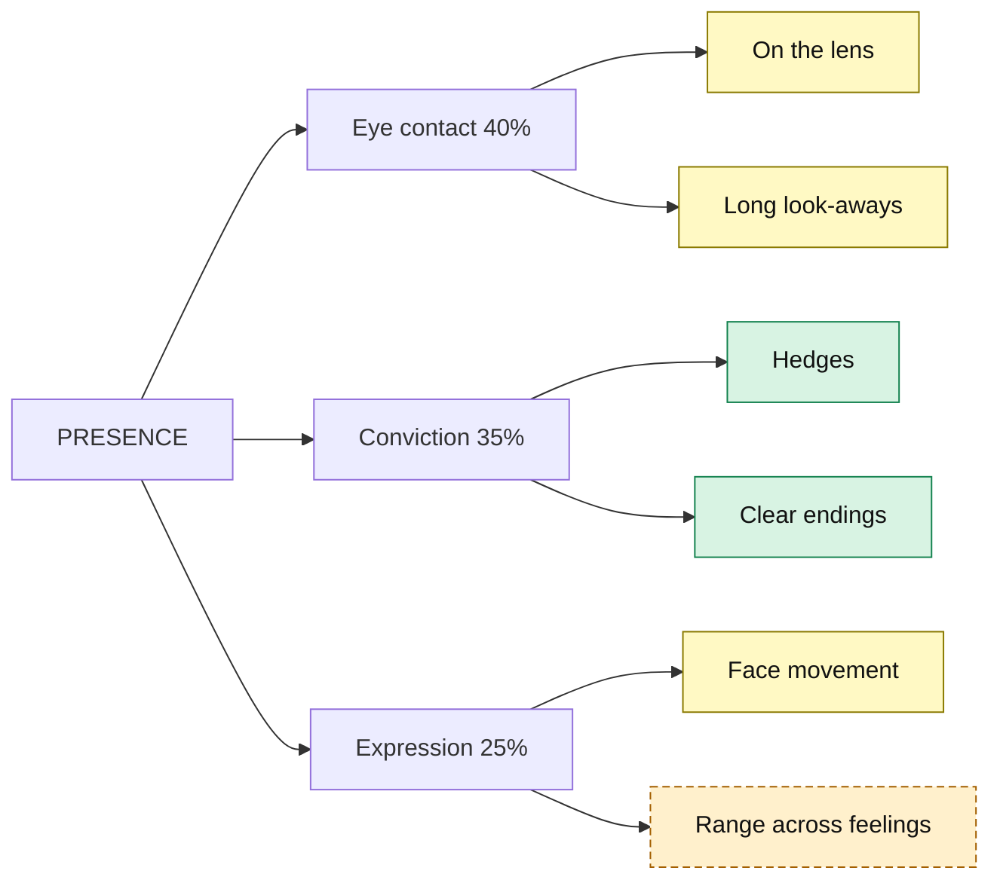
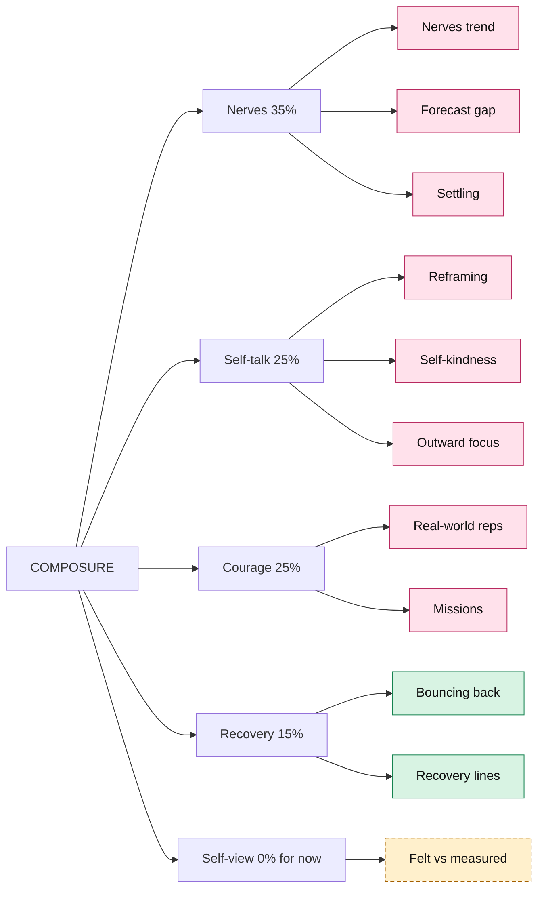

# Tono overhaul plan (final)

**Status: final, agreed 2026-11-05. Started 2026-11-06.** The first step is **step −1, cleaning the repo on `staging`** (section 14). Live progress is in `docs/overhaul/PROGRESS.md`, and changes to this plan are in `docs/overhaul/DECISIONS.md`. "You" in this plan means the app's owner.

**Context.** Tono was built feature by feature, so it doesn't feel like one product: there's no clear "what next", drills are scattered, check-offs don't sync, and scores don't add up to one story. This plan makes it one curriculum with one honest score system, built around your skill tree and your rule that everything must be quantifiable.

The audit behind this plan was done on `fix/hotfix-round-1`, the newest branch at the time. Work starts from `staging` after step −1. Screens and animation come last; the app's logic comes first.

**Words used in this plan**
- **Overall:** the one score at the top of the tree.
- **Pillar:** a core skill directly under Overall, like Voice.
- **Secondary skill:** a skill under a pillar, like Pauses.
- **Leaf:** the bottom of the tree, always a single number we can measure, like "Pauses at sentence ends".
- **Scoring grid:** the table saying which skills each activity moves, and by how much.
- **Gate:** the check an attempt must pass before it can move a score. It proves you did the task.
- **On probation:** a reading whose sensor isn't proven yet. We show it but don't count it until it passes a test on a real phone.
- **Tuning:** the sensor is fine, but the formula on top needs a quick check before it counts.
- **Signal Lab:** the new testing suite in the Dev tab.
- **Whisper:** the transcription model already on the phone for takes. The **live recognizer** is the separate on-device speech recognition the drills use today.
- **Take:** one recorded video answer.

---

## 0. Final decisions at a glance

| Decision | Final | Section |
|---|---|---|
| Starting point | **Step −1:** bring the newest work into `staging`, clean it there, then branch off | 14 |
| Name | Stays **Tono** | 3 |
| Tabs | Today, Path, Practice, You | 4 |
| Curriculum | One catalogue, one activity log; check-offs sync everywhere | 5 |
| Skill tree | Overall, 6 pillars, 26 secondary skills, 63 leaves, with final weights | 6.2, Appendix C |
| Scale and levels | 0–100 at every node; levels 1–25, one every 3 points, never dropping; 5 stages that need proof at difficulty | 6.3 |
| Scoring grid | Every activity has a number and a list of what it moves, in one data file a test enforces | 7, Appendix A |
| Valid scores | No score without proof the task was done; nonsense can't score well; each number says what was checked | 6.4 |
| Who owns what | The phone owns delivery, the judge owns content, and scores read Whisper's words, not the live recognizer's | 6.4, 6.6 |
| Judged skills | 0–5, ×20, with a quote the phone verifies | 6.6 |
| Content checks | Phone checks for everyone; small server checks **free for signed-in adults, about 60 a month**; full reviews for Plus and the free monthly take | 6.6 |
| Readings | Pitch, volume and pauses on probation; eye contact and expression tuning. None count until they pass **Signal Lab**. | 6.5 |
| Difficulty | One 1–10 scale, seeded from your skill, with rising floors, a weekly Stretch rep and a challenge setting | 6.7 |
| Today | The session plus ranked cards that change by time of day and events | 8 |
| Rewind | Works at any hour: "today" in the evening, "yesterday" in the morning | 5.3 |
| Session length | **One number, minutes a day**: 5, 10, 15, 20 or 30. Set a usual, change it any day. | 9 |
| Results | Predict, always 3 passes, results open at the top, nothing pinned, Rewatch and Analysis in accordions | 10 |
| Onboarding | Speak first, with Whisper; questions fill the wait | 12 |
| Release | Version 2.0.0, a clean start with no backwards compatibility | 14 |
| Working style | **Phase branches, a pull request per phase, a session-start hook.** You review and merge. | 17 |
| Later | Content overhaul of lessons and drills, as separate work | 18 |

---

## 1. Context: the root causes

**1. Three structures that don't share state.**
- Today's plan, the Path and everything else each keep their own records.
- A lesson done in Learn never ticks Today.
- Today ticks a lesson only when the whole plan finishes, with a made-up score (`progressRepo.ts:533`).
- Lesson step progress is lost when you leave (`LessonScreen.tsx:67`).

**2. Activities live where they were built.** There are 30+ activities across 60+ routes. The 12 main drills have no menu at all.

**3. About 12 number systems.** "Level" means four different things. Lessons never move a rating. Many activities count for nothing. A take's score uses only 3 of the 5 skills.

**4. Today has no hierarchy.** It can show about 18 sections with similar weight, not chosen for the moment. The plan's skill badge ("Impromptu") reads like the card's title. The fix is hierarchy and relevance, not fewer cards.

**5. Results are built to stream in.** Sections pop in while you're looking elsewhere. About 250–300pt stays pinned. The rewatch is the 9th block.

**6. Scores claim more than they check.** Fluent nonsense can score well, several drills don't verify what they claim to train, and 26 guided exercises end in a self-rating that moves real skill ratings. Every live drill also scores from the on-device recognizer's text (`DrillRunnerScreen.tsx:217`), which you've found isn't good enough; only takes and Rewind use Whisper.

**Bugs to fix first:**
- Keyboard covers fields, app-wide.
- The after-event check-in only asks about nerves.
- Filler words don't read as yellow.
- The "overall 0/10" toast (`sessionPipeline.ts:234`).
- The skill check mostly doesn't seed starting levels (`progressRepo.ts:95`).
- Warm-ups are described as feeding Confidence, but they record nothing.

---

## 2. What the research says

| Finding | Rule for Tono |
|---|---|
| Automated speech scoring runs a **filter before the score**. ETS's SpeechRater flags responses that can't be scored (off-topic, no answer) because fluent speech can otherwise score high. | Every activity gets a gate. |
| Speaking rubrics (NCA Competent Speaker, AAC&U VALUE, Public Speaking Competence Rubric) cover **both content and delivery**. Content and organization are a large share of the items. | A take's headline can't be called "overall" unless content was checked. Meaning-based skills are scored against anchored rubric levels. |
| Even human raters disagree: one study of the Public Speaking Competence Rubric found 0.23–0.71 agreement between expert and non-expert raters across its dimensions. | Be modest. Measure what's objective, judge what isn't, and never let one take swing a skill. |
| Conversation competence is usually split into attentiveness, composure, expressiveness and coordination (Spitzberg's CSRS). | This shapes the Connection and Composure pillars. |
| Duolingo pairs one path with a separate Practice Hub feeding the same daily goal. Khan Academy moves mastery through different kinds of evidence, with a unit test confirming it. Strava counts every activity type through one effort model. | Path is the spine, Practice is the gym. Everything counts, but differently. Checkpoints confirm a unit. |
| Feedback hurt performance in over a third of cases, mostly when it pointed attention at the self (Kluger & DeNisi 1996). Next steps are the most useful part (Hattie & Timperley 2007). | Results end in one thing to try next, with a button that practises it. |
| Speakers overestimate how visible their nerves are (Savitsky & Gilovich 2003). Video feedback works better if you predict first, then watch as if it were a stranger (Harvey et al. 2000). | Predict, watch 3 passes, then see what was measured. |
| Paying for gym visits at a fixed time led to **fewer** visits than paying for visits at any time (Beshears et al. 2021). | Being flexible doesn't harm the habit. This study is about timing, not length, so it's the closest evidence I found, not a direct answer. |
| Goals with a built-in "skip" help people persist after a miss (Sharif & Shu); a student replication didn't find it, so it's promising, not settled. Broken streaks reduce later use, less so when repairable (Silverman & Barasch 2023). | Keep streak freezes and add repair. |
| One teardown describes Duolingo's onboarding offering 5, 10, 15 or 20 minutes a day. Headspace lets you change length per session. Sources disagree on Duolingo's current options. | There's precedent for both. Section 9 combines them. |
| Oura's Today tab changes by time of day and goals, leading with one prioritized item (2025 redesign). | Today changes through the day, with one clear main thing. |
| Duolingo lets you try a lesson before asking for an account; one write-up credits delayed sign-up with a 20% rise in daily users (third-party, unverified). Evidence on how many onboarding questions is too many is mostly teardowns. | Speak first, ask later. |
| Being tested beats re-reading on delayed tests (Roediger & Karpicke 2006), though later work finds a mix of the two can do as well or better. | An optional one-question check on each lesson's teach card. |
| Habits average 66 days, and one missed day didn't matter (Lally 2010). Learning peaks near 85% success (Wilson 2019). If-then plans help (d≈0.65). New weeks raise goal pursuit (Dai et al. 2014). | Keep anchors, rest days and the drill staircase. Add a Monday recap. |
| Listeners' ratings of liveliness tracked pitch variation (Hincks 2005), and live feedback on pitch variation in semitones raised it, with the gain lasting after training (Hincks & Edlund 2009). | Score melody from how much pitch varies, not just its overall range. |
| Listeners hear stress from pitch, loudness and duration together, and classifiers do best with all three (Tamburini; Johnson & Kang 2015). | Emphasis stops relying on loudness alone. |
| Looking away tracks how hard someone is thinking and can improve performance (Glenberg et al. 1998, via summaries; I didn't read the paper). | Short glances shouldn't cost eye-contact points. |
| Math Garden updates both player and item ratings with an Elo scheme and targets about 75% success, with good reliability across 3.5 million answers (Klinkenberg et al. 2011). | Skill ratings should set difficulty, not run beside it. |
| A 2026 study across six benchmarks found a **0–5 scale gave the strongest agreement** between human and AI judges (Li et al.). The abstract doesn't say whether speech or writing was included. | Judged skills use 0–5, checked against hand-rated takes. |

---

## 3. The concept

**A daily coach that carries you from short reps to the real moments that matter, where everything you do lands in one tree of skills and counts for what it actually proves.**

The app stays **Tono**. What sets it apart, as far as I could find (reviews of competitors are thin and often written by vendors):
1. **One visible skill tree.** Every rep shows how it moved a leaf, its parent, its pillar and your Overall.
2. **Predict, watch, compare.** Every take trains how you see yourself.
3. **Real life is in the curriculum.** Interviews, talks and dates become "Moments" that the plan builds toward.
4. **Honest scores.** Every number says what was checked. Nonsense can't earn a good score.

---

## 4. Four tabs (your decision)

| Tab | Job | What lives there |
|---|---|---|
| **Today** | What to do now | Session, relevant cards, this week |
| **Path** | The course | Units, lessons, checkpoints |
| **Practice** | The gym | Every repeatable thing: all drills, speak modes, conversation, Reflect tools, Moments, prompts, frameworks |
| **You** | Your record | Overall, the skill tree, trends, recordings, settings |

---

## 5. One curriculum

### 5.1 One catalogue of activities

A new `src/content/activities.ts` wraps the existing definitions. Each entry has a kind, minutes, whether it repeats, its gate, how its number is worked out, and where it can appear.

| Kind | Repeats? | Examples |
|---|---|---|
| **Lesson** | Once, then spaced reviews | 71 lessons in 22 units |
| **Checkpoint** (new) | Once per unit, can retry, can skip for now | A 1-minute rep that closes a unit |
| **Drill** | Yes; difficulty adapts | Twisters, sprints, chains, Say it short, the 26 guided exercises |
| **Speak** | Yes | Impromptu, Concise, Free record, Speeches |
| **Conversation** | Yes | 12 drills + Live (Plus) |
| **Reflect** | Yes | Rewind, Feeling of the week, Three things, Talk back, Phrasebook |
| **Moment** | Once per event | Interview, talk, toast, date; merges Events with Prime/Debrief |
| **Check** | Day 1, then every 30 days | Skill check |

### 5.2 One activity log keeps check-offs in sync

A new `activity_log` table is written by every runner through the existing `completePracticeStep` (`services/practice/practiceEvents.ts`). Every check mark becomes a query over it:
- **A plan step** ticks when that activity is done anywhere today.
- **A lesson step** ticks when done from the lesson, from the plan, or from Practice while that lesson is your current one. It persists across days.
- **A lesson** completes when all its steps are done, using the real average score.
- **A unit** completes when its lessons are done and its checkpoint is passed or skipped. A skipped checkpoint stays open, so nobody gets locked out.

### 5.3 The session pulls from everything

Rebuild `buildDailyPlan` (`domain/dailyPlan.ts`) around five slots:
1. **Warm up.**
2. **Learn:** the current lesson's next step.
3. **Drill:** aimed at the lowest leaf on your current focus, or your last result's "one thing next".
4. **Record + review:** a take and its 3 passes, as one step (section 10).
5. **Reflect or Moment:** the first that applies:
   - The day after an event: its debrief.
   - An event within 2 days: a rehearsal rep.
   - This week's Feeling of the week isn't done, and it's been a few days: Feeling of the week.
   - A day is waiting to be told: Rewind (below).
   - Otherwise: Three things.

**Rewind works at any hour, so morning people aren't left out.**
- **Evening session:** "Rewind today".
- **Morning or midday session, yesterday not told:** "Rewind yesterday". It's the same exercise, about the day before, and recalling a day later is good practice in itself. `day_recalls` already keeps `date` and `recorded_at` apart, so the day it's about and the day you recorded it stay separate. Cues and the judge's prompt switch to the past tense.
- **The app learns your habit.** From the activity log it sees when you usually practise over the last 14 days. Morning people get their Rewind nudge and card in the morning; evening people at night. Settings can override it.
- **Each day can be told once,** and a day older than yesterday isn't offered.

Practice tab: search and pillar filters, then "For you" (3 tiles), then sections by kind.

---

## 6. The skill tree

### 6.1 How the tree works

**The design:** Overall at the top, core pillars under it, secondary skills under those, going down until it's measurable, with numbers visible at every level so you can see how each skill contributes to the one above. The app already has the start of this: `domain/scoring/taxonomy.ts` has skills, subcategories and 37 metrics, but most metrics are "shown only" and the tree stops rolling up at the skill.

**The rules:**
1. **A leaf is always one number.**
2. **Each leaf has one parent.** That keeps the sums honest. If a drill trains two things, it gets two rows in the grid; the tree itself stays a tree.
3. **Evidence always lands on leaves.** An activity can point at a leaf or at an upper node. If it points at an upper node, its score splits down to that node's children by their weights. So the stored numbers all live at the bottom, and everything above is just adding up.
4. **An untouched leaf stays at its starting value.** It isn't skipped. So you can't get a high Overall from one branch, and doing something new raises your score.
5. **The scoring grid is one data file, with a test.** A new drill with no row makes the test fail, so coverage can't drift again.
6. **Six pillars, not the current five.** Composure is new, for the inner game. Self-reported numbers are valid only for inner states like nerves, never for performance.

### 6.2 The tree

Every node is on a 0–100 scale. **These weights are final.** They only change if test data says so, and any change gets logged (section 17). Appendix C holds the same tree in machine-readable form.



**Why these six**
- All 11 onboarding obstacles land in one place: ramble (Concision), blank (Quick thinking, Recovery), fillers (Fillers), nerves (Nerves), monotone (Melody), too fast (Pace), mumble (Clear words), too quiet (Power), sound unsure (Conviction), eye contact (Eye contact), putting feelings into words (Detail).
- **Clarity is separate from Voice** because its readings come from words and timing, which we can trust today. Voice leans on pitch and volume, which we can't yet.
- **Composure is its own pillar** so the inner work counts, without being mixed into performance scores.

**How old skills map**
| Old skill | New home |
|---|---|
| Articulation | Clarity |
| Cadence | Voice |
| Impromptu | Message; its Fluency moves to Clarity |
| Confidence | Presence; breath and volume move to Voice; nerves move to Composure |
| Conversation | Connection; "Say it straight" moves to Message; "Outward attention" moves to Composure |

**How to read the trust column** (colours in the diagrams)
- **Now** (green): measured from words and timing, usable today.
- **Probation** (amber, dashed): relies on pitch, volume or pause readings not yet proven on a phone (section 6.5). Weight 0 until it passes.
- **Tuning** (yellow): the sensor is fine, but the formula on top needs a quick check. Weight 0 until it passes.
- **Judge** (purple): about meaning, so scored 0–5 against written rubric levels, with a required quote the phone verifies, then ×20. Without a judge, a coarser phone estimate counts lightly.
- **Phone + judge** (blue): the phone can check part of it; a judge can check the rest.
- **You** and **Count** (pink): a number you report, valid for inner states only, or things that happened, counted.

"Tune" means the formula needs real takes to set its numbers.

#### Message (25% of Overall)



| Leaf (share of its parent) | The number | Score out of 100 | Trust |
|---|---|---|---|
| Answers the question (60%) | Judge rubric; phone estimate: similarity to the prompt | Level ×20 | Judge |
| Point first (40%) | Does the first sentence carry the point? | 100 or 0 | Phone + judge |
| Has a shape (50%) | Judge rubric; phone estimate: framework found | Level ×20; phone 80 or 40 | Judge |
| Hits the beats (50%) | Beats found ÷ beats in the framework (`guessStructure`) | % | Phone + judge |
| Ideas connect (60%) | Judge rubric; phone estimate: sentence-to-sentence similarity | Level ×20 | Judge |
| Explains why (40%) | Explained links ÷ target (Bridge chain) | % | Judge |
| Within limits (35%) | Sentences and seconds against the budget | % | Now |
| Keeps the core (35%) | Key words hit, words kept, judge's "core" verdict | % | Phone + judge |
| Plain words (15%) | Words per sentence, share of long words | Under limit = 100 | Now |
| No detours (15%) | "By the way", "anyway" per minute | Tune | Now |
| Word retrieval (40%) | Checked words ÷ target | % | Phone + judge |
| Word links (30%) | Links that connect ÷ target | % | Phone + judge |
| Starting fast (30%) | Seconds to first word with no prep | Tune | Now |
| Specifics (50%) | Names, numbers, times, senses a minute (`countDetails`) | Tune | Phone + judge |
| Story (30%) | Required words used + judge rubric | % | Phone + judge |
| Feeling words (20%) | Different feeling words used (`feelingWordsUsed`) | Count ÷ 5 | Now |

#### Voice (20% of Overall)



| Leaf (share of its parent) | The number | Score out of 100 | Trust |
|---|---|---|---|
| Speaking rate (50%) | Words a minute | 100 inside 130–160, −1.4 per word outside | Now |
| Pace control (30%) | Hitting a target speed; fast vs slow ratio | In band, or ratio 1.5+ = 100 | Now |
| Rhythm (20%) | Pace spread across phrases; speed-up in second half | Tune | Now |
| At sentence ends (60%) | % of sentence ends with a pause | 60%+ = 100 | Probation |
| Deliberate pauses (40%) | Pauses held at marks; 2-second holds | % hit | Probation |
| Pitch variety (60%) | How much pitch varies within each phrase, in semitones, averaged (the app already stores `sdSemitones`) | Set in Signal Lab; personal after 5 takes | Probation |
| Endings that fall (40%) | Statements not rising at the end | % | Probation |
| Stand-out stress (50%) | How far your most stressed words stand out, from pitch, loudness and length combined | Set in Signal Lab | Probation |
| Stress on the right words (30%) | Strong peaks landing on content words | % | Probation |
| Knowing where to stress (20%) | Your marks matching the coach's (`LineRepScreen`) | % | Now |
| Breath length (50%) | Numbers on one breath; seconds of steady hiss | Count ÷ target | Now |
| Volume carry (50%) | % of speech at target; last word within 6 dB | % | Probation |

#### Connection (20% of Overall)



| Leaf (share of its parent) | The number | Score out of 100 | Trust |
|---|---|---|---|
| Reply start (50%) | Seconds to first word (`timingScore`) | Existing formula | Now |
| Keeps replying (50%) | Turns replied ÷ turns | % | Now |
| Follow-up questions (40%) | Asked a question + used their words | 50 + 50 | Now |
| Open questions (30%) | Open questions ÷ questions asked | % | Now |
| Echo (30%) | Echo, Ask, Add beats ÷ required (`echoAskAdd`) | % | Now |
| Hand it back (40%) | One or two sentences, then a question | % of turns | Now |
| Join in (30%) | Group turns taken ÷ turns | % | Now |
| Start and leave (30%) | Opener and exit beats found | % | Phone + judge |
| Reactions (40%) | Reacted in time | Timing | Now |
| Callbacks (40%) | Called back to an earlier story | 100 or 50 | Now |
| Playfulness (20%) | Judge rubric; phone estimate: replied in time | Level ×20 | Judge |

These measure what you did, not how witty you were, in line with the app's "lower the pressure" rule. Playfulness is the one exception, and it's only judged when Tono AI is on.

#### Clarity (15% of Overall)



| Leaf (share of its parent) | The number | Score out of 100 | Trust |
|---|---|---|---|
| Read accuracy (40%) | % of words recognized as read | % | Now; the recognizer may hide slurring (my inference, unmeasured) |
| Tricky sounds (30%) | % of minimal pairs recognized, stored per sound | % | Now |
| Speed with clarity (30%) | Twister at target speed; pa-ta-ka syllables a second | Accuracy × speed; 5+ syllables a second = 100 (published adult range is about 5.3–7.1) | Now |
| Ums and uhs (70%) | Per minute | 100, −8 per one over 2 | Now, after the filler test |
| Like, actually (30%) | Per minute | Half that rate | Now, after the filler test |
| Stalls (60%) | Mid-phrase gaps of 2+ seconds a minute | 100, −20 per stall a minute | Now |
| Restarts and repeats (40%) | Per minute | Tune | Now |

If your profile says you stutter, Fillers and Flow don't count, as today.

#### Presence (10% of Overall)



| Leaf (share of its parent) | The number | Score out of 100 | Trust |
|---|---|---|---|
| On the lens (70%) | % of speaking time on the lens, with glances under about 1.2s forgiven | 85%+ = 100 | Tuning |
| Long look-aways (30%) | Look-aways over 3s a minute; looking down counts double, since it usually means notes or your own preview | 100, −20 each | Tuning |
| Hedges (50%) | "I think", "maybe" counted (`findHedges`) | First 2 free, −5 each | Now |
| Clear endings (50%) | Clear, neutral or trailing (`hasStrongEnding`) | 100, 60, 30 | Now |
| Face movement (60%) | Brow lifts and smiles a minute, measured against your own resting face and range from the face check | Set in Signal Lab | Tuning |
| Range across feelings (40%) | Difference across 4 reads of one line, voice and face | Set in Signal Lab | Probation, because of its voice part |

**Why Tuning, not Probation.** You've tested the eye and face tracking and it's good, so the sensor counts as fine. The formulas on top are first guesses (section 6.5). Signal Lab checks them in about 3 minutes, which tests the math, not the tracking.

Almost only takes feed Presence. No drill trains eye contact; that's for the content overhaul (section 18).

#### Composure (10% of Overall)



| Leaf (share of its parent) | The number | Score out of 100 | Trust |
|---|---|---|---|
| Nerves trend (50%) | Comfort check-in; nerves after real moments | Compared with your start | You |
| Forecast gap (30%) | Predicted vs actual nerves or awkwardness | Actual at or under predicted = 100 | You |
| Settling (20%) | Breathing rounds done; how energized you feel | % | You + count |
| Reframing (50%) | Talk back: steps done, belief drop, fairer line said | 40 + 40 + 20 | You + count |
| Self-kindness (25%) | Three things: different items, said aloud (`saidRatio`) | 50 + 50 | Count |
| Outward focus (25%) | Attention on yourself, before vs after | A drop = 100 | You |
| Real-world reps (70%) | Moments and debriefs a week, weighted by kind | Diminishing returns | Count |
| Missions (30%) | Logged ÷ target | % | Count (self-logged) |
| Bouncing back (60%) | Beat held, blanks replayed, fresh starts recovered | Existing timing + count | Now |
| Recovery lines (40%) | Three lines said, unhurried | % | Now |
| Felt vs measured | Gap between how you felt and what was measured | Display only | Probation |

**Composure can only go up.** Honest bad days never lower it, so there's no reason to fudge a self-report.

### 6.3 How numbers roll up and show

**The update**
- **Leaf:** the same Elo-style update as `domain/mastery.ts`, scaled by the grid's weight (●●● 1, ●● 0.5, ● 0.25). It accounts for difficulty, so acing easy drills can't reach 90.
- **Every node above:** the weighted average of its children. Computed, never stored.
- **Untouched leaf:** stays at its starting value (from the skill check, otherwise 25).
- **Leaf on probation or tuning:** weight 0; its siblings share its weight until it passes.

**A worked example.** You score 80% on Word chain at difficulty 3, with Word links at 40 after 5 attempts.

| Node | Change | Why |
|---|---|---|
| Word links | 40 → 42.4 (+2.4) | The existing formula |
| Quick thinking | +0.7 | Word links is 30% of it |
| Message | +0.1 | Quick thinking is 15% of it |
| Overall | +0.03 | Message is 25% of it |

A single drill barely moves Overall, which is honest. A full session moves many leaves, so I'd expect roughly half a point to a point a day early on, slowing later. That's an estimate to check with real use.

**The trail.** After *every* activity, a result shows the path from leaf up to Overall with what changed: `Word links +2.4 · Quick thinking +0.7 · Message +0.1 · Overall +0.03`. This is the unified experience you described, and it reuses `ProgressReveal`.

**Final levels and ranges**

| What | Final value |
|---|---|
| Scale | 0–100 at every node. Overall shows one decimal; everything else shows whole numbers. |
| Starting value | 25 for every leaf; the skill check sets 15–45 for leaves it measures |
| Overall weights | Message 25, Voice 20, Connection 20, Clarity 15, Presence 10, Composure 10 |
| **Level** | 1 to 25. Level 1 is under 28, then one level every 3 points, so Level 25 starts at 97. It's a high-water mark and never drops. It's the only thing called "level". |
| A single attempt | 0–100: 80+ Great, 60–79 Solid, 40–59 Getting there, under 40 Keep going |
| A take | Message 40, Voice 20, Clarity 20, Presence 20 |
| Judged skills | 0–5, ×20 |
| Difficulty | 1 to 10: Easy 1–3, Medium 4–6, Hard 7–10. The old 1–5 practice step goes away. |
| Target success rate | 82% by default (section 6.7) |

**Stages** name any node, at any level of the tree:

| Stage | Score | Attempts | Proof at difficulty |
|---|---|---|---|
| Foundations | 0–34 | None | None |
| Building | 35–47 | 6 | None |
| Steady | 48–61 | 18 | 3 good attempts at difficulty 3+ |
| Strong | 62–79 | 36 | 5 good attempts at difficulty 5+ |
| Polished | 80–100 | 60 | 8 good attempts at difficulty 6+ |

A good attempt scores 70+. For a pillar or secondary skill, attempts and proof come from any leaf below it. Earned stages never drop, as today; a score more than 6 below its floor just reads as "rusty".

These line up with the rating formula. A steady 80% settles near 10 × difficulty + 20, so about 50 at difficulty 3 (Steady), 70 at 5 (Strong) and 80 at 6 (Polished). At 0.5–1 point a day early on, that's a new level every 3–6 days at first, slowing later. That pace is an estimate to check with real use.

**A take uses the same tree.** It shows *this attempt's* score at each node, 0–100 instead of today's 0–10.
- Without a content check, the headline says **Delivery** and leaves Message out.
- If the gate fails: "We couldn't score this one", and you keep your minutes.
- A take of 72 and a Voice skill of 48 can both be true: the first is how this one went, the second is your slow-moving skill.

**Trends:** a Delivery line for everyone, a Message line for judged takes. No more two-layer switch.

### 6.4 The rules that keep scoring valid

1. **Everything has a number.** No activity is "done" without one, except pure reading (teach cards, Frameworks, Sources), where nothing was attempted.
2. **No score without proof the task was done.** Fail the gate and you keep your minutes and check-off, but no score moves, and it says why kindly.
3. **A number only claims what was checked.** Every score carries its source: Measured, Phone estimate, Tono AI, or You said.
4. **The phone owns delivery; the judge owns content.** The judge stops scoring pace and pitch from numbers it can't hear. This removes the "Tono AI vs This phone" switch, and a take's Delivery is the same whether or not it was judged.
5. **Phone estimates count lightly.** A content leaf moves ● from a phone estimate and ●●● from a judge.
6. **Self-reported numbers are for inner states only.** They never move a performance leaf. Today's self-ratings on guided exercises and line reps stop moving skills.
7. **A reading counts only after it passes its test in Signal Lab** (6.5).
8. **If nothing can check it,** such as an unjudged Bridge chain offline, the attempt earns minutes and says "not checked". Today it still moves your rating.
9. **Scores read Whisper's words, not the live recognizer's** (6.6).

### 6.5 Pitch, volume and face: what I found, and what to do

**Why the graph looks wrong**
1. **Many of the gaps are normal speech, drawn badly.** For a 60-second take the chart uses 250 ms buckets and breaks the line whenever a bucket has fewer than 2 voiced frames (`voiceChartData`). Every pause and many consonants cause a break. Older exports show about 22 pauses a minute, so a break about every 3 seconds. The line is straight between points with no smoothing (`TimeChart.tsx`), so you get jagged fragments even if the tracker is right.
2. **The tracker has never been proven on a real phone, as far as the repo shows.** Its 82–88% accuracy comes from synthetic voices and public clips through a *simulated* phone (`docs/research/signal-capture.md`, section 7). The phone tests were written (device test plan, sections D and F), but I found no results. The only exports in `analysis_samples/` are from Oct 20, before the new tracker.
3. **Volume is the weaker of the two.** Takes record in VisionCamera's `videoRecording` mode, which may apply automatic gain; that's unverified. Phone distance changes the reading. Drills use a different meter on a different scale.
4. **These readings affect your score now.** Pitch variety and Emphasis are about 15% of a take's measured score.

**What's wrong with the face math (the tracking is fine)**
- **Expression** is the average variation of smile, cheek lift and brow lift, ×600 (`EXPRESSION_SCALE`), with full marks at 30. So a variation of just 0.05 on a 0–1 scale earns full marks. Normal tracker jitter could supply a good part of that. The code itself calls 600 "a first setting, to be checked".
- **Eye contact** checks each frame against fixed cut-offs (head within 20°, eyes within 0.35). The cut-off is generous on purpose, so glancing at your own preview counts as on the lens. Every look-away counts the same whether it lasts a quarter second or ten seconds, and it counts frames across the whole take, not just while you're speaking.
- **The longest look-away** is calculated but never scored.
- **Your face check** already stores your resting face and your range (`faceCalibration.ts`), but expression barely uses them.

**A. Signal Lab: the testing suite in the Dev tab.** Nothing else can settle these; the emulator has no real microphone chain. It replaces guesswork with a repeatable test, and folds in the existing Voice Lab, Face Lab and ASR Lab.

How it works:
- A home screen lists every test with its status, last result and date. Run them all (about 25 minutes) or one at a time.
- Each test shows a script and cues, then records through **the same capture path and the same formulas as the real feature**, so it tests what users actually get.
- It shows the raw numbers and a chart, marks pass or fail against the bar, and saves the result with the date, app version and extractor version.
- **Export** copies the results as JSON, which I can read to tune formulas and to compare against offline reference tools.
- A Dev switch previews how scores change if a reading is turned on or off.
- A reading goes live only when I change its status in code after reading your results, so the change is reviewed and logged. Since this is one phone, I'd re-check on a second device before launch.

| Test | What you do | Pass bar | If it fails |
|---|---|---|---|
| **Voice** | | | |
| Pitch variety | Flat, normal and lively takes, 45–60s each | Flat under 2.5 semitones of range, lively over 4.5, clear order on variation, pitch found for 60%+ of speech | SwiftF0 via Core ML |
| Pitch glide | Slide slowly from low to high | A smooth rise with no octave jumps | Better cleanup, or SwiftF0 |
| Endings | 5 statements falling, 5 as questions | 80%+ classified right | Leaf stays display-only |
| Volume gain | 5s normal, 5s quiet, 5s loud, phone still | 15 dB+ between quiet and loud | Change the takes' audio set-up (below) |
| Volume distance | Same level at arm's length, then half that | About a 6 dB shift, and within 2 dB after face-size correction | Volume leaves stay drills-only |
| Emphasis | Same passage flat, then stressing key words | Stressed clearly higher | Leaf stays display-only |
| Word stress | "I didn't say she stole the money", 7 ways | The stressed word ranks top in 5 of 7 | Leaf stays display-only |
| Pauses | Read a passage with 10 marked pauses | 8+ found, 2 or fewer false | Use Whisper gaps too, then Silero VAD |
| Pace | Read a timed passage | Within 5% of a stopwatch | Fix the timing source |
| **Clarity** | | | |
| Fillers | Read a script with 10 ums, on a take and in a drill | 9+ kept by Whisper (2 of 3 older exports showed none). Reports what the live recognizer keeps too. | Fix the Whisper prompt |
| Recognizer vs Whisper | Same passage through both | Word errors for each; decides 6.6's rule with data | |
| Whisper speed | Time on a 30s clip | Under about 10s, so drills can use it | Show a longer "Checking" state, or run it after |
| **Presence** (tracking accepted; this checks the math) | | | |
| Looking | 20s each at lens, notes, ceiling, side | 85%+ right on each | Tune cut-offs with these takes |
| Glances | Short glances, then one long look-away | Short ones forgiven, the long one counted | Tune the 1.2s and 3s lines |
| Your preview | 20s at the lens, 20s at your own preview | Tells them apart, or we decide they count the same | Keep the generous cut-off |
| Expression | Still face, then animated | Animated at least double still, and still near zero | Change the formula |
| Face events | 10 brow lifts and 5 smiles on cue | 80%+ counted | Tune with your face check |
| **Content** | | | |
| Word links | The gold set in `cases_synthetic.json`, on the phone | Catches 80%+ of broken links, wrongly fails under 10% | Fall back to the small content check |
| On topic | Real answers, off-topic answers and gibberish | Flags the last two, never a real answer | Same |
| Judge | Hosted eval plus about 30 takes you rate | Two runs within one level 90%+ of the time | Fix the prompt, or try another model |

**B. Probation and tuning until each passes.** The reading shows with a "Beta" label and doesn't count. When it passes, it starts counting.

**C. Better ways to gather each reading.** Each is tried in Signal Lab before it ships.

| Reading | Problem today | Better way | Basis | Cost |
|---|---|---|---|---|
| Melody score | Overall range is thrown off by a few outlying points | Average pitch variation within each phrase, in semitones | Listeners' liveliness ratings tracked pitch variation; feedback on it improved speakers (Hincks) | Code only |
| Pitch tracking | Our own YIN tracker may struggle with room echo | SwiftF0 (135 KB) via Core ML in a small Swift module, only if the tests fail | Repo's signal-capture doc: this route avoids the MediaPipe link clash | New build |
| Pitch cleanup | Octave jumps, jagged lines | Smooth with a median filter, and limit the search to your own range, learned from Hum and siren | My suggestion | Code only |
| Volume on takes | The camera's audio mode may apply gain control | Test 3 set-ups: today's; `automaticallyConfiguresApplicationAudioSession` off with `measurement` mode; and log `activeMicrophoneMode`, since Voice Isolation processes the audio. Apple warns recording can fail if settings conflict, so this needs a test. | Apple's docs; whether these modes turn gain off isn't documented | Native change, new build |
| Volume and distance | Moving closer reads as louder | Correct the level using face size from the same take: half the distance is about +6 dB | My idea, untested | Code only |
| Emphasis | Uses loudness alone, which gain control flattens | Score each word from pitch, loudness and length together, using Whisper's word times | Tamburini; Johnson & Kang 2015; Streefkerk 1998 | Code only |
| Pauses | The energy gate misses some (7 of 9 in simulation) | Combine it with gaps between Whisper's words; Silero VAD via Core ML if that fails | Repo's signal-capture doc | Code, maybe a new build |
| Eye contact | Every frame and every glance counts the same | Group frames into looks, forgive short glances, score only while speaking, count long ones separately | Looking away tracks hard thinking (Glenberg 1998) | Code only |
| Expression | Variation ×600 can reward jitter | Count brow lifts and smiles against your own rest and range | Your face check already stores these | Code only |
| Face and voice together | Never measured | An experiment: do brow lifts land on stressed words? | My recollection of Krahmer & Swerts; my search didn't confirm it | Code only |

**D. A chart that doesn't fall apart: one by-phrase strip.**
- Split the take into phrases at real pauses, each one mark on a single strip, so a pause is just a space.
- A switch picks Pace, Melody or Emphasis. For Melody, each phrase is a floating bar showing its pitch range, which holds up when some frames are missing.
- Tap a phrase to see its words and hear it. The flattest and liveliest phrases are labelled.
- This replaces the three charts, zoom buttons and long captions. It uses data already stored.

**E. An experiment, not a commitment: let the judge hear audio.** The default text judge can't hear you. Audio-only input would cost about 0.09¢ for 90 seconds by my estimate, and could give an independent "flat vs lively" read. The prior decision was no audio by default, so this needs consent and a test first.

### 6.6 Who checks content, and what it costs

| Level | What it is | Works for | Cost |
|---|---|---|---|
| **1. Phone checks** | Matching a script or given line (`alignFinal`, `saidRatio`), required letter, required words, key words, repetition, questions (`countQuestions`), and **new: meaning similarity** using Apple's built-in embeddings (`NLEmbedding`) | Everyone, offline | Free. Needs a small Swift module and a new build. Android falls back to "not checked". |
| **2. Small content check** (new) | A short server call returning a rubric level with a quote | **Free for signed-in adults, about 60 a month**; also part of Plus | About 0.08¢ a call by my estimate (1,000 tokens in, 200 out, no thinking) |
| **3. Full review** | Today's take review, narrowed to Message | Plus, plus the free monthly take | About 0.68¢ per take by the docs' estimate; likely less if it stops scoring delivery |

Caveats:
- **I found no accuracy data for `NLEmbedding`.** It must pass a test first: the Word Chain cases in `spikes/inference-eval/cases_synthetic.json` are a ready-made gold set. If it's too coarse for a job, that job falls back to level 2 or "not checked".
- All cost figures are estimates, not measurements.
- Levels 2 and 3 need sign-in, 18+ and consent, as Tono AI does today.

**What the free checks change on the server.** Free users have no exercise calls today (`not_entitled`). A new small-check pool goes in `allowance.ts` and `config.ts`, `domain/analysis/routing.ts` learns the new kind, and the consent, privacy and terms copy get updated. At my estimate, 60 checks cost about 5¢ per active user a month, so the existing `freeBudgetUsd` of $50 covers about 1,000 people using all of them. Watch the real cost in the ledger and raise the budget as the app grows.

**Validating the judge.** The hosted run with pass bars already exists (`spikes/inference-eval`), but I found no results in the repo, so as far as I can tell its accuracy is unmeasured. Run it, add about 30 takes you rate by hand, check two runs land within one rubric level, and re-run whenever models change. Judge checkpoints and the 30-day check twice and average them.

**Why 0–5.** Judged skills use a handful of written levels because that's how speaking rubrics usually work: a judge can tell "answers the question partly" from "answers it clearly" more reliably than a 73 from a 74. A 2026 study comparing three scales across six benchmarks found 0–5 gave the strongest agreement between human and AI judges. Its abstract doesn't say whether speech or writing was among them, so it's a good reason to choose it, not proof. So judged skills use **0–5, ×20**: 0 not there, 1 barely, 2 partly, 3 mostly, 4 clearly, 5 excellent, with wording written per skill. Today's judge uses 1–10. Your hand-rated takes will show whether 0–5 holds up.

**Words come from Whisper, not the live recognizer.** You've found the on-device recognizer isn't good enough, and it's what every live drill scores from today (`DrillRunnerScreen.tsx:217`). Only takes and Rewind use Whisper.
- **The live recognizer stays for on-screen feedback only:** highlighting words as you read, showing a fresh word in a chain.
- **The score reads Whisper's transcript of the saved clip.** A short "Checking…" state covers the wait, at roughly a quarter of the clip's length going by take timings. Signal Lab measures the real time and how much better Whisper does.
- **If the model isn't on the phone yet,** a drill still runs, marked "Quick check", and counts ● until the model is ready.

### 6.7 Difficulty: how the app keeps challenging you

**What's there today.**
- Each drill type has its own difficulty, 1–10, which rises as you succeed and settles where you succeed 82% of the time (`nextDifficulty`). That part is sound.
- A separate 1–5 "practice step" sets prompts and recording length.
- Guided exercises share one level across four skills, and warm-ups have none.
- Ratings already account for difficulty, but nothing links a drill's difficulty to your skill. Every new drill starts at level 1 however good you are (`getDrillLevel`), and nothing stops you staying on easy content.

**The new rules**
1. **One scale.** Every attempt has a difficulty from 1 to 10, shown on its result. The 1–5 practice step goes away.
2. **Harder attempts earn more.** The rating formula already does this: the same 80% moves a leaf more at difficulty 6 than at 2. A steady 80% settles near 10 × difficulty + 20, so nobody reaches Strong on easy content.
3. **Your skill sets the starting point.** The first time you try an activity, difficulty = (leaf score − 20) ÷ 10. With Word retrieval at 60, a new sprint starts at 4, not 1. This is the Math Garden idea of using one rating to pick the challenge.
4. **Then it adapts.** Each activity keeps today's staircase. If it drifts more than 2 levels from what your leaf score implies, it's pulled back.
5. **Stages need proof.** Steady needs good attempts at difficulty 3+, Strong at 5+, Polished at 6+ (section 6.3). To progress, you have to go harder.
6. **Floors rise with your stage.** Once earned, difficulty for that leaf won't drop below: Steady 2, Strong 4, Polished 5. Three misses in a row eases it by 1 for that session only, so a bad day doesn't pile up.
7. **A weekly Stretch rep.** Once a week, the session includes one attempt 2 levels above you. A good result counts extra, and a bad one can't lower anything, so reaching is safe. This matters for anxious users.
8. **Reviews get harder.** A lesson review reruns at your current difficulty, not the one you first did it at.
9. **Lessons unlock by stage.** Tier 2 units are recommended from Building and tier 3 from Steady in that pillar, on top of today's path rules. You can still open any lesson.
10. **The session changes with you.** Foundations: more Learn. Steady and up: more Record. Strong and up: a second rep with no prep.
11. **A challenge setting.** Settings offers Gentle (90% success), Standard (82%) or Push me (70%). It changes the staircase's step sizes, using math already in `mastery.ts`.

**What gets harder in each activity** (from the code, easy end to hard end)

| Activity | Gets harder by | Status |
|---|---|---|
| Takes | Easy prompts, 28s prep, 55s long → hard prompts, 5s prep, 145s long; at the top, surprise prompts with no prep | Exists; no-prep is new |
| Takes you choose yourself | Difficulty worked out from the prompt's tier, prep and length | New |
| Tongue twister | Accuracy only → speed target from level 5, 140 up to 190 wpm | Exists |
| Minimal pairs | 7 → 14 words | Exists |
| Pace reading | Band of ±28 → ±10 wpm | Exists |
| Pause reading | Pauses of 290 → 650 ms | Exists |
| Shadowing | None today → faster model speech | New |
| Line rep | More kinds of marks to place | Exists |
| Move it | Target lift of 13% → 40% | Exists |
| Projection | Higher volume target, 11 → 20s | Exists |
| One-breath count | 10 → 28 numbers | Exists |
| Category sprint | 8 words in 30s → 21 in 60s | Exists |
| Letter sprint | 6 → 15 words | Exists |
| Word chain | 8 links in 30s → 25 in 60s; silence grace 3 → 1.5s | Exists |
| Bridge chain | 3 → 8 links | Exists |
| Random-word story | 2 → 4 words; 14s prep → none | Exists |
| Sixty seconds | 35 → 75s; allowed slips 3 → 0 | Exists |
| Sum it up | 2 sentences in 30s → 1 in 12s | Exists |
| Rolling summary | 3 → 5 paragraphs; 1 → 2 key words | Exists |
| Explain it simply | Less time, shorter sentences, fewer long words | Exists |
| Conversation drills | Reply window 6 → 2.4s; hold 5 → 10s; more beats and group turns; Land the plane 45 → 20s; Squeeze keeps more | Exists |
| Live conversation | Its own staircase | Exists |
| **Guided exercises (26)** | Today none. Each gets its own bar and harder content, for example: Rate contrast ratio 1.3 → 1.8, Power pause 1 → 3s, Catch the um 30 → 60s, harder questions in Say it back | New |
| **Warm-ups** | Today none. Steady hiss 10 → 25s, a higher pa-ta-ka rate, a wider siren range, more breathing rounds | New |
| Rewind | 60 → 120s, more details | New |
| Talk back, Three things | Tougher thoughts first; can't repeat recent items | New |
| Missions | Tiers, from "ask one follow-up" to "start a conversation with someone new" | New; the wording comes with the content overhaul |
| **Moments** | Each kind has a difficulty: small talk 2, meeting comment 3, date 5, toast 6, pitch 7, talk 7, interview 8. Real-world reps use it, so small talk alone can't max out Courage. | New |

The Moments ladder follows the step-by-step exposure used in anxiety treatment. My search didn't surface a source for it, so treat that as background knowledge. All the difficulty values above are starting points to check against real success rates.

---

## 7. The scoring grid

Every activity, its number, and what it moves. Dots: ●●● main (1), ●● partial (0.5), ● light (0.25). This becomes one data file, `src/content/skillGrid.ts`, with a test that fails if any activity, lesson step or leaf is left out. "(p)" means the leaf is on probation or tuning. Anything that depends on words reads Whisper's transcript (6.6).

**Takes** (each leaf uses its own formula from 6.2)
| Activity | Moves | Gate, and what it fixes |
|---|---|---|
| Impromptu, lesson and plan reps, follow-ups, event practice | Every Voice, Clarity and Presence leaf a take can measure ●●●; Message leaves ●●● judged, ● phone estimate; the lesson's target leaf ×1.5 | Enough words; on-topic check; judge can say "not scorable". **Today nonsense can score well:** Relevance has no phone formula, Structure gets 8 for any framework words, Conviction starts at 8. |
| Concise 45s | Same, plus Within limits ●●●, Point first ●●● | Same |
| **Free record** | Same, but Answers the question only if you add a topic | Coherence check. **Today:** no content check at all, and it moves nothing. |
| Script take | Voice ●●●, Read accuracy ●●●, Fillers and Flow ●●, Presence ●●; no Message, since the words were given | Read 80%+ of the script (70% if English isn't your first language). **Today:** never checks you read it. |
| Skill check | Sets starting values for every leaf it touches | Fix: seeding is mostly blocked today |
| Checkpoint | Unit's target leaf ●●● ×1.5 | Pass at 70 (tune); units whose target is on probation finish on lessons alone until it passes |

**Reading and voice drills**
| Drill | The number | Moves | Gate, and what it fixes |
|---|---|---|---|
| Tongue twister | Accuracy × speed factor | Speed with clarity ●●●, Read accuracy ●● | Accuracy |
| Minimal pairs | % recognized | Tricky sounds ●●● | Accuracy |
| Pace reading | In band × accuracy | Pace control ●●●, Read accuracy ● | 70%+ accuracy. **Today** 70% of the score is pace, so wrong words still score. |
| Pause reading | Pauses at marks ÷ marks | Deliberate pauses ●●● (p), Read accuracy ● | 70%+ accuracy. **Today** counts pauses anywhere. |
| Shadowing | Accuracy; later, timing against the model | Read accuracy ●●; Rhythm ● once timing exists | **Today** claims Cadence but measures only words |
| Mark it up, Line rep, Phrasebook reps, Line of the day | Marks matched; words read; pause at pause marks; peak on stressed words | Knowing where to stress ●●, Read accuracy ●●, Deliberate pauses ●● (p), Stress on the right words ●● (p) | Words read. **Today** a self-rating moves Cadence, and Line of the day records nothing. |
| Move it | Lift over your plain take | Pitch variety ●●● (p), Stand-out stress ●●● (p) | Line heard. I found no such check today. |
| Projection | % at target, against your own normal that session | Volume carry ●●● (p) | Words heard. **Today** a shout passes. |
| One-breath count | Count ÷ target | Breath length ●●● | A silence gap ends the count. **Today** "one breath" isn't verified. |

**Thinking drills**
| Drill | The number | Moves | Gate, and what it fixes |
|---|---|---|---|
| **Category sprint** | Checked words ÷ target | Word retrieval ●●● | Each word checked against the category. **Today** any word counts (`uniqueContentWords`). |
| Letter sprint | Words on the letter ÷ target | Word retrieval ●●● | Already sound |
| **Word chain** | Links that connect ÷ target, minus resets | Word links ●●●, Bouncing back ● | Links checked by phone or Tono AI. **Today** with no judge, any word counts and moves your rating. |
| Bridge chain | Explained links ÷ target | Explains why ●●●, Word links ● | Needs a judge. **Today** with no judge, it counts the word "because". |
| Random-word story | Required words + coherence or rubric | Story ●●●, Word retrieval ● | Coherence check. **Today** only checks the words were used. |
| Sixty seconds | Slips and talk time | Stalls ●●●, Ums and uhs ●●, Starting fast ●● | On-topic, no heavy repetition. **Today** babble passes. |
| Sum it up | Limits × content | Within limits ●●●, Keeps the core ●●● | Content multiplies the score. **Today** missing the point can still score 65%. |
| Rolling summary | Key words + limits | Keeps the core ●●●, Within limits ●● | Key words hit |
| Explain it simply | Plainness × accuracy | Plain words ●●●, Within limits ●●, Ideas connect ●● | Key term or similarity. **Today** short nonsense passes on the phone. |

**Conversation drills**
| Drill | The number | Moves |
|---|---|---|
| Reply window | Timing | Reply start ●●●, Keeps replying ●● |
| Take a beat | Beat held in the window | Bouncing back ●●, Reply start ● |
| Ask about it | Asked + used their words | Follow-up questions ●●● |
| Hold one word | Asked + used their words | Follow-up questions ●●● |
| Curious outsider | Asked + used their words | Follow-up questions ●●●, Open questions ●● |
| Echo – Ask – Add | Beats ÷ required | Echo ●●●, Follow-up questions ●, Hand it back ● |
| Join the group | Turns taken ÷ turns | Join in ●●●, Reply start ● |
| Replay a blank | Timing | Bouncing back ●●● |
| Land the plane | Point first + in time + no trail-off | Point first ●●●, Within limits ●●●, Clear endings ●● |
| Squeeze it | Words kept + in time | Keeps the core ●●●, Within limits ●● |
| Call it back | Called back + replies | Callbacks ●●● |
| React | Replied in time; the self-rating is dropped | Reactions ●●● |
| Live conversation (Plus) | Per-turn scores (exists), plus a listening verdict in the debrief | Reply start, Keeps replying, Follow-up questions, Hand it back ●●; Reactions ● |

Reply length of 3+ words is the gate for all of these, as it is today. These drills measure the behaviour they train, so they're fair as long as they only claim that.

**The 26 guided exercises** (today: a self-rating, no mic)

These turn on the mic. "Said" uses the existing `saidRatio`.

| Exercise | The number | Moves |
|---|---|---|
| Reframe it | Said twice 40, second louder 20, how energized 40 | Settling ●●, Volume carry ● (p) |
| Reset before you speak | Long out-breaths done 50, line said unhurried 50 | Settling ●●● |
| One breath, one phrase | Pauses at bars ÷ bars, over 2 reads | Deliberate pauses ●●● (p), Breath length ● |
| Breath behind the volume | Last word within 6 dB 70, third read louder 30 | Volume carry ●●● (p) |
| The power pause | 2-second holds and post-point pauses ÷ 6 | Deliberate pauses ●●● (p) |
| Rate contrast | Fast speed ÷ slow speed; 1.5+ = 100 | Pace control ●●● |
| Emphasis shift | Reads with the loudest word on the asked word ÷ reads | Stress on the right words ●●● (p) |
| Catch the um | Ums in the second 30s vs the first | Ums and uhs ●●● |
| Statement or question? | End of line falls or rises as asked, % right | Endings that fall ●●● (p) |
| Choppy, flowing, mixed | Versions with the right pause pattern ÷ 3 | Rhythm ●●● |
| Same line, different feeling | Difference across 4 reads | Range across feelings ●●● (p) |
| Where's my attention? | Named 3 things aloud 60, how easy 40 | Outward focus ●●● |
| Listen for the spark | Asked a question using a word from a clip the app plays (today: "find a podcast") | Follow-up questions ●●● |
| Set down the rehearsal | Said an if-then plan 70, confidence 30 | Outward focus ●● |
| Predict, then check | Prediction now 50; actual at or under it later 50 | Forecast gap ●●● |
| Say the plain thing | Replies said ÷ 3 | Reactions ●●, Reply start ● |
| Turn facts into stories | Open questions ÷ 3 | Open questions ●●● |
| One sentence, then hand it back | Tries with 1–2 sentences and a question ÷ 2 | Hand it back ●●● |
| Practice the blank | Lines said unhurried ÷ 3 | Recovery lines ●●● |
| Catch the detour | Clean final try 60, one-sentence point 40 | No detours ●●●, Point first ● |
| The short version | Tries with 1–2 sentences and an offer ÷ 2 | Within limits ●●●, Hand it back ● |
| Make it bigger | Replied in time ÷ 3; rubric if judged | Playfulness ●● |
| Curious and kind | Asked a question + lines said; rubric if judged | Playfulness ●●, Follow-up questions ● |
| Say it back | Restated + short answer ÷ 3 | Starting fast ●●●, Point first ●● |
| Something plain, then a question | Comment then question ÷ 3 | Start and leave ●●● |
| Warm, reason, goodbye | Beats found ÷ 6 | Start and leave ●●● |

**Warm-ups** (today: nothing recorded)
| Warm-up | The number | Moves |
|---|---|---|
| Low breath, Calming sigh | Rounds finished ÷ rounds (a silent breath can't be heard) | Settling ● |
| Steady hiss | Seconds of steady sound ÷ 10, and how even it was | Breath length ●●● |
| Wake up the articulators | Pa-ta-ka syllables a second; 5+ = 100 | Speed with clarity ●● |
| Hum and siren | Lowest-to-highest siren in semitones; 12+ = 100 | Pitch variety ● (p) |

**Personal and real-world**
| Activity | The number | Moves |
|---|---|---|
| Rewind | Parts of the day ÷ 3 (40), details a minute (40), talk time (20); Tono AI's checked coverage replaces the keywords | Specifics ●●●; Ums and uhs, Like, actually, and Stalls ● (switch in Settings) |
| Feeling of the week | Different feeling words; seconds spoken. **A count, not a grade.** | Feeling words ●●● |
| Three things | Different items ÷ 3 (50), said aloud (50) | Self-kindness ●●● |
| Talk back | Steps ÷ 6 (40), belief drop (40), fairer line said (20) | Reframing ●●● |
| Prime | Fields filled ÷ 6; questions open | Open questions ●, Forecast gap ● |
| Debrief | Predicted vs actual; fields filled; blanks named | Real-world reps ●●●, Forecast gap ●●● |
| Moment, before | Nerves + focus written | Nerves trend ● |
| Moment, after | How it went, focus done, nerves vs forecast, fields filled | Real-world reps ●●●, Nerves trend ●●●, Forecast gap ●●● |
| Missions | Logged ÷ target | Missions ●●●, plus the mission's own leaf ● (for example, "Ask two follow-ups" feeds Follow-up questions) |
| Monthly comfort check-in | 1–5 slider | Nerves trend ●● |
| Attention rating (conversation drills) | 0–10 before vs after | Outward focus ●● |
| Felt vs measured | Gap on the track | Self-view; display only for now |
| Speech study, Rehearse | % of words followed | Read accuracy ●● |
| Plan your point | Fields filled ÷ 3 | Has a shape ● |

**Lessons** are built from these. A lesson's score is the average of its steps, and it shows "Target met" when its target leaf hits 70 (tune). The Appendix lists all 71.

**Optional, later: a one-question check on each teach card.** It would give each lesson a "know-how" percentage. It helps retention, and it needs 71 questions written. It wouldn't move the tree, since knowing isn't doing.

**What this adds to the build.** The biggest new work is giving guided exercises and warm-ups a mic. Most of the pieces exist: `useLiveSpeech`, `saidRatio`, `countQuestions`, `summarizeVolume`, `takeAnalysis`. Each exercise's steps become data with a check attached, in place of a plain string. Many formulas are first guesses and need your real takes to tune; those are marked "Tune" or "Set in Signal Lab".

---

## 8. Today

**One main thing, plus whatever is relevant right now.** The "one thing stands out" idea is about hierarchy, not how many cards appear.

**Layout**
1. Greeting, Overall, and a small streak flame.
2. **Session card:** the lesson's title, "Unit 3 · Lesson 2", the focus as a small chip, the minutes control, the slots as a playlist row, and the only filled primary button on the page.
3. **Right now:** full-width cards for time-sensitive things.
4. **Also today:** smaller tiles in a 2-column grid.
5. **This week:** a 7-day strip. On Mondays it's the weekly recap and next week's focus.

**Rules** (a new pure, tested function, `domain/today/cards.ts`):

| Card | Shows when | Size | Goes away when |
|---|---|---|---|
| Your take | Analysing, stuck, or ready but unopened | Full | Opened |
| **Moment, a few days out** | 3 days or less before an event | Full | The day arrives |
| Moment, further out | 4–14 days out | One line under the session | Closer |
| **Moment, today** | The event's date | Full, "Warm up for it", "Check in" | Debriefed |
| **Moment, after** | The day after, up to about 3 days | Full, "How did it go?" | Saved or dismissed |
| **Rewind** | Evening: "Tell today", from your Rewind time until told. Morning or midday, if yesterday wasn't told: "Tell yesterday". Timing follows your habit (5.3). Hidden only if it's already a step in an unfinished session. | Tile, or full if it's your only card | Told |
| Three things | Morning, if you keep that practice | Tile | Done |
| Feeling of the week | Until this week's rep is done | Tile | Done |
| Missions, Prime, Debrief | Open missions or a pending debrief | Tile | Done |
| Review due | A lesson is due and isn't in today's session | Tile | Done |
| New progress | An unseen best or level-up | Full | Seen |
| Skill check, comfort check-in | Due | Tile | Done or snoozed |
| Path changed | After a goal or event change | One line | Dismissed |
| Streak repair + your "why" | Streak just broke | Full | Repaired or dismissed |
| Model download | Until installed | One line | Done |

Other rules:
- Swipe a card to snooze it for today.
- If more than about 4 cards apply, the rest sit behind "Show 2 more".
- **Time of day changes the session card too.** Morning: your anchor line. Evening, not started: "5 minutes still counts tonight." Done: "Done for today ✓", then "Keep going" and "Something else".

---

## 9. Session length

**Set a usual once. Change it any day. One number, minutes a day, replaces both "sessions a day" and "session length".**

| Setting | Works like |
|---|---|
| **Your usual** | Picked at onboarding, changed in Settings. Default suggestion: 10. |
| **Today** | A 5 · 10 · 15 · 20 · 30 control on the session card, available until you start. It changes *today only*. Today it overwrites your default (`TodayScreen.tsx:119`), which I'd change. |
| **Streak** | Any one finished activity, as now, widened to every activity. |
| **Ring** | Fills from anything you do, anywhere, toward today's goal. |
| **Nudges** | Above your usual 3 days running: "Make 15 your usual?" Below for a week: offer to lower it, no guilt. |

**Why flexibility doesn't hurt consistency.** "Consistent" here means *you showed up*, not *you did the same length*. The closest study I found has flexibility beating rigid routines, though it's about when people exercise, not for how long, so it's indirect. On a busy day, a smaller session beats a skipped one.

**Why one number.** Today there are two settings: sessions a day (1–3) and session length (5/8/12). One number replaces both. Longer goals split into blocks, because spaced practice works better than long sittings and half an hour of non-stop talking is tiring.

| Goal | Shape | Time budget |
|---|---|---|
| **5** | 1 block | Warm up 1, Learn 1.5, Record + 3 passes 2.5 (45s take, passes at 1.5×) |
| **10** | 1 block | Warm up 1, Learn 2, Drill 2, Record + 3 passes 4, Reflect 1 |
| **15** | 1 block | Warm up 1, Learn 3–4, Drill 2–3, Record + 3 passes 5, Conversation or second rep 2–3, Reflect 1 |
| **20** | 10 + 10 | The second block is Drill, Conversation, Review, Reflect. "Best around 6 pm" |
| **30** | 15 + 15 | Same idea |

You can do the blocks back to back. Top-ups disappear; "Keep going" is just the next block.

---

## 10. Results: record, review, then results

**1. Save** in Preview. Analysis starts in the background.

**2. Review** (a new screen built from `ThreePassPlayer`):
- First the predict question, on a 5-stop track: "Before you watch: how do you think you came across?"
- Then **always the 3 passes**: **Watch, muted**, then **Listen, no video**, then **Both**, each with one thing to notice.
- Then "after watching" on the same track.
- Speed chips and **Skip to results** are always there. A small line shows "Preparing your results · 3 of 5" and becomes "Results ready" with a haptic tick. It never interrupts a pass.

**3. Results open at the top.** If you skip before analysis finishes, you see a full "Preparing your results" state with the real steps, then results open. Never piece by piece.

**Edge cases**
- **No video:** only old takes lose their video, to cleanup. A new take always has one, since hiding your face only hides the preview. An old take without video just shows what it has.
- **"I'd rather not see myself":** this affects recording only. Playback is always the 3 passes.
- **No setting to turn the passes off.** Skip is enough.
- **Skill-check takes:** the talk inside the skill check goes back to the check instead of opening results, as it does today.

**The plan's review step.** The take and its passes are one step. Finishing the passes ticks it, so there's no return trip. If you skip, the step stays open and goes straight to the Review screen.

**Overview, top to bottom. Nothing is pinned.** The prompt scrolls away, Done is in the nav bar and at the end, and the Overview / Transcript / Details switch scrolls with the page.
1. **Score** (not collapsible): the ring, one verdict line, what was checked, the change since your last take, and the trail.
2. **Rewatch (accordion):** the felt / after-watching / measured track and the player. **Open if you skipped the passes; closed if you finished them**, with a summary like "Watched ✓ · Felt 3, after 4, measured 3.6".
3. **Coaching** (open): one thing to try next + **Practise this**, your strength, the follow-up question.
4. **Accordions, closed:** "How we scored this", "Since last time on this prompt", "Analysis" (steps, retry, cost).

**Details** (was Scores): the skill tree for this take.
- **Four pillar rows:** Message (or "not checked" with a way to check it), Voice, Clarity, Presence. Each has a bar and a one-line reason.
- Tap to go down: pillar, then secondary skills, then leaves with the raw number ("2.1 ums a minute").
- The by-phrase strip sits under Voice.
- Only the take's focus is open by default.

**Transcript:**
- Clean text with **filler words in yellow**, on a new highlighter colour with readable contrast in both themes.
- One legend line: "um ×4 · like ×2".
- Tap a word to play from there.
- Everything else is under "More marks", off by default.

---

## 11. Moments (merges Events and Prime/Debrief)

- **Before:** nerves (0–10), one focus, "Warm up for it".
- **After:**
  - **How did it go?** (5 stops, Rough to Great)
  - **Did you do your focus?** (Yes / Partly / Not this time)
  - Nerves against your forecast, with the note that nerves show less than they feel
  - "What went okay?" and "One thing for next time"
  - An optional 60-second voice recap, handled like a Rewind

Saving earns a field rep, which feeds Real-world reps.

---

## 12. Onboarding

**What's there now.** Welcome, then 22 questions (including a 574 MB model download), then camera and mic checks, then the skill check (now or tomorrow), then Starting Point. You don't do a real speaking rep until all of that is behind you.

**The new flow: speak first, in under a minute.** **The first take uses Whisper like every other take, not the live recognizer, and onboarding's questions fill the wait**, the same way the 3 passes do after a normal take.

1. **Welcome.** One line and your name (optional). The Whisper model starts downloading right away on Wi-Fi. On cellular it asks first, since it's about 574 MB.
2. **Your first 30 seconds.** A real take with the camera, on an easy prompt. Camera and mic permissions are asked here, with the option to hide your face while recording.
3. **"How do you think that went?"** on the 5-stop track.
4. **The 3 passes,** with Skip. A 30-second take at 1.5× is about a minute. This is the first payoff, and it needs no transcript.
5. **"Anything we should know?"** (optional): first language, stutter or other speech difference, because it changes how fillers and stalls are counted.
6. **What do you want to fix, and where?** Obstacles and situations, as taps, plus a comfort slider.
7. **Is anything coming up?** Event and date.
8. **Your plan.** Minutes a day, an anchor ("After my coffee"), a reminder (notification permission asked here), and a "commit" button.
9. **Your first results.** They open like any other result, at the top, with real numbers, your prediction beside them, and your first leaves lit up on the tree. Light celebration. If the download or analysis isn't finished (a slow connection, or cellular declined), you see "Your first results are on the way", and a Today card and a notification bring you back.
10. **Your path.** The first units, explained by your answers, with your first bar already partly filled.

On decent Wi-Fi, the download and analysis should finish about when you reach step 9, but that's an estimate to check on your phone.

**The first session is the skill check.** Reading a passage, a category sprint, a conversation reply and a longer talk become your first session on Today, in place of a separate gate. It sets your starting values when it finishes (bug fixed) and ends with the Starting Point summary. The camera check happens the first time the camera opens.

**Where the 22 questions go**

| Question | New home |
|---|---|
| Name | Step 1 |
| Video comfort | Step 2, as the hide-your-face option |
| English, speech | Step 5 |
| Contexts, obstacles, comfort | Step 6 |
| Event | Step 7 |
| Goal + minutes | One question, step 8 |
| Anchor, reminders | Step 8 |
| Days | Step 8, optional; default every day |
| Birthday, Tono AI consent | When Tono AI is first offered, after you've seen results |
| Transcription | Automatic |
| Place | A small card on day 2 |
| Inner critic | First time you open Talk back |
| Why | A card around day 3, shown back if your streak breaks |
| Retention | Default 30 days, in Settings |
| Experience, voice note | Dropped from onboarding; editable in Profile |

---

## 13. You and Settings

**You tab**
- **Header:** name, Overall and level, streak, gear.
- **Progress | Recordings** segments.
- **Progress:**
  - **The skill tree, as a screen.** Overall on top, then the six pillars as a 2×3 grid, each with its score and bar. Tap one to go down a level: rows showing each child's score and its share ("Pauses 49, 30% of Voice"). At a leaf: the raw number, its recent history, what trains it, and "Practise this".
  - Week and streak calendar.
  - Delivery and Message trends.
  - Felt-vs-measured chart.
  - Field reps list.
  - Path summary.
  - This replaces the separate Progress, Trends, Level and Skill Detail screens.
- **Recordings:** the old Library list, with search, a filters sheet and keepsakes. Swipe to delete, with undo.

**Settings** go from 7 sections to 5, with no overlap:

| Section | Contains |
|---|---|
| **Profile** | Name, birthday, goals, situations, speech difference, language. Edited one at a time; no re-running onboarding. |
| **Practice** | Usual minutes, practice days, anchor, reminders, Rewind time (Auto, Morning, Evening), challenge level (Gentle, Standard, Push me), Plan your point, whether personal recordings feed delivery leaves |
| **Tono AI** | Merges "Coaching & AI" and "Tono AI": on or off, what's sent, usage this month |
| **Account & Plus** | Sign-in, subscription, restore |
| **App** | Appearance (System, Light, Dark), permissions, camera calibration, storage and videos, tips, export, reset, delete, legal |

---

## 14. Build order: logic first

Each phase can ship alone. **New build** means native code, so it can't go over the air. Only you can run the **iPhone** steps.

### Step −1: clean the repo on `staging`, before anything else

**1. Bring in the newest work.**
- Switch to `staging` and merge `fix/hotfix-round-1`. It's 15 commits ahead and `staging` has nothing it lacks, so this is a clean fast-forward.
- Merge `feature/dev-test-helpers` (7 commits). Its seeded demo takes let the emulator reach Result screens. A preview shows it and the hotfix work both changed `navigation/index.tsx`, `accountStore.ts`, `signIn.ts`, `purchases.ts`, `tonoApi.ts` and `device-test-plan.md`, with about 2 conflicts to resolve.
- Run the tests to confirm the merge is sound.

**2. Commit the plan** to `staging` as `docs/overhaul/PLAN.md`, so every branch has it.

**3. Find what's stale.** Run the project's `cleanup-scan` skill, plus a dead-code check such as `knip`, then apply the findings with `cleanup-apply`. Everything removed stays recoverable in git history.

What a read-only check has already found:

| Item | Finding | Action |
|---|---|---|
| `modules/device-metrics/android/.gradle/` | Untracked build output | Delete and add to `.gitignore` |
| `dist/` (69 MB) | Local build output, already ignored | Delete locally |
| `components/common/TextField.tsx` | Nothing imports it | Delete |
| `domain/conversation/live/cost.ts` | Only a test imports it | Confirm, then delete with its test cases |
| `buffer`, `react-dom` | No direct use in the app | Confirm no library needs them, then remove |
| `expo-dev-client`, `expo-system-ui`, `react-native-gesture-handler`, `react-native-screens` | Also no direct imports | **Keep:** the build or other libraries need them |
| `README.md` | Still describes anonymous accounts, which were removed | Rewrite the stale parts |
| `docs/history/` | Four finished plans, superseded by this one | Delete, and fix the code comments and docs that point to them |
| `docs/testing/hotfix-round-1.md` | 34 unticked phone checks from the last round | Ask you which still matter, move those to the device checks, delete the file |
| `screens/ProcessingScreen.tsx` | A redirect kept for old links | Delete, since old links don't need to survive |
| `services/secrets/secretsStore.ts` | Deletes keys left by removed features, for old installs | Delete, once you confirm testers have opened a recent build |
| Local branches | `feature/tono-ai`, `fix/hotfix-round-1` and `feature/dev-test-helpers`, once merged | Delete |
| Remote branches | `origin/feature/conversation-voice`, `origin/feature/tono-ai`, `origin/fix/prep-timer-and-audio-session`, `origin/feature/dev-test-helpers` | Show you the list and ask first, since remote deletes are harder to undo |
| Worktree at `C:/dev/tono-devseed` | Holds `feature/dev-test-helpers` | Remove after the merge, once it's confirmed to have nothing uncommitted |

**What stays:** `docs/decisions/`, `docs/research/`, `spikes/inference-eval/` (the judge's eval), the device and emulator test plans, `analysis_samples/` (local reference), `app-store-launch-checklist.md`.

**4. Leave what the overhaul replaces.** Old scoring, tabs and plan code stay until their own phase deletes them, so the app keeps running and each removal gets checked in context. This step only removes things that are dead today.

**5. Verify.** `npx tsc --noEmit`, `npx jest`, `npx expo export --platform ios` and the emulator smoke test all pass, with the test count unchanged apart from deleted tests. Record what was removed in `docs/decisions/cleanup-2026-11.md`, in the same format as the last cleanup, then push `staging`.

**6. Branch off.** Create `overhaul` from the cleaned `staging`. All other work starts there.

### The phases

**No backwards compatibility.** This is version **2.0.0** (the README's rule for a big relaunch), and it starts clean:
- One new database schema with no migrations from old tables, and no replay of old scores. First launch wipes old test data, so copy anything you want first.
- Old code is deleted as each phase replaces it, not kept alongside: the legacy `scores` table, `drill_completions`, `curriculum_state` and the practice step, the two-layer score sheets, the `typography` scale, the `Processing` redirect, the old tab screens.
- No dual writes and no compatibility shims. The bundle id and slug stay, so TestFlight keeps working.

| Phase | What | Key files |
|---|---|---|
| **−1. Clean the repo** | Everything above, on `staging` | `staging`, `docs/decisions/cleanup-2026-11.md` |
| **Setup** | On `overhaul`: set up tracking (section 17), add the session-start hook and `check:overhaul`, bump to 2.0.0. Keep the seeded demo takes working as the schema changes. | `docs/overhaul/`, `AGENTS.md`, `.claude/settings.json`, `scripts/`, `app.config.ts` |
| **0. Bug fixes** | Keyboard (**new build**), after-event questions, filler colour, 0/10 toast, skill-check seed, skill guide copy | `Screen.tsx`, `EventCheckInScreen.tsx`, `theme.ts`, `sessionPipeline.ts`, `progressRepo.ts` |
| **1. Prove the readings** | Build Signal Lab (folding in Voice, Face and ASR Labs); try the better capture and formulas from 6.5; **iPhone: you run it**; I set what counts from your results; run the judge's eval | `screens/dev/`, `domain/dsp/`, `domain/presenceMetrics.ts`, `domain/scoring/bands.ts` |
| **2. Log and sync** | `activity_log`, catalogue, two-way check-offs, persistent lesson steps, real lesson scores, new schema | `services/db/migrations.ts`, `practiceEvents.ts`, `progressRepo.ts`, `LessonScreen.tsx` |
| **3a. Tree and grid** | `skillTree.ts`, `skillGrid.ts`, leaf ratings, roll-up, final levels and stages, the trail, coverage test | `taxonomy.ts`, `mastery.ts`, `levels.ts`, `repEvidence.ts`, `takeScore.ts` |
| **3b. Gates and content checks** | Gates per section 7, phone-owns-delivery, Whisper for drill scores, phone content checks (**new build**, shared with phase 0 if timed together), small content check, judge narrowed to Message on 0–5, checkpoints | `evaluateDrill.ts`, `drillSpecs.ts`, `evaluateSummary.ts`, `DrillRunnerScreen.tsx`, `domain/analysis/routing.ts`, `supabase/functions/_shared/` (prompts, `allowance.ts`, `config.ts`), `docs/privacy.md`, `docs/terms.md` |
| **3c. Measure everything** | Mic on all 26 guided exercises and warm-ups, Line of the day records, voice analysis on Rewind, inner-voice numbers | `GuidedScreen.tsx`, `lessons.ts`, `drillContent.ts`, `LineRepScreen.tsx`, `rewindProcessor.ts` |
| **3d. Difficulty** | Everything in 6.7: one scale, seeding from skill, floors, proof at difficulty, Stretch rep, challenge setting, new knobs for guided exercises, warm-ups, Rewind, Moments | `mastery.ts`, `drillSpecs.ts`, `curriculum.ts` (removed), `promptDifficulty.ts`, `dailyPlan.ts` |
| **4. Session and Today logic** | Minutes-a-day, blocks, slots, Rewind for any hour, habit detection, day override, cards function, streak repair | `dailyPlan.ts`, `dailyGoal.ts`, new `domain/today/cards.ts`, `TodayScreen.tsx`, `reminderScheduler.ts`, `services/rewind/` |
| **5. New structure** | Practice tab, Path shows lessons, You with the tree, Settings, Moments merge | `navigation/index.tsx`, `LearnScreen.tsx`, `HistoryScreen.tsx`, `YouScreen.tsx`, `pathTargets.ts` |
| **6. Results flow** | Review screen, Overview order, accordions, Details as the tree, by-phrase strip, Transcript | `ResultScreen.tsx`, `ThreePassPlayer.tsx`, `ScoresTab.tsx`, `AnnotatedTranscript.tsx` |
| **7. Onboarding** | Speak-first flow with Whisper, questions moved, skill check as first session | `OnboardingScreen.tsx`, `content/onboarding.ts`, `SkillCheckScreen.tsx`, `useTranscriptionModel.ts` |
| **8. Look and feel** | Section 15 | `theme/`, `components/common/` |

**Reuse, don't rewrite:** `recordDrillOutcome`, `measuredSubscores`, `alignFinal`, `saidRatio`, `countQuestions`, `echoAskAdd`, `ramblingMetrics`, `guessStructure`, `findHedges`, `countDetails`, `feelingWordsUsed`, `askChecked`, `acceptJudgedReview`, `summarizeWork`, `workCopy.ts`, `ThreePassPlayer`, `ScaleSlider`, `CelebrationHost`, `ProgressReveal`, `bannerEvent`, `useLiveSpeech`, the stored 10 ms track.

Check each API against https://docs.expo.dev/versions/v57.0.0/ before writing code (per AGENTS.md).

---

## 15. UI, UX and animation (the last phase)

### Design language
Keep "Quiet Studio": warm neutrals, ink as the main action, colour that means something, Instrument Sans, light and dark tokens. The work is finishing it:
- One type scale (119 legacy uses and 27 files with raw `<Text>` to migrate).
- New tokens: `highlight` (fillers) and `fieldRep`.
- Fix the hard-coded `SegmentedControl` indicator.
- Add an Appearance setting.

### Which component where

| Element | Use it for | Don't use it for |
|---|---|---|
| **Tabs** | The 4 main tabs (native, already there; Liquid Glass on iOS 26) | More than 4–5 destinations |
| **Bottom sheets** | Filters, options, the ⋯ menu's longer choices, "why this score" | Anything with a long flow |
| **Modals** | Interruptions only: consent, discard, celebrations, the Moment check-ins | Browsing |
| **Cards** | One thing you can act on | Plain lists |
| **Bento grid** | Six pillars, "Also today" tiles, "For you" in Practice | Long lists, charts |
| **Accordions** | Rewatch, How we scored this, Analysis, tree rows on Details | The score itself |
| **Segmented control** | Overview / Transcript / Details, Progress / Recordings, minutes | Many options |
| **Week strip** | Today | Long history |
| **Calendar** | Streak history in You, Moments dates | The home screen |
| **Graphs** | By-phrase strip, trends, a leaf's history, felt vs measured | Anything a single number says better |
| **Swipe actions** | Snooze a Today card, delete a recording (with undo) | Anything not also available another way |
| **Stepped track** | Felt vs measured, how it went | Precise numbers |
| **Lists and rows** | Settings, Recordings, Practice sections, tree levels | |
| **Drawer** | **Not used.** It hides navigation, and 4 tabs cover the app. | |

### Libraries

| Need | Use | Status |
|---|---|---|
| Animation core | **Reanimated** 4.5.1 + worklets | Installed; SDK 57's version |
| Gestures, swipe rows | **Gesture Handler** ~2.32 (`ReanimatedSwipeable`) | Installed; confirm the import at build time |
| Custom drawing, smooth charts, rings | **Skia** 2.6.2 | Installed |
| Confetti | **react-native-fast-confetti** (Skia + Reanimated + worklets) | New, no native code of its own; check it works with our versions first |
| Keyboard | **react-native-keyboard-controller** 1.21.9 | New, **native build**; SDK 57 lists it |
| Sheets | Native-stack `formSheet`, or `@expo/ui` BottomSheet (a drop-in for gorhom) | Available. I'd avoid `@gorhom/bottom-sheet`: I found no statement of Reanimated 4 support. |
| Menu, pager, segmented, slider | `@expo/ui` drop-ins, where native feel helps | Installed, used only by the widget so far |
| Accordion | Own, on Reanimated | `@expo/ui` Collapsible takes only a text label, and its docs don't say whether RN children work |
| Long lists | **FlashList** 2.0.2 | New; SDK 57 lists it |
| Rolling numbers | Own small component | `react-native-animated-rolling-numbers` exists; maintenance unchecked |
| Calendar | Own, from the current streak calendar | `flash-calendar` is an option; last push I saw was Nov 2025 |
| Charts | Own (Skia) for the strip; keep gifted-charts for simple trends | Installed |
| Icons | Keep Ionicons | `expo-symbols` is still marked beta |
| Lottie, Rive | **Not now.** Both need assets or a designer. Skia and Reanimated cover what's below. Rive's status on the new architecture wasn't confirmed. | Revisit if you commission art |

npm's site refused my fetches, so versions outside Expo's docs need checking at install.

### Animation moments

| Moment | Animation |
|---|---|
| Plan step or lesson step done | Check mark draws itself, the row settles, light haptic |
| Item knocked off a list | Strike-through draws, the row slides and collapses |
| Minutes ring | Fills as you practise; closes with a small pulse |
| Session done | Ring closes, minutes count up, light confetti |
| Take score | Ring fills from empty, number counts up, verdict fades in |
| **The trail** | Each node's number counts up in turn, from leaf to Overall |
| Predict reveal | Your marker sits still, then the measured marker slides in beside it |
| Level up, unit done | Full celebration (existing `CelebrationHost`), confetti |
| Streak milestone | Flame pulse, digits roll |
| Event countdown | Digits flip to the new day |
| Field rep | Badge stamps in with a firm haptic |
| Card snoozed | Swipes away; the others close the gap |

Rules: animate only to explain a change, and only when it's on screen. Keep it calm, since many users are anxious. Respect iOS Reduce Motion.

---

## 16. How we'll know it works

**Tests (Jest, pure logic)**
- **Grid coverage:** every drill type, guided exercise, warm-up, lesson step and activity has at least one row; every leaf has at least one source; every node's weights add to 100%.
- **Roll-up:** the worked example above; probation weight sharing; Composure never falling; level as a high-water mark; every stage threshold in 6.3.
- **Difficulty:** first-time seeding from a leaf score, floors by stage, proof at difficulty blocking a stage, a Stretch rep never lowering anything, the challenge setting changing the staircase, and a simulated user who improves ending up at higher difficulty.
- **Rewind timing:** morning session offers yesterday; evening offers today; each day told once; habit detection picks the right time.
- **Content check allowance:** signed-in adults get the small-check pool; signed-out users and under-18s don't, and fall back to phone checks.
- **Plan conformance:** `npm run check:overhaul` passes.
- **Validity for every gate:** nonsense in Word Chain scores nothing; "table" doesn't count as an animal; pauses away from marks don't count; a wrong script is rejected; a fluent off-topic take gets no Message credit; self-ratings don't move performance leaves.
- Check-offs in both directions, partial plans, across days.
- Session budgets for all 5 goals.
- Today's card rules at different hours, event distances and states.

**Each phase:** `npx tsc --noEmit`, `npx jest`, `npx expo export --platform ios`.

**Android emulator** (`docs/testing/emulator-test-plan.md`): keyboard on every input screen, Learn and Today ticking each other, Practice listing every drill, Today's cards with the device clock changed, Result opening at the top, yellow fillers in both themes.

**iPhone (only you can run these):** Signal Lab; phone content checks against the gold set; guided exercises with the mic; drills scored by Whisper; the Review flow with a real Tono AI review; first-minute onboarding.

**Accuracy:** the hosted judge eval and about 30 hand-rated takes.

---

## 17. How we stick to this plan

This will take days across many sessions, so the plan has to survive outside any one conversation.

**Working style (changed 2026-11-06, see `DECISIONS.md` D1).** One feature at a time: I build it on its own branch off `staging`, validate it and check it against this plan, merge it into `staging`, then move to the next. I never merge to `main`. I stop at sensible points instead of running through every task in one go. A session-start hook prints the current phase and next task.

**During step −1 and Setup, before any feature code:**
1. `docs/overhaul/PLAN.md`, committed in step −1, is the source of truth.
2. Create `docs/overhaul/PROGRESS.md`: every task from section 14 with an ID, a status and the evidence that it's done, plus a "Where we left off" note updated at the end of each session.
3. Create `docs/overhaul/REQUIREMENTS.md` from Appendix B: everything you've asked for, with its status.
4. Create `docs/overhaul/DECISIONS.md`: every change to the plan, why, and your OK.
5. Add a short pointer in `AGENTS.md`: before any work, read the plan and progress files, and work only on the current phase. Save a memory note too, so a fresh session finds it.

**How each risk gets handled**

| Risk | Guard |
|---|---|
| Forgetting something you asked for | Appendix B gives every request an ID, a section and a check. A phase can't close with one of its IDs open. |
| Code drifting from the plan | `npm run check:overhaul` compares `skillTree.ts` and `skillGrid.ts` with the machine-readable tree and levels in Appendix C. It fails if weights don't add up, an activity has no row, a leaf has no source, or a requirement has no evidence. It runs with the tests. |
| Quietly changing the plan | If something needs to differ from the plan, I stop and ask, then log it in `DECISIONS.md`. Nothing changes silently. |
| Calling something done without proof | A phase is done only with passing tests, `tsc`, an iOS export, the emulator cases, and your iPhone results, all recorded in `PROGRESS.md`. |
| Losing the thread between sessions | Each session starts by reading the progress file and ends by updating it. The session-start hook prints the current phase and next task automatically. |
| Scope creep | Anything not in this plan goes on a "later" list in `PROGRESS.md`. The content overhaul stays separate (section 18). |
| Too much to review at once | One branch per phase off the `overhaul` integration branch, small commits, and a pull request per phase that lists the IDs it closes. |
| Blind spots in my own work | At the end of each phase, a fresh review agent reads only the plan and the diff, and lists anything missing or different. Every finding gets fixed or logged. |
| Phone-only checks getting skipped | `docs/overhaul/device-checks.md` holds a short iPhone checklist per phase. The phase stays open until you've sent results. |

---

## 18. After this: the content overhaul (separate work)

Some or many lessons and drills may need an overhaul. That's a **second, separate effort after this work is done**, not part of this plan. It'll go better afterward, because the tree, grid and Signal Lab will show which content actually moves which skills.

A starting list of what I've noticed so far:
- Presence has only 5 lessons, and no drill trains eye contact.
- Clarity has no lesson on stalls, and Composure has none on real-world exposure.
- Many guided exercises were written to end in a self-rating, so their wording may need rethinking now that they're measured.
- Listen for the spark needs a clip the app provides. Shadowing needs a real measure of timing.
- Bridge chain could become a true bridge between two distant words ("pen" to "ocean"), an idea in `exercise-judging.md`.
- The mission ladder needs writing, from easy to hard.
- Each teach card could get a one-question check.
- Some units may turn out thin or overlapping once all 71 lessons are mapped.

This work will change `lessons.ts` only as far as it must: each step gets a check, a difficulty and a grid row, with the lesson text left alone.

---

## 19. Deliberate choices worth remembering

No questions are open. These are places where the plan made a specific call, so nobody "fixes" them by accident:
- **Felt vs measured is five stops,** drawn as a track. It looks like a slider, but free sliders are slower with no gain in accuracy (MeasuringU; Funke).
- **Feeling of the week and Rewind get numbers, not grades.** They count the words and details you gave. Nothing grades your feelings or your day.
- **A 30-minute goal is two blocks,** not one sitting.
- **Breathing rounds only count whether you finished,** because a silent breath can't be heard.
- **Reading pages have no number,** because nothing was attempted.
- **Attempt scores stay absolute,** so a 72 means the same in month 1 and month 12. Harder conditions earn more skill credit through difficulty, not through stricter scoring.
- **Composure can only go up,** so there's never a reason to fudge a self-report.

---

## Appendix A: all 71 lessons

A lesson's number is the average of its steps. Each step's number and what it moves are in section 7. A rep also gives normal take evidence, with the lesson's target leaf at ×1.5.

**Message (21)**
| Lesson | Target leaf | Steps |
|---|---|---|
| Word retrieval | Word retrieval | Category sprint, Letter sprint, Word chain |
| Keep the thread | Explains why | Word chain, Bridge chain, rep |
| No-hesitation minute | Starting fast | Sixty seconds, Category sprint, rep |
| Sum it up | Keeps the core | Sum it up ×2 |
| Rolling summary | Keeps the core | Rolling summary |
| Explain it simply | Plain words | Explain it simply ×2 |
| PREP | Hits the beats | Rep |
| What – So what – Now what | Hits the beats | Rep |
| Problem – Solution – Benefit | Hits the beats | Rep |
| Past – Present – Future | Hits the beats | Rep |
| Tell me about a time… | Hits the beats | Rep |
| Take a side | Has a shape | Rep |
| Random-word story | Story | Random-word story, rep |
| The rule of three | Hits the beats | Letter sprint, rep |
| The question you didn't expect | Starting fast | Say it back, rep |
| Pick an angle | Answers the question | Rep ×2 |
| Headline first | Point first | Land the plane ×2, rep |
| Land the plane | Within limits | Land the plane |
| Squeeze it | Keeps the core | Squeeze it |
| Cut the detours | No detours | Catch the detour, Land the plane |
| Offer more, don't add more | Within limits | The short version, Land the plane |

**Voice (16)**
| Lesson | Target leaf | Steps |
|---|---|---|
| Your natural pace | Speaking rate | Pace reading, rep |
| Slow down to land it | Pace control | Rate contrast, Pace reading |
| Pause at full stops | At sentence ends | Pause reading, rep |
| Pause before the point | Deliberate pauses | The power pause, Pause reading |
| Up or down? | Endings that fall | Statement or question?, Line rep |
| Use your whole range | Pitch variety | Hum and siren, Move it, rep |
| Vary the beat | Rhythm | Choppy flowing mixed, Line rep |
| Stress the key word | Stress on the right words | Emphasis shift, Line rep |
| Shadowing | Read accuracy, for now | Shadowing ×2 |
| Move it to mean it | Stand-out stress | Move it, Line rep |
| Score your own lines | Knowing where to stress | Line rep ×2 |
| Breathe low | Breath length | Low breath, One-breath count |
| One breath, one phrase | Deliberate pauses | One breath one phrase, Pause reading |
| Steady air | Breath length | Steady hiss, One-breath count |
| Breath behind the volume | Volume carry | Breath behind the volume, Projection |
| Projection | Volume carry | Projection, rep |

**Connection (13)**
| Lesson | Target leaf | Steps |
|---|---|---|
| Echo – Ask – Add | Echo | Echo – Ask – Add, Ask about it |
| Ask about the last thing | Follow-up questions | Ask about it ×2 |
| Questions that bring out a story | Open questions | Turn facts into stories, Ask about it |
| The one-sentence "me too" | Hand it back | One sentence then hand it back, Echo – Ask – Add |
| Hold one word | Follow-up questions | Hold one word ×2 |
| The curious outsider | Follow-up questions | Curious outsider ×2 |
| Join the group | Join in | Join the group |
| Open with what's here | Start and leave | Something plain then a question, Ask about it |
| Leaving gracefully | Start and leave | Warm reason goodbye |
| React out loud | Reactions | React ×2 |
| Notice and call back | Callbacks | Call it back |
| Playful exaggeration | Playfulness | Make it bigger, React |
| Kind teasing, real curiosity | Playfulness | Curious and kind, React |

**Clarity (8)**
| Lesson | Target leaf | Steps |
|---|---|---|
| Lips, tongue, jaw | Speed with clarity | Wake up the articulators, Twister |
| Finish your words | Tricky sounds | Minimal pairs, Twister, rep |
| S and SH | Tricky sounds | Minimal pairs, Twister |
| R and L | Tricky sounds | Minimal pairs, Twister |
| The TH sound | Tricky sounds | Minimal pairs, Twister |
| Long words and clusters | Tricky sounds | Minimal pairs, Twister |
| Speed ladder | Speed with clarity | Wake up the articulators, Twister, rep |
| Pause instead of um | Ums and uhs | Catch the um, rep |

A rep can't yet measure Clear words on a take. I'd investigate whether Whisper's word confidence can serve; the app doesn't currently keep it.

**Composure (8)**
| Lesson | Target leaf | Steps |
|---|---|---|
| Calm in a minute | Settling | Calming sigh, Reset before you speak, rep |
| "I'm excited" | Settling | Reframe it, rep |
| When you blank | Recovery lines | Practice the blank, Take a beat |
| Where's my attention? | Outward focus | Where's my attention?, Reply window |
| Listen for the spark | Outward focus | Listen for the spark, Ask about it |
| Set down the rehearsal | Outward focus | Set down the rehearsal, Reply window |
| People like you more than you think | Forecast gap | Predict then check, Take a beat |
| Good enough is the goal | Outward focus | Say the plain thing, Reply window |

**Presence (5)**
| Lesson | Target leaf | Steps |
|---|---|---|
| Hedge-free answers | Hedges | Rep |
| Strong endings | Clear endings | Rep |
| Make the case | Clear endings | Rep |
| Talk to the lens | On the lens | Rep |
| Let your face talk | Range across feelings | Same line different feeling, rep |

Path rules (`pathTargets.ts`) need remapping to the new homes. Gaps this reveals are in section 18.

---

## Appendix B: everything you've asked for

The checklist behind section 17. A phase can't close while one of its IDs is open.

| ID | What you asked for | Section | How we'll check |
|---|---|---|---|
| R1 | Home screen uncluttered and guided | 8 | Emulator: session card first, one primary button |
| R2 | Keyboard never covers text boxes | 14 (phase 0) | Emulator and iPhone: every input screen |
| R3 | After-event asks how you think you did | 11 | Emulator: question appears and saves |
| R4 | A clear "what next", fewer places to go | 4, 8 | Walkthrough: four tabs, one main action |
| R5 | Prompt and Done don't stay pinned | 10 | Emulator: nothing pinned while scrolling |
| R6 | No skeletons; prepare, then land at the top | 10 | iPhone: results open at the top in one piece |
| R7 | Transcript clean, filler words in yellow | 10 | Screenshots in both themes |
| R8 | Scores not overloaded; only useful graphs | 6.5, 10 | Details opens on 4 rows; by-phrase strip replaces 3 charts |
| R9 | Overview order: score, rewatch, coaching | 10 | Screen test |
| R10 | Felt vs observed as a track, not a button row | 6.5, 10 | Screen test; same track shows all three markers |
| R11 | Analysis in an accordion | 10 | Screen test |
| R12 | One scoring logic across the whole app | 6 | Grid coverage test |
| R13 | Everything earns a score, including Rewind | 7 | Grid coverage test |
| R14 | One curriculum, like Duolingo | 5 | Plan, Path and Practice read the same catalogue |
| R15 | Rewind, Feeling, Conversations in the daily session | 5.3 | Session builder tests |
| R16 | Check-offs sync both ways | 5.2 | Tests and emulator |
| R17 | Clear which are lessons, drills, repeatable or one-off | 5.1 | Catalogue test; labels on screen |
| R18 | One central place to start any drill | 4, 5.3 | Emulator: Practice lists every drill |
| R19 | Keep the name Tono | 3 | No rename |
| R20 | Clean, modern design in light and dark | 15 | Screenshots of every new screen in both themes |
| R21 | Decisions on UI components | 15 | Component table followed |
| R22 | Rewatch during the wait, no round trip | 10 | iPhone: passes tick the step, no return to Today |
| R23 | Tabs: Today, Path, Practice, You | 4 | Emulator |
| R24 | Today shows relevant cards by time and events | 8 | Card rule tests with a changed clock |
| R25 | Onboarding flow | 12 | iPhone walkthrough |
| R26 | You and Settings redesigned | 13 | Emulator walkthrough |
| R27 | Libraries and animation researched and used | 15 | Library table followed; animation list checked |
| R28 | Session length flexible day by day | 9 | Budget tests; a day's change doesn't alter your usual |
| R29 | Content judged; nonsense can't score well | 6.4, 7 | Validity tests for every gate |
| R30 | Better pitch and volume, fixed graphs | 6.5 | Signal Lab results on iPhone |
| R31 | Playback is always the 3 passes | 10 | iPhone walkthrough |
| R32 | Rewatch is a collapsible accordion | 10 | Screen test: open if skipped, closed if done |
| R33 | Mermaid skill tree | 6.2 | Diagrams in the plan |
| R34 | Overall, pillars, secondary skills, leaves | 6.2 | `check:overhaul`: tree matches the plan, weights add up |
| R35 | See how each skill contributes upward | 6.3 | The trail on every result |
| R36 | Grid for every drill and lesson, and how much | 7, Appendix A | Grid coverage test |
| R37 | Quantifiable judging of everything | 7 | Grid coverage test: every activity has a number |
| R38 | Rewind works for morning users | 5.3 | Rewind timing tests |
| R39 | A reasoned rubric scale | 6.6 | 0–5 in prompts; checked against hand-rated takes |
| R40 | Testing suite in Dev | 6.5 | Signal Lab runs every test on iPhone |
| R41 | Research into better capture | 6.5 | Better-ways table tried and results logged |
| R42 | Better face and eye math, tracking kept | 6.2, 6.5 | Presence tests in Signal Lab |
| R43 | Final levels and ranges | 6.3 | Tests on every threshold |
| R44 | Difficulty fits scoring and keeps challenging | 6.7 | Difficulty tests, simulated user |
| R45 | No backwards compatibility | 14 | No migration code; legacy code gone |
| R46 | First take doesn't use the on-device recognizer | 12 | iPhone walkthrough; code uses Whisper |
| R47 | Later content overhaul noted | 18 | In the plan |
| R48 | Plan saved in the repo; ways to stick to it | 17 | Files exist; `check:overhaul` runs |
| R49 | Fix the bugs found (toast, seed, warm-up copy) | 1, 14 | Tests |
| R50 | Small content checks free for signed-in adults | 6.6 | Allowance tests; real cost in the ledger |
| R51 | One "minutes a day" number replaces two settings | 9 | Old settings gone; budget tests |
| R52 | Phase branches, a pull request per phase, session-start hook | 17 | Branches and pull requests exist; hook prints the next task |
| R53 | Clean the repo on `staging` first, then branch off | 14 | `docs/decisions/cleanup-2026-11.md` exists; all checks pass; `overhaul` starts from the cleaned `staging` |

---

## Appendix C: the tree and levels, machine-readable

`npm run check:overhaul` compares the code against this block. Trust values: `now`, `probation`, `tuning`, `judge`, `phone+judge`, `self`, `count`.

```json
{
  "scale": { "min": 0, "max": 100 },
  "startingValue": 25,
  "skillCheckSeed": { "min": 15, "max": 45 },
  "level": { "min": 1, "max": 25, "level2At": 28, "pointsPerLevel": 3 },
  "stages": [
    { "name": "Foundations", "from": 0, "attempts": 0, "proof": null },
    { "name": "Building", "from": 35, "attempts": 6, "proof": null },
    { "name": "Steady", "from": 48, "attempts": 18, "proof": { "good": 3, "difficulty": 3 } },
    { "name": "Strong", "from": 62, "attempts": 36, "proof": { "good": 5, "difficulty": 5 } },
    { "name": "Polished", "from": 80, "attempts": 60, "proof": { "good": 8, "difficulty": 6 } }
  ],
  "goodAttempt": 70,
  "attemptLabels": [
    { "name": "Great", "from": 80 },
    { "name": "Solid", "from": 60 },
    { "name": "Getting there", "from": 40 },
    { "name": "Keep going", "from": 0 }
  ],
  "takeWeights": { "Message": 40, "Voice": 20, "Clarity": 20, "Presence": 20 },
  "gridWeights": { "main": 1, "partial": 0.5, "light": 0.25 },
  "judgedScale": { "min": 0, "max": 5, "multiplier": 20 },
  "difficulty": { "min": 1, "max": 10, "easyTo": 3, "mediumTo": 6, "floors": { "Steady": 2, "Strong": 4, "Polished": 5 } },
  "challenge": { "Gentle": 0.9, "Standard": 0.82, "Push me": 0.7 },
  "dailyMinutes": [5, 10, 15, 20, 30],
  "tree": [
    { "pillar": "Message", "weight": 25, "skills": [
      { "name": "Point", "weight": 25, "leaves": [["Answers the question", 60, "judge"], ["Point first", 40, "phone+judge"]] },
      { "name": "Structure", "weight": 20, "leaves": [["Has a shape", 50, "judge"], ["Hits the beats", 50, "phone+judge"]] },
      { "name": "Coherence", "weight": 15, "leaves": [["Ideas connect", 60, "judge"], ["Explains why", 40, "judge"]] },
      { "name": "Concision", "weight": 15, "leaves": [["Within limits", 35, "now"], ["Keeps the core", 35, "phone+judge"], ["Plain words", 15, "now"], ["No detours", 15, "now"]] },
      { "name": "Quick thinking", "weight": 15, "leaves": [["Word retrieval", 40, "phone+judge"], ["Word links", 30, "phone+judge"], ["Starting fast", 30, "now"]] },
      { "name": "Detail", "weight": 10, "leaves": [["Specifics", 50, "phone+judge"], ["Story", 30, "phone+judge"], ["Feeling words", 20, "now"]] }
    ] },
    { "pillar": "Voice", "weight": 20, "skills": [
      { "name": "Pace", "weight": 30, "leaves": [["Speaking rate", 50, "now"], ["Pace control", 30, "now"], ["Rhythm", 20, "now"]] },
      { "name": "Pauses", "weight": 30, "leaves": [["At sentence ends", 60, "probation"], ["Deliberate pauses", 40, "probation"]] },
      { "name": "Melody", "weight": 15, "leaves": [["Pitch variety", 60, "probation"], ["Endings that fall", 40, "probation"]] },
      { "name": "Emphasis", "weight": 15, "leaves": [["Stand-out stress", 50, "probation"], ["Stress on the right words", 30, "probation"], ["Knowing where to stress", 20, "now"]] },
      { "name": "Power", "weight": 10, "leaves": [["Breath length", 50, "now"], ["Volume carry", 50, "probation"]] }
    ] },
    { "pillar": "Connection", "weight": 20, "skills": [
      { "name": "Responsiveness", "weight": 30, "leaves": [["Reply start", 50, "now"], ["Keeps replying", 50, "now"]] },
      { "name": "Curiosity", "weight": 30, "leaves": [["Follow-up questions", 40, "now"], ["Open questions", 30, "now"], ["Echo", 30, "now"]] },
      { "name": "Turn-taking", "weight": 25, "leaves": [["Hand it back", 40, "now"], ["Join in", 30, "now"], ["Start and leave", 30, "phone+judge"]] },
      { "name": "Warmth and play", "weight": 15, "leaves": [["Reactions", 40, "now"], ["Callbacks", 40, "now"], ["Playfulness", 20, "judge"]] }
    ] },
    { "pillar": "Clarity", "weight": 15, "skills": [
      { "name": "Clear words", "weight": 40, "leaves": [["Read accuracy", 40, "now"], ["Tricky sounds", 30, "now"], ["Speed with clarity", 30, "now"]] },
      { "name": "Fillers", "weight": 35, "leaves": [["Ums and uhs", 70, "now"], ["Like, actually", 30, "now"]] },
      { "name": "Flow", "weight": 25, "leaves": [["Stalls", 60, "now"], ["Restarts and repeats", 40, "now"]] }
    ] },
    { "pillar": "Presence", "weight": 10, "skills": [
      { "name": "Eye contact", "weight": 40, "leaves": [["On the lens", 70, "tuning"], ["Long look-aways", 30, "tuning"]] },
      { "name": "Conviction", "weight": 35, "leaves": [["Hedges", 50, "now"], ["Clear endings", 50, "now"]] },
      { "name": "Expression", "weight": 25, "leaves": [["Face movement", 60, "tuning"], ["Range across feelings", 40, "probation"]] }
    ] },
    { "pillar": "Composure", "weight": 10, "skills": [
      { "name": "Nerves", "weight": 35, "leaves": [["Nerves trend", 50, "self"], ["Forecast gap", 30, "self"], ["Settling", 20, "self"]] },
      { "name": "Self-talk", "weight": 25, "leaves": [["Reframing", 50, "self"], ["Self-kindness", 25, "count"], ["Outward focus", 25, "self"]] },
      { "name": "Courage", "weight": 25, "leaves": [["Real-world reps", 70, "count"], ["Missions", 30, "count"]] },
      { "name": "Recovery", "weight": 15, "leaves": [["Bouncing back", 60, "now"], ["Recovery lines", 40, "now"]] },
      { "name": "Self-view", "weight": 0, "leaves": [["Felt vs measured", 100, "probation"]] }
    ] }
  ]
}
```

---

## Sources

- **Scoring validity:** [ETS non-scorable response filters](https://www.ets.org/research/policy_research_reports/publications/patent/2015/00528.html), [SpeechRater filtering (ACL 2014)](https://mirror.aclweb.org/acl2014/W14-18/pdf/W14-1814.pdf), [SpeechRater 5.0](https://www.ets.org/research/policy_research_reports/publications/report/2018/jyzm.html), [AAC&U VALUE rubric](https://www.brooklyn.cuny.edu/web/off_assessment/AACU_Oral_Communication_VALUE_Rubric.pdf), [Public Speaking Competence Rubric](https://joyfulpublicspeaking.blogspot.com/2012/07/new-scale-rubric-for-evaluating.html?m=1), [NCA form mention](https://assessment.ucmerced.edu/node/57), [CSRS subscales](https://wwwnew.salisbury.edu/administration/university-analysis-reporting-and-assessment/_files/SP16-GULLWeek_CSRS_InterpersonalCommunication_OneSheet_Publications_v8.pdf), [Pa-ta-ka norms](https://cyberhumanitatis.uchile.cl/index.php/RCDF/article/download/74366/77950/300563)
- **Learning and feedback:** [Kluger & DeNisi 1996](https://mrbartonmaths.com/resourcesnew/8.%20Research/Marking%20and%20Feedback/The%20effects%20of%20feedback%20interventions.pdf), [Hattie & Timperley model](https://sites.google.com/ed.act.edu.au/feedback-on-student-learning-w/the-hattie-and-timperley-model), [Shute 2008](https://myweb.fsu.edu/vshute/pdf/shute%202008_b.pdf), [Roediger & Karpicke 2006](https://psychology.ecu.edu/wp-content/pv-uploads/sites/216/2019/03/Roediger-Karpicke-2006.pdf), [Later work on restudy plus retrieval](https://www.frontiersin.org/articles/10.3389/fcogn.2023.1258955/pdf)
- **Self-perception:** [Illusion of transparency](https://en.wikipedia.org/wiki/Illusion_of_transparency), [Harvey et al. 2000](https://www.psy.ox.ac.uk/publication/244155), [Video feedback and self-observer gap](https://pmc.ncbi.nlm.nih.gov/articles/PMC2922463)
- **Habit and goals:** [Beshears et al. 2021](https://ideas.repec.org/a/inm/ormnsc/v67y2021i7p4139-4171.html), [Sharif & Shu](https://anderson-review.ucla.edu/wp-content/uploads/2021/03/Sharif-Shu_EmergencyReserveFailure_OBHDP2019.pdf), [Replication thesis](https://studenttheses.uu.nl/handle/20.500.12932/44466), [Silverman & Barasch 2023](https://www.colorado.edu/business/faculty-research/2023/04/19/or-track-how-broken-streaks-affect-consumer-decisions), [Lally 2010 (UCL)](https://www.ucl.ac.uk/news/2009/aug/how-long-does-it-take-form-habit), [Gollwitzer & Sheeran](https://www.academia.edu/55735607/Implementation_intentions_Strong_effects_of_simple_plans), [Dai, Milkman & Riis 2014](https://faculty.wharton.upenn.edu/wp-content/uploads/2014/06/Dai_Fresh_Start_2014_Mgmt_Sci.pdf), [Wilson et al. 2019](https://pmc.ncbi.nlm.nih.gov/articles/PMC6831579)
- **Other apps:** [Duolingo path](https://blog.duolingo.com/new-duolingo-home-screen-design), [Practice Hub](https://blog.duolingo.com/guide-to-duolingo-practice-hub/), [Streak research](https://blog.duolingo.com/duolingo-streak-research/), [Duolingo onboarding teardown](https://www.reallygoodux.io/blog/duolingo-user-onboarding), [Teardown with 5/10/15/20](https://medium.com/product-breakdown/product-breakdown-3-learnings-from-the-duolingo-app-7cb4a2e15cb3), [Delayed sign-up test](https://taplytics.com/blog/duolingo-ab-test-onboarding), [Sign-up lift](https://www.appcues.com/blog/the-10-best-user-onboarding-experiences?frame=0), [Daily goal guide](https://lingoly.io/change-duolingo-daily-goals/), [Headspace session length](https://help.headspace.com/hc/en-us/articles/115008206067-Can-I-change-the-length-of-my-sessions), [Oura redesign](https://www.engadget.com/wearables/ouras-new-app-brings-enhanced-health-insights-and-longer-fertility-window-predictions-171329174.html), [Khan Academy mastery](https://support.khanacademy.org/hc/en-us/articles/115002552631), [Strava Relative Effort](https://medium.com/strava-engineering/quantifying-effort-through-heart-rate-data-e6a0e3dd6a52)
- **Rating input:** [MeasuringU](https://measuringu.com/time-and-preference-numeric-slider-desktop-mobile/), [Funke](https://journals.sagepub.com/doi/10.1177/0894439315575477)
- **Gathering better signals:** [Hincks 2005](https://www.isca-archive.org/interspeech_2005/hincks05_interspeech.html), [Hincks & Edlund 2009](https://www.lltjournal.org/search/?q=Hincks), [Niebuhr on charisma](https://frontiersin.org/articles/10.3389/fcomm.2022.869084/pdf), [Tamburini on prominence](https://www.ee.columbia.edu/~dpwe/papers/Tambu05-prominence.pdf), [Streefkerk et al. 1998](https://www.fon.hum.uva.nl/IFA-publications/ICSLP98/barber/barber.html), [Johnson & Kang 2015](https://springerlink.bibliotecabuap.elogim.com/content/pdf/10.1007/s10772-015-9299-z.pdf), [Apple: capture session audio](https://developer.apple.com/documentation/avfoundation/avcapturesession/automaticallyconfiguresapplicationaudiosession.md), [Apple: microphone modes](https://developer.apple.com/documentation/avfoundation/avcapturedevice/microphonemode.md), [Glenberg et al. 1998 summary](https://www.altmetric.com/details/2867118), [pYIN vs CREPE](https://arxiv.org/pdf/2206.14357), repo's `docs/research/signal-capture.md`
- **Judging and difficulty:** [Li et al. 2026 on 0–5 scales](https://arxiv.org/abs/2601.03444), [Klinkenberg et al. 2011](https://dare.uva.nl/id/de65bb65-d198-4dbc-ac7b-bc25ca23e627)
- **Text similarity:** [Apple NLEmbedding](https://developer.apple.com/documentation/naturallanguage/nlembedding.md), [Finding similarities between text](https://developer.apple.com/documentation/naturallanguage/finding-similarities-between-pieces-of-text.md)
- **Libraries:** Expo SDK 57 docs: [@expo/ui](https://docs.expo.dev/versions/v57.0.0/sdk/ui/universal.md), [Slider](https://docs.expo.dev/versions/v57.0.0/sdk/ui/drop-in-replacements/slider.md), [keyboard-controller](https://docs.expo.dev/versions/v57.0.0/sdk/keyboard-controller.md), [Reanimated](https://docs.expo.dev/versions/v57.0.0/sdk/reanimated.md), [fast-confetti](https://socket.dev/npm/package/react-native-fast-confetti), [Flash Calendar](https://marceloprado.github.io/flash-calendar), [rolling numbers](https://awesome.ecosyste.ms/projects/github.com%2Fbouarourmohammed%2Freact-native-animated-rolling-numbers)
