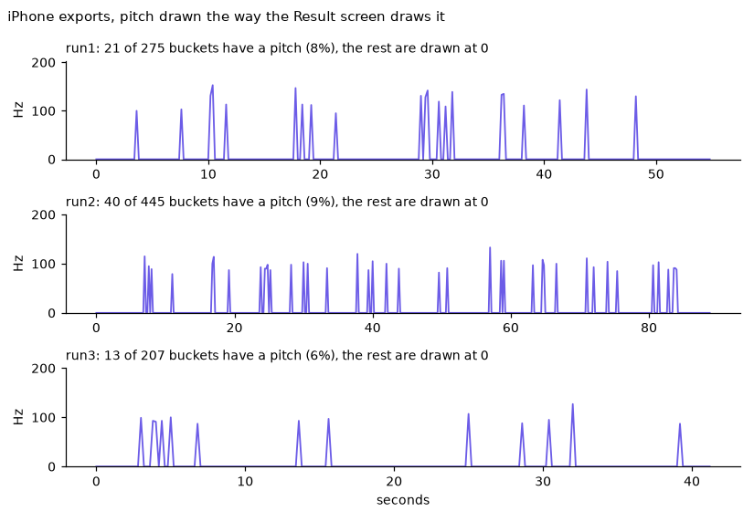
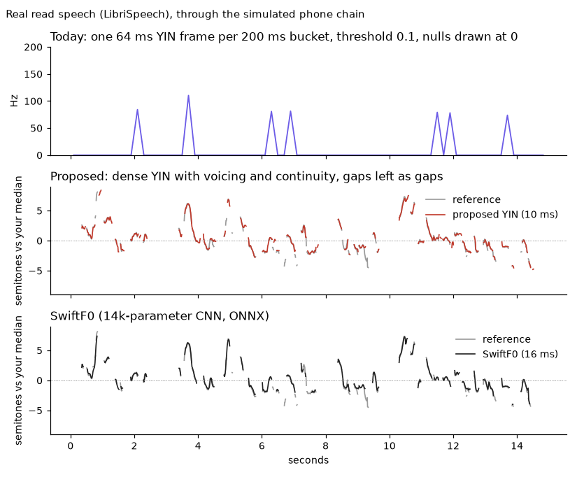
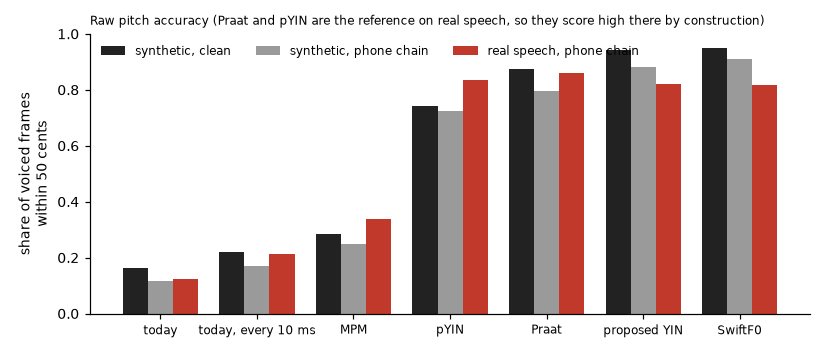

# Signal capture: audit, options, spikes and a plan

Session 05 (research/signal-capture), 2026-10-22/23. Audited against `main` at 27d4b76 (includes PR #12: 48 kHz recognizer takes, the iOS audio-session module).

> **Session 06 (2026-10-23) built most of section 10.** What changed, what was decided differently and what is still open is in [section 16](#16-what-session-06-built). Two corrections to this document: Rewind's saved audio is a **16 kHz** WAV (`rewindProcessor.ts` re-encodes the recognizer's 48 kHz pieces), not 48 kHz, and there is **no audio master**: Ahmad decided that deleting a video deletes its audio (keepsakes are the re-analysable set).

Everything here is about the raw, on-device layer: what the phone measures from the microphone and the camera before any model, generative or not, sees it. The spike code is in `docs/research/spikes/signal-capture/` (offline, Python and Node) and in one Dev-tab lab (`src/screens/dev/VoiceLabScreen.tsx`, with the candidate tracker in `src/domain/dsp/pitchTracker.ts`).

## Contents

1. [Summary](#1-summary)
2. [Why the pitch chart looks flat](#2-why-the-pitch-chart-looks-flat)
3. [Audit: every raw signal today](#3-audit-every-raw-signal-today)
4. [Capture, analysis and storage quality](#4-capture-analysis-and-storage-quality)
5. [Options per signal](#5-options-per-signal)
6. [What else can be detected](#6-what-else-can-be-detected)
7. [Spike results](#7-spike-results)
8. [Proposed raw signal schema](#8-proposed-raw-signal-schema)
9. [From signals to meaning without generative AI](#9-from-signals-to-meaning-without-generative-ai)
10. [Implementation plan for session 06](#10-implementation-plan-for-session-06)
11. [What blocks on the phone, and the iPhone checklist](#11-what-blocks-on-the-phone-and-the-iphone-checklist)
12. [What this changes for session 04](#12-what-this-changes-for-session-04)
13. [Open decisions](#13-open-decisions)
14. [Running the spikes](#14-running-the-spikes)
15. [Sources](#15-sources)
16. [What session 06 built](#16-what-session-06-built)

---

## 1. Summary

**Pitch looks flat because the tracker throws away about 80 to 90% of the voice, and the chart draws every thrown-away moment as 0 Hz.** It is not the recording mode, the sample rate or AAC. On the three iPhone exports only 6 to 9% of the 200 ms buckets have a pitch (21/275, 40/445, 13/207), and the chart plots the other 91 to 94% at the floor, so it is a flat line with a few spikes. The same tracker on real read speech and on synthetic speech with known pitch, through a simulated phone chain, finds pitch in 7 to 12% of buckets: it reproduces the iPhone result with nothing iPhone-specific. A dense YIN with a proper voicing decision finds 86 to 98% of voiced frames on the same audio, within about 5 to 11 cents.

The user's voice is not unusually flat as far as the few readings show: about 1.7 to 2.3 semitones of SD around a 93 to 128 Hz median, which is ordinary conversational movement for a low voice. Scoring that range in Hz (max minus min, full marks at 110 Hz) penalises low voices: the same musical range is half as many Hz at 100 Hz as at 200 Hz.

Top recommendations, ranked by value over effort:

1. **Replace the pitch tracker** with the dense YIN in `src/domain/dsp/pitchTracker.ts` (pure TS, no dependency, MIT-clean), score in semitones (p10 to p90 range and SD), and draw gaps as gaps. Pitchfinder is GPL-3.0, which is a licence problem for an App Store app on its own. Later, SwiftF0 (14k parameters, 135 KB ONNX, MIT) is the best accuracy per CPU if a model runtime lands for other reasons.
2. **Store a versioned 10 ms feature track per take** (pitch, confidence, level, voice activity) and keep a small audio-only master (AAC, about 0.7 MB a minute) when the video is deleted or shrunk. Today a better algorithm cannot be re-run on any take whose video was cleaned up.
3. **Fix volume.** The current "volume variation" (SD of 200 ms dBFS buckets, silence included) mostly measures how much you pause: in the spike it rose when pauses were longer and was lower for a lively voice than a monotone one. Measure loudness on speech frames only, relative to your own median, and add syllable-peak variation for emphasis.
4. **Use Silero VAD v6 (MIT, 2.3 MB ONNX) for pauses** once an ONNX runtime is in the app; until then, an energy gate with hysteresis. The current gate splits pauses at every breath: it found 1 of 9 true pauses when breaths were added in the phone chain; Silero found 9 of 9.
5. **Fix the face metrics that saturate.** Expressiveness includes jaw movement, which is speech articulation, so every take scores full marks (37 to 46 against a full-marks bar of 30) while the video reviewer gave 5/10. Blinks are counted at 10 detections a second or fewer, which misses short blinks (the takes read 7 to 14 a minute, low for someone talking). Include the presence timeline in the Dev export so the gaze thresholds can finally be tuned.
6. **Separate capture, analysis and storage quality** (section 4): analysis needs much less than 1080p at 15 Mb/s, and Gemini samples video at 1 frame per second and audio at about 1 kb/s, so a 720p copy uploads 10x faster with the same input to the model.

Voice-quality measures (jitter, shimmer, HNR) are **not trustworthy on running speech from a phone**: in the spike they compress or saturate after the phone chain. Tremor ("shakiness") is measurable, but only from a held vowel. If shakiness matters, it should be a short "hold an aah" check, not a number pulled from a talk.

---

## 2. Why the pitch chart looks flat



Each hypothesis from the prompt, with the evidence:

| Hypothesis | Verdict | Evidence |
|---|---|---|
| The algorithm and its voicing decision | **Main cause** | `analyzePitchVolume` runs pitchfinder's YIN on one 2048-sample frame per 200 ms bucket. Pitchfinder only reads the first 1024 samples (64 ms) and returns null unless the normalised difference dips below 0.1, a strict threshold for speech whose pitch moves within the window. On clean synthetic speech it found 22% of voiced frames; on real read speech 29%; through the phone chain 16 to 19% (section 7). The same detector run every 10 ms still finds only 19 to 25%, so sampling density is not the main problem; the rejection is. |
| Too few frames (one per 200 ms) | Contributes | 200 ms buckets cap the contour at 5 points a second, too coarse for pitch accents (100 to 300 ms) and impossible for tremor (4 to 8 Hz). It also makes min and max depend on which 64 ms slice each bucket happened to sample. |
| Octave errors | Minor today, real for women | The 65 to 600 Hz gate (added 2026-10-16) removes the wild ones, but octave and fifth errors inside the gate remain. On the synthetic female voice with reverb the current tracker reported a 178 to 290 Hz max-minus-min range (reverb and phone conditions) for voices that moved 2 to 4 semitones; that scores full marks for pitch range. |
| Smoothing or median filtering | Not present | There is no smoothing at all. Flatness is not from over-smoothing. |
| Units and scaling of the chart | **Second cause** | `PitchVolumeChart` draws null as 0 on a 0 to 200 (or more) Hz axis, with gifted-charts' default 50 px per point (a 55 s take is 275 points, about 13,750 px wide, scrolled). With 91 to 94% of points at 0, the line sits on the floor. A 100 Hz voice moving 3 semitones moves only about 20 Hz, 10% of that axis. |
| Units of the score | Bias | Pitch range is scored as max minus min in Hz, full marks at 110 Hz, the same for every voice. 110 Hz is 1.1 octaves at a 100 Hz median but 0.5 of an octave at 220 Hz. |
| Sample rate | No | Analysis decodes at 16 kHz, plenty for pitch (the candidate tracker decimates to 8 kHz on purpose). |
| AAC compression | No | In the spike the AAC round trip (64 kb/s) changed no tracker's accuracy by more than 0.01 (clean versus aac rows in section 7). |
| Recording settings (audio mode, AGC) | Not needed to explain it | The flat chart is fully reproduced without any iPhone processing. The impromptu camera takes record in VisionCamera's `videoRecording` mode, which per Apple may apply system processing; whether that includes gain control is not documented, and it would affect loudness, not the pitch period. The checklist in section 11 has a 2-minute test for it. |
| A real property of the speaker | Partly | Median 93 to 128 Hz (a low male voice). From the few readings: SD 1.7 to 2.3 semitones, p10 to p90 2.4 to 5.8 semitones, which is ordinary movement, not monotone (the synthetic "monotone" voice is 0.7 st SD). The Gemini review also called the melody narrow, so there may be room to grow, but the chart cannot show it either way today. |

Volume, briefly: dBFS of 200 ms buckets floored at -60, so silence is about -50 dBFS and speech -20 to -30 dBFS (speech-to-floor about 22 to 27 dB on the samples). The average and SD include silence, so they measure the pause share as much as the voice. There is no calibration (dBFS is not SPL), and the absolute level depends on distance to the phone.

---

## 3. Audit: every raw signal today

Thread: unless noted, analysis runs in JS on the main JS thread (Hermes) inside the session pipeline after the take is saved. The face runs per camera frame in a worklet context (`CameraPreview.tsx`) and calls back to JS.

| Signal | How it is computed today | Output | Feeds | Weaknesses (sample evidence) |
|---|---|---|---|---|
| **Audio decode** | `decodeAudioData(videoUri, 16000)` (react-native-audio-api, FFmpeg), mono channel 0 of the take's AAC track; 30 s timeout | Float32 16 kHz | Whisper, DSP | Lossy AAC before analysis (fine for pitch, bad for voice quality). Only channel 0. |
| **Pitch** | `audioAnalysis.ts`: per 200 ms bucket, RMS gate 0.01 (about -40 dBFS), one 2048-sample frame at the bucket centre, `Pitchfinder.YIN` (threshold 0.1, probability 0.1; reads 1024 samples), keep 65 to 600 Hz | `pitchContourHz` (null = unvoiced), avg, min, max | Chart; `pitchRangeHz` = max minus min feeds Delivery (full marks at 110 Hz), rule coach (under 60 Hz = "flat"), skill check, path targets (under 50 Hz), Move It (p10 to p90 semitones), `computeRichDeliveryScore` (range / avg) | 6 to 9% of buckets voiced on the iPhone; max and min from 13 to 40 points; Hz units; pitchfinder is GPL-3.0 (its YIN is aubio's code). |
| **Volume** | Same buckets: RMS to dBFS, floor -60 | `volumeEnvelopeDbfs`, avg, SD | Chart; rich delivery (SD / 6 dB); cloud reviewer prompt | Silence included, so SD tracks the pause share (section 7). No AGC knowledge. Not relative to the speaker. |
| **Live volume** | expo-speech-recognition `volumechange` (about every 100 ms, -2 to 10 scale, 0 or less = inaudible) | `VolumeSample[]` | Drills (projection, pauses, Move It loudness range, Rewind waveform) | Opaque scale defined by the OS recognizer, not dB. Recorded in `measurement` mode (no AGC) on iOS since PR #12 documented it. |
| **Pauses** | `dsp/pauses.ts`: 20 ms frames, dBFS, threshold max(-45, p10 + 8 dB), silence runs of 300 ms or more between first and last speech; classified boundary vs mid-phrase from word end times and sentence punctuation; hesitation = mid-phrase of 2 s or more | `pauses` artifact (list plus per-minute, mean, longest, boundary rate) | Delivery (pauses at full stops, full marks at 60%), Fluency (stalls), coach, cloud prompt | Breaths and noise bumps split pauses (section 7). Mid-phrase vs boundary depends on Whisper word times and punctuation. 22 pauses a minute on runs 1 and 2, 15 of 20 "mid-phrase" on run 1. |
| **Speaking rate** | words / total duration (`measuredVoice`); WPM curve = words per 5 s bucket by word start | `wpmAvg`, `wpmCurve` | Delivery (pace, full marks 130 to 160) | Counts leading and trailing silence; no articulation rate (rate while actually talking); words, not syllables. |
| **Fillers** | Regex over the verbatim transcript (um, uh, er, you know, I mean, like, sort of, kind of, basically, actually, literally...), rate per total minute; the AI transcript is used when a video review exists | count, rate | Fluency | "like", "actually", "literally" are often not fillers. Depends on Whisper keeping ums (it does with the filler prompt). |
| **Repeated words** | Adjacent duplicate tokens | count | Display | Fine for what it is. |
| **Face frames** | MediaPipe Face Landmarker (local plugin, `face_landmarker.task` 3.6 MB: BlazeFace 192x192, mesh 256x256, 52 blendshapes, matrix), video running mode, 1 face. Run on at most 1 frame per 100 ms and only when the previous one finished (`MIN_INTERVAL_MS`, `busy`), so 10 Hz or less | per-frame result | everything below | Input is the full camera frame (1080p BGRA on iOS), resized inside MediaPipe; rate capped at 10 Hz. |
| **Presence timeline** | `useFaceDetection`: a `PresenceSample` every 200 ms (yaw, pitch, roll from the matrix with the quarter-turn fix; gazeX and gazeY from eyeLook blendshapes, Y inverted on iOS; smile, brows, jaw, mouthPress; framed); blinks counted on every detection | `presence_timeline` artifact (raw, recomputable) | presence metrics | 5 Hz storage; head pitch and yaw signs still unverified; omitted from the Dev export, so it cannot be audited off the phone. |
| **Eye contact** | `classifyLook`: head within 20 degrees and gaze offset (hypot of gazeX, gazeY) under 0.35, blinks count as looking; calibrated from the face check when done | % of present samples | Presence (60%) | Thresholds untuned. Run 2: 84% eye contact and 13% looking down, while the video reviewer listed three glances at the ceiling (0:09, 0:24, 0:59). Either looking up is not caught, or the reviewer is wrong; the timeline is needed to tell. |
| **Looking down** | gazeY at or below -0.35 with eyes open | % | Display, cloud prompt | Same as above. No "looking up" or "sideways" category. |
| **Expressiveness** | (SD of smile + SD of brow raise + SD of jaw open) / 3 x 400, capped 100 | 0 to 100 | Presence (30%, full marks at 30) | Jaw open moves with every syllable, so talking alone scores high: 46, 37, 41 on the samples, all full marks; the video reviewer gave 5/10 to both reviewed takes. |
| **Head tilt, movement** | median abs roll; tilted % above 12 degrees; SD of yaw and pitch | degrees, % | Presence (10%) | 0% tilted on all samples, as expected for a phone on a stand. Head movement has no score. |
| **Smile** | mean mouthSmile at or above 0.5 | % | Display | 0 to 2% on the samples: the 0.5 cut-off is high for a talking smile. |
| **Brow raises** | rising edges of browRaise through 0.5 per minute | per minute | Display, cloud prompt | 3 to 15 a minute; untested threshold. |
| **Tension** | browDown or mouthPress at or above 0.45 | % | Display | 0% on all samples. |
| **Blinks** | `blinkCounter.ts` hysteresis (close 0.55, open 0.35, under 500 ms) on each detection | per minute | Display, cloud prompt | At 10 Hz or less a 100 ms blink is often missed: 14, 11 and 7 a minute on the samples, below the usual 15 to 25 a minute while talking (an undercount is likely, not proven). |
| **Framing** | face bounds inside the wide zone | % | Display | Fine. |

How the scores use them: Delivery = mean(pace, pauses at full stops, pitch range Hz); Fluency = mean(fillers, stalls); Presence = 0.6 eye contact + 0.3 expression + 0.1 head level; the cloud blends in by trust weights (`sessionScore.ts`). The phone's presence scores were 9.2 to 10 against the video reviewer's 4.5 to 6.5 on the same takes, mostly because expressiveness saturates and eye contact may be generous.

---

## 4. Capture, analysis and storage quality

The user's assumption: "we analyse at high quality and store lower". **For video that is only half true today, and for audio it is the other way round.**

### What the app does today

| Surface | Capture | What analysis reads | What is stored, and for how long |
|---|---|---|---|
| **Impromptu and script takes (video)** | VisionCamera 4.7.3, front camera, no `format` prop, so the device's default active format; H.264 in mp4 via `recommendedVideoSettingsForAssetWriter` (no bitrate override). Measured from the two uploads in the exports: 105.7 MB for 54.9 s and 171.4 MB for 88.8 s, both **15.4 Mb/s, about 115 MB a minute**, which matches 1080p30 H.264. Audio: AAC via `recommendedAudioSettingsForAssetWriter` (rate and channels not set by the app; the Voice Lab reports them). iOS audio session set by VisionCamera: `playAndRecord`, mode **`videoRecording`** (not `measurement`). | **Face: live camera frames**, full resolution BGRA, at 10 Hz or less, resized to 192 and 256 px inside MediaPipe; summary samples kept at 5 Hz. **Audio: the stored AAC file**, decoded later at 16 kHz mono. | The full 1080p file in Documents until the retention cleanup (user-chosen days; 0 = forever; not set = only on request). "Keepsakes" past the cutoff are re-encoded to 720p at 1.5 Mb/s (about 11 MB a minute, `videoKeepsakes.ts`); the rest are deleted, and with them the only copy of the audio. |
| **Deep review (Gemini)** | Uploads the full stored file (106 MB and 171 MB in the exports) | Gemini samples video at 1 frame per second and processes audio at about 1 kb/s mono (Gemini docs) | Nothing extra on the phone |
| **Recognizer takes: Rewind, Move It, Line of the Day, drills** | expo-speech-recognition with `persist`: **WAV, 16-bit PCM, 48 kHz mono on iOS** since PR #12 (16 kHz on Android); session `playAndRecord`, `measurement` mode, A2DP | Live: the recognizer's volume meter (100 ms, -2 to 10). Saved file: Move It decodes it at 16 kHz for pitch range (`takeAnalysis.ts`) | Rewind keeps its WAV (5.76 MB a minute at 48 kHz) until its own age cleanup (`listRewindAudioBefore`); Move It and Line takes keep theirs only while the screen is open |

So for video takes: face analysis does run on full-quality frames (good, though more pixels than it needs), but audio analysis runs on the lossy stored track, and once a non-keepsake video is deleted nothing can be re-analysed. Recognizer takes are the reverse: stored uncompressed at 48 kHz, more than any analysis needs.

### What each analysis needs

| Analysis | Needs | Why |
|---|---|---|
| Pitch (any tracker here) | 16 kHz (8 kHz is enough), 16-bit, AAC at 64 kb/s or more is fine | Speech f0 is under 500 Hz; the AAC round trip changed nothing measurable in the spike. |
| Loudness, emphasis, pauses, VAD | 16 kHz, 16-bit, lossy is fine; **no automatic gain** for loudness dynamics | AGC flattens the level differences you want to measure. Relative measures survive it partly; absolute ones do not. |
| ASR (Whisper), emotion or arousal models | 16 kHz | What the models are trained on. |
| Jitter, shimmer, HNR, tremor | 44.1 or 48 kHz, PCM (lossless), no AGC or noise suppression, a held vowel | Period-to-period measures are sensitive to codec and noise; the spike shows them failing on phone-chain running speech anyway. The recognizer path (48 kHz WAV, `measurement` mode) is the right one for a "hold an aah" check. |
| Face landmarks, head pose | Face at least about 200 px across in the frame; 640x480 or 720p with the face filling a third of the width is plenty | MediaPipe resizes the face to 256x256; extra pixels are thrown away. |
| Gaze (iris and eye blendshapes) | Same as landmarks; good light; 10 to 15 Hz for glances | Eyes are about 40 px wide in the 256 crop either way. Glances last 300 ms or more. |
| Blinks | **15 to 30 detections a second** | Blinks last about 100 to 400 ms; at 10 Hz the short ones fall between frames. |
| Head nods, gestures, posture | 10 to 15 Hz | Slow movements. |
| Deep review (Gemini) | 1 frame per second of video and about 1 kb/s of audio | Per Gemini's docs. A 720p or 540p copy at 1 Mb/s gives it the same input as 1080p at 15 Mb/s. |

### What to store, and when to transcode

Recommendation:

1. **At capture**, keep recording as today (1080p30 is fine and gives a good preview), but **move face detection to 15 Hz or more** (blinks), and if VisionCamera allows, a smaller frame-processor buffer (in v4 the frame processor gets the video format's size; v5 may separate outputs, check before relying on it).
2. **Right after the on-device steps finish**, write the **feature tracks** (section 8) and an **audio master**: the take's audio track remuxed without re-encoding (AVAssetExportSession passthrough on iOS; it is already AAC) or re-encoded to AAC 48 kHz mono 96 kb/s. About 0.7 MB a minute. Never deleted with the video.
3. **Deep review uploads a transcoded copy** (720p or 540p, about 1 Mb/s, 7.5 MB a minute) instead of the 115 MB a minute original: 10 to 15x less upload, same model input.
4. **When the take is settled** (all steps done, deep review done or not wanted), replace the 1080p file with a **720p30 playback copy** at about 2 Mb/s H.264 (or 1.2 Mb/s HEVC). Keep 30 fps so face analysis can be re-run from it later if the face pipeline improves (that needs a native file reader for MediaPipe, see 10.8).
5. **Retention cleanup** then deletes playback copies as today, but keeps the audio master and the feature tracks.
6. **Recognizer takes**: store Rewind audio as AAC 48 kHz mono (0.7 MB a minute instead of 5.8) unless a voice-quality check needs the PCM, and only for that check.

Sizes per minute:

| What | Size per minute |
|---|---|
| Today's take, 1080p30 H.264 at 15.4 Mb/s | about 115 MB (measured) |
| Today's keepsake, 720p at 1.5 Mb/s | about 11 MB |
| Proposed playback copy, 720p30 H.264 2 Mb/s + AAC 96 kb/s | about 16 MB (HEVC 1.2 Mb/s: about 10 MB) |
| Deep-review upload copy, 540p 1 Mb/s | about 7.5 MB |
| Recognizer WAV, 48 kHz 16-bit mono (today) | 5.76 MB |
| WAV 16 kHz 16-bit mono | 1.92 MB |
| Audio master, AAC 48 kHz mono 96 kb/s | 0.72 MB |
| Audio feature track (section 8), packed binary | about 36 KB (JSON about 180 KB) |
| Face feature track, 15 Hz, 52 blendshapes as bytes + pose + gaze + 10 landmarks | about 120 KB (core fields only: about 30 KB) |
| Today's presence timeline JSON, 5 Hz | about 75 KB |

Raw features versus high-quality media: features (a few hundred KB a minute) let every score and threshold be recomputed for ever, and are enough for any change that works on the same measurements (new rules, a trained classifier, a new chart). They cannot help a new extractor (a better pitch tracker, a new face model, a breath detector). The audio master covers every future audio extractor for under 1 MB a minute, which is why it is the one piece of media worth keeping. Video at 720p covers future face extractors at 10 to 16 MB a minute, and is the thing to let go of first. Privacy is the same as today (everything stays on the phone), but a kept audio master means voice recordings outlive the video; it should be listed in Settings with a way to delete it.

---

## 5. Options per signal

Platform notes that apply to all: the app is Expo SDK 57, RN 0.86, Hermes V1 (no JIT by default; Hermes V1 has an experimental one). Pure-JS DSP runs at roughly V8 `--jitless` speed, which the spike measured. Native options: an Expo module (Swift or Kotlin, as the app already does for backup exclusion), C++ through react-native-audio-api, or a model runtime: `onnxruntime-react-native` 1.24.3 (MIT, July 2026; an autolinking fix for Expo new-architecture landed this year), `react-native-fast-tflite` 3.0.1 (MIT, April 2026), or `react-native-executorch` 0.10.7 (removed from this app on 2026-10-16 after linker conflicts with MediaPipe).

### Pitch

| Option | Accuracy (spike, phone chain) | Cost | Licence, size, native | Verdict |
|---|---|---|---|---|
| Today: pitchfinder YIN, 1 frame per 200 ms | finds 12 to 16% of voiced frames within 50 cents | 5 ms CPU per s of audio (V8), about 40 ms jitless | **GPL-3.0**, pure JS | Replace. |
| pitchfinder MacLeod (MPM), 10 ms | 25 to 34% | 55 ms/s V8, 1.5 s/s jitless | GPL-3.0, pure JS, hard 80 Hz floor (cuts low male voices) | No. |
| librosa pYIN | 72% synthetic, reference on real | 27 ms/s (Python) | ISC, Python only | Offline reference only. |
| Praat autocorrelation | 79% synthetic (octave trouble on the synthetic female), reference on real | fast | GPL-3.0 (Parselmouth) | Offline reference only. |
| **Candidate: dense YIN** (`pitchTracker.ts`) | **88% synthetic, 82% real; range within 0.2 to 0.4 st** | 6 ms/s V8, about 75 ms/s jitless (about 4.5 s for a 60 s take on the JS thread) | MIT-clean (own code), pure TS, no native | **Adopt now.** Move to a worklet or native later if 4 s is too long. |
| **SwiftF0 0.3.0** (Sept 2026) | **91% synthetic, 82% real; range within 0.1 to 0.2 st; best on the female voice** | 7 ms/s with ONNX Runtime on one desktop core (paper: about 180x real time) | MIT, **14,386 parameters, 135 KB ONNX**, plain ops (STFT done inside with MatMul), needs an ONNX or converted runtime | **Next step** once a runtime is in the app (it would also carry Silero VAD). Tops the 2026 pitch benchmark (F1 0.781, tied with RMVPE). |
| CREPE / torchcrepe | benchmark F1 0.69 | 0.4x real time on CPU (too slow) | MIT, 22 MB full | No. |
| PESTO | benchmark 0.68 | 20x real time | LGPL-3.0 | No. |
| RMVPE, FCPE | 0.77 and 0.73 | 14x and 28x real time | Apache / MIT, larger | No (SwiftF0 is as good and 10x lighter). |
| Apple SFVoiceAnalytics (pitch, jitter, shimmer, voicing per segment) | not tested | free, iOS only, only from SFSpeechRecognizer final results | iOS 13+, still documented, not deprecated in the docs | Not for the main path (we moved to Whisper), worth a look for the held-vowel check on iOS. |

### Voice activity and pauses

| Option | Result (phone chain + breaths) | Cost | Licence, size | Verdict |
|---|---|---|---|---|
| Today: 20 ms energy gate, p10 + 8 dB | 1 of 9 pauses found (breaths split them) | trivial | own code | Replace. |
| Energy with hysteresis and 80 ms hangover | 7 of 9, no false pauses | trivial | own code | **Now**, as the fallback. |
| **Silero VAD v6.2.3** (Sept 2026) | **9 of 9**, but starts about 140 ms late (32 ms chunks plus its smoothing) | 63 to 78 ms CPU for a 23.5 s take (one thread), well under 1 ms per 32 ms chunk | MIT, 2.3 MB ONNX, 8 and 16 kHz | **With the ONNX runtime.** Use it to decide speech vs pause, then snap boundaries with the energy track. |
| WebRTC VAD | not tested | trivial | BSD, C | Weaker than Silero on noise; only if no runtime. |
| TEN VAD | not tested | small | custom licence with conditions | Check the licence before considering. |
| A background talker | every detector fails (2 of 9) | | | Not solvable cheaply; tell people to record alone. |

### Loudness and emphasis

No library needed. Proposed: 10 ms RMS in dB on the same band-limited signal the pitch tracker uses, voice-activity-gated; report relative to the take's median speech level; dynamic range = p90 minus p10 of 50 ms speech loudness; emphasis = SD of syllable-peak levels (peaks at least 120 ms apart with 3 dB prominence); speech-to-noise ratio as a clarity proxy. LUFS (ITU BS.1770 K-weighting) is a possible refinement but adds little for speech on one phone. Absolute "projection" needs no AGC plus a per-phone calibration; until then report it relative to your own past takes.

### Speaking rate and rhythm

Use Whisper word times (real ones now): speaking rate (words per minute of the speaking span, first to last word), **articulation rate** (syllables per second of phonation, pauses removed; syllables from a dictionary or a vowel-group count), pace variation (SD of the rate over phrases), and the pause pattern. The de Jong and Wempe syllable-nuclei method (Praat script) is the no-ASR alternative; not needed while Whisper runs on every take.

### Fillers

Keep Whisper turbo with the filler prompt (10/10 fillers on the ASR Lab take). Split the list into **sounds** (um, uh, er: always fillers) and **discourse markers** (like, you know, I mean, actually, basically, literally: fillers only in context). Count sounds as fillers; count markers only when standing alone (followed by a pause or a comma) or report them separately. The pause track can add "filled pause" evidence: a voiced, flat-pitch, low-formant-motion stretch of 200 ms or more with no word is an "um" even if ASR drops it.

### Voice quality ("shakiness")

Spike result: on running speech, jitter, shimmer and HNR do move with the true values in clean audio, but after the phone chain jitter of 2% and 3% read the same (3.05% vs 3.14%) and shimmer saturates around 15 to 19% whatever the truth. Not usable as a score. On a **held vowel** (4 s "aah"), tremor at 5.5 Hz is clear even through the phone chain (tremor share 0.65 to 0.73 with tremor vs 0.23 to 0.38 without; peak frequency right within 0.2 Hz). openSMILE / eGeMAPS would be the standard feature set but its open-source licence forbids commercial products; Praat and Parselmouth are GPL. Our own implementation of jitter (period perturbation from the pitch marks), shimmer and tremor share is small and enough for a held-vowel check.

### Emotion, arousal

Small models exist but none is licence-clean: audEERING's Wav2Small (17k to 72k parameters, about 120 KB ONNX) is CC BY-NC-SA; emotion2vec+ is about 90M parameters. Arousal is largely carried by loudness, pitch level and range, and rate, which we measure directly; a learned arousal score adds little we can act on. Skip for now.

### Face, gaze, head

| Option | What it gives | Platform, cost | Verdict |
|---|---|---|---|
| **MediaPipe Face Landmarker (current)** | 478 landmarks incl. iris, 52 blendshapes, transform matrix | Both platforms; 3.6 MB; the app ships 0.10.35, MediaPipe is now 1.1.1 (Oct 2026, mostly LiteRT and C API changes) | **Keep.** Tune thresholds from data; run at 15 Hz or more; consider the upgrade only if it fixes something. |
| ARKit face tracking (TrueDepth) | `lookAtPoint` gaze, eye transforms, 52 blendshapes, metric head pose; iPhone X and later | iOS only; replaces the camera stack (ARSession owns the front camera; recording means encoding `capturedImage` with AVAssetWriter, reported to drop to 25 to 28 fps at 60) | Better gaze on iPhone, but a big rebuild and iOS-only. Not now; revisit if MediaPipe gaze cannot be tuned. |
| Apple Vision face landmarks / pose | roll, yaw, pitch, 76 landmarks with pupils | iOS, free | Not better than MediaPipe for gaze. |
| MediaPipe Pose Landmarker | 33 body landmarks (lite, full, heavy; 224 and 256 px inputs) | Both, a few MB, extra ms per frame | For posture and shoulders when the phone frames the upper body. Later. |
| MediaPipe Hand Landmarker | 21 points per hand; 17 ms CPU, 12 ms GPU on a Pixel 6 | Both | For gesture and fidgeting. Later, and only if hands are in frame (often not, with a phone close up). |
| Apple Vision body and hand pose | body 19 joints, hands 21 | iOS, free, no download | The iOS alternative to the two above. |

---

## 6. What else can be detected

Ranked by value over cost. Reliability is for a phone on a stand, one speaker, indoors. Coachable = a person can act on it in the next take.

| Rank | Signal | From | Reliability | On-device cost | Coachable | Notes |
|---|---|---|---|---|---|---|
| 1 | Pitch range and movement in semitones | mic | High with the new tracker | low | Yes ("lift the key word") | The base of "monotone". |
| 2 | Pauses: at full stops vs mid-phrase, length | mic + words | High with VAD | low | Yes | Already a skill; needs the VAD fix. |
| 3 | Articulation rate and pace changes | words + VAD | High | none extra | Yes | Speeding up when nervous is the classic one. |
| 4 | Emphasis (loudness and pitch peaks on content words) | mic + words | Medium-high | low | Yes | Join syllable peaks to words: are the peaks on content words or on "the"? |
| 5 | Eye contact vs looking away, and which way (down = notes, up = thinking, side) | camera | Medium (untuned) | already paid | Yes | Add an "up" category; the reviewer saw ceiling glances the phone did not report. |
| 6 | Uptalk (rising ends on statements) | pitch + punctuation | Medium-high | low | Yes | Final 300 ms pitch slope of statements. |
| 7 | Trailing off (volume and pitch fall at sentence ends) | mic + words | Medium | low | Yes | Pairs with "strong ending". |
| 8 | Filled pauses that ASR missed | mic | Medium | low | Yes | Voiced, flat, wordless stretch. |
| 9 | Smile and expression (excluding articulation) | camera | Medium | already paid | Yes | Use smile, brows, cheeks, not jaw. |
| 10 | Head movement and nods | camera | Medium-high | already paid | Some | Nods while making a point read as conviction; constant bobbing as nerves. |
| 11 | Blink rate | camera | Medium at 15 to 30 Hz | small | Weakly | Rises with stress; hard to change on purpose; show it, don't score it. |
| 12 | Breath: audible inhales, breath before phrases, running out of air | mic | Medium | low to medium | Yes | Phrase length vs breath; loud gasps. |
| 13 | Vocal fry (creak) at phrase ends | mic | Medium | low | Yes | Very low irregular pitch, subharmonics; the new tracker marks it unvoiced or low confidence; a creak detector is a small add. |
| 14 | Laughter, throat clearing, cough | mic | Medium-high | Apple SoundAnalysis built-in classifier (about 300 sounds, iOS 15+, free) or YAMNet (Apache-2.0, about 4 MB) | Mostly no | Use to exclude stretches from scoring. The reviewer heard a throat clear in run 1. |
| 15 | Posture, shoulders | camera (pose) | Medium if framed | medium | Yes | Needs upper body in frame. |
| 16 | Gestures, fidgeting, face touching | camera (hands) | Low-medium close up | medium | Yes | Hands are often out of frame on a phone. |
| 17 | Shakiness (tremor) | mic, held vowel | High on a held vowel, low in a talk | low | Somewhat (breath support) | Only as a separate check. |
| 18 | Jitter, shimmer, HNR | mic, held vowel | Low on a phone | low | No | Clinical measures; not a coaching signal. |
| 19 | Arousal or emotion from voice | mic | Low-medium, licence-blocked | small | Indirectly | Covered by the prosody features. |
| 20 | Face-voice congruence (smiling while saying sad things) | both + words | Low | medium | Some | Leave to the reviewer. |

---

## 7. Spike results

Ground truth: 6 synthetic voices (male lively, normal, monotone, low-creaky; female normal, monotone), each about 25 s, built from a jittered glottal pulse train through vowel formants, with fricatives, stop closures and phrase pauses, and an exact pitch per 10 ms frame. Real speech: three LibriSpeech clips (public-domain LibriVox, 45 s in total) with the consensus of Praat and pYIN as the reference (so those two score high on it by construction). Conditions: clean; pink-plus-hum noise at 15 dB SNR; reverb (RT60 0.5 s); AAC 64 kb/s round trip at 48 kHz, decoded back to 16 kHz like the app; and **phone** = reverb 0.35 s + noise at 25 dB SNR + 90 Hz high-pass + AAC (the iPhone samples sit at 22 to 27 dB speech-to-floor). CPU: Intel i7-13700K, one thread; Node 22 (V8) and `--jitless` as a Hermes stand-in.

### Pitch





Synthetic, mean over the six voices. VR = share of truly voiced frames given a pitch; VFA = share of truly unvoiced frames given one; GPE = gross errors (more than 20% off) among those found; RPA = voiced frames within 50 cents; cents = median error; range err = absolute error of the p10 to p90 range in semitones.

| Condition | Tracker | VR | VFA | GPE | RPA | cents | range err |
|---|---|---|---|---|---|---|---|
| clean | today | 0.22 | 0.01 | 0.013 | 0.16 | 15 | 0.55 |
| clean | today, every 10 ms | 0.24 | 0.00 | 0.008 | 0.22 | 7 | 0.32 |
| clean | MPM | 0.29 | 0.00 | 0.015 | 0.28 | 5 | 0.38 |
| clean | pYIN | 0.78 | 0.01 | 0.000 | 0.74 | 7 | 0.13 |
| clean | Praat | 0.95 | 0.00 | 0.049 | 0.88 | 8 | 3.58 |
| clean | SwiftF0 | 0.96 | 0.00 | 0.000 | 0.95 | 6 | 0.05 |
| clean | **candidate YIN** | 0.95 | 0.00 | 0.000 | 0.94 | 4 | 0.05 |
| aac | today | 0.21 | 0.01 | 0.014 | 0.16 | 15 | 0.56 |
| aac | candidate YIN | 0.95 | 0.00 | 0.000 | 0.94 | 4 | 0.05 |
| noise 15 dB | today | 0.20 | 0.00 | 0.014 | 0.14 | 16 | 0.56 |
| noise 15 dB | SwiftF0 | 0.97 | 0.00 | 0.000 | 0.96 | 6 | 0.05 |
| noise 15 dB | candidate YIN | 0.93 | 0.00 | 0.000 | 0.93 | 4 | 0.05 |
| reverb | today | 0.17 | 0.02 | 0.051 | 0.14 | 15 | 2.46 |
| reverb | SwiftF0 | 0.90 | 0.16 | 0.000 | 0.88 | 8 | 0.29 |
| reverb | candidate YIN | 0.91 | 0.49 | 0.005 | 0.87 | 6 | 0.67 |
| **phone** | **today** | **0.16** | 0.01 | 0.032 | **0.12** | 27 | 0.68 |
| phone | today, threshold 0.2 | 0.28 | 0.03 | 0.095 | 0.18 | 23 | 4.93 |
| phone | MPM | 0.26 | 0.01 | 0.011 | 0.25 | 7 | 0.23 |
| phone | pYIN | 0.79 | 0.20 | 0.012 | 0.72 | 10 | 0.37 |
| phone | Praat | 0.93 | 0.10 | 0.091 | 0.79 | 11 | 5.03 |
| phone | **SwiftF0** | **0.94** | 0.10 | 0.000 | **0.91** | 8 | 0.20 |
| phone | **candidate YIN** | **0.92** | 0.14 | 0.010 | **0.88** | 6 | 0.19 |

Real speech (LibriSpeech):

| Condition | Tracker | VR | VFA | GPE | RPA | cents | range err |
|---|---|---|---|---|---|---|---|
| clean | today | 0.29 | 0.00 | 0.026 | 0.17 | 43 | 1.20 |
| clean | SwiftF0 | 0.97 | 0.01 | 0.000 | 0.93 | 8 | 0.20 |
| clean | candidate YIN | 0.98 | 0.01 | 0.023 | 0.95 | 7 | 1.03 |
| phone | today | 0.19 | 0.00 | 0.000 | 0.12 | 42 | 1.41 |
| phone | MPM | 0.36 | 0.02 | 0.000 | 0.34 | 10 | 0.25 |
| phone | SwiftF0 | 0.87 | 0.06 | 0.000 | 0.82 | 12 | 0.12 |
| phone | candidate YIN | 0.89 | 0.15 | 0.012 | 0.82 | 11 | 0.41 |

Readings:

- Today's tracker finds a pitch in 7 to 12% of 200 ms buckets on the phone condition (male synthetic 6.8 to 12.4%, real male 9.3 to 9.5%), the same as the iPhone exports (6 to 9%). Raising the threshold to 0.2 helps a little and adds octave errors. Running it every 10 ms does not help: the rejection is the problem.
- The candidate and SwiftF0 are close on accuracy. The candidate's weak spots: reverb tails count as voiced (VFA 0.49 in heavy reverb; the pitch there is still right, the voiced stretch is just longer), and occasional octave errors on a wide-ranging female voice (libri3: 7% octave-down on clean). SwiftF0 is cleaner on both.
- Hz ranges from today's tracker on the phone condition: monotone 19 Hz, normal 27, lively 57 (male); female monotone 209 Hz (outliers). Semitone ranges from the candidate: 2.1, 3.9, 5.5 (male, truth 1.9, 3.8, 5.3), female monotone 2.0 (truth 2.0).
- What the charts would look like: see the two figures; the candidate's contour, drawn in semitones from your median with gaps left empty, follows the reference closely; today's chart is a floor line with spikes.

CPU per second of audio (V8 / jitless): today 5 / about 40 ms; candidate 6 / about 75 ms; MPM 55 / 1,150 ms; SwiftF0 7 ms (ONNX Runtime, native). On the phone, today's whole voice step took 1.5 to 3 s per take (step timestamps in the exports), consistent with the jitless numbers, so the candidate should take about 4 to 5 s for a 60 s take on the JS thread. The Voice Lab measures it for real.

### Volume

| Take (synthetic, phone chain) | True syllable-level SD | Pause share | Today: SD of buckets | Proposed: speech p90-p10 | Proposed: syllable-peak SD |
|---|---|---|---|---|---|
| monotone, normal pauses | 1.41 dB | 32% | 11.20 dB | 10.2 dB | 1.65 dB |
| monotone, long pauses | 1.41 | 53% | **12.80** | 10.2 | 1.65 |
| normal, normal pauses | 2.33 | 36% | 11.26 | 12.2 | 3.05 |
| normal, long pauses | 2.33 | 58% | 12.55 | 12.3 | 3.11 |
| lively, normal pauses | 2.59 | 32% | **10.85** | 12.5 | 3.03 |
| lively, long pauses | 2.59 | 53% | 12.51 | 12.4 | 3.05 |

Today's SD goes up with pausing and is lower for the lively voice than for the monotone one. The proposed speech-only spread and syllable-peak SD do not move with pausing and do order monotone below the others (normal and lively are close in the truth too).

### Pauses

9 true pauses in a 23.5 s take; "found" = overlapping at least half the true pause.

| Condition | Today (recall / precision) | Hysteresis | Silero VAD v6 |
|---|---|---|---|
| clean | 1.00 / 1.00 | 1.00 / 1.00 | 1.00 / 1.00 |
| breaths in long pauses (digital silence around) | 0.11 / 0.07 | 0.11 / 0.20 | 0.11 / 0.13 |
| breaths + noise 15 dB | 1.00 / 1.00 | 1.00 / 1.00 | 1.00 / 1.00 |
| **breaths + phone chain** | **0.11 / 0.08** | 0.78 / 1.00 | **1.00 / 1.00** |
| background talker at -15 dB | 0.22 / 0.67 | 0.22 / 0.67 | 0.22 / 0.67 |

Boundary error: today's gate starts pauses on time (0 to 80 ms); Silero starts them about 140 ms late. Combine: Silero decides, energy refines the edges. The clean-with-breaths row is an artefact of perfect digital silence (nothing real sounds like that); the phone row is the realistic one.

### Voice quality

Running speech, Praat measures (truth is the synthetic period jitter SD; Praat local jitter reads about 1.1x that plus the prosody floor):

| True jitter SD | Jitter clean | Jitter phone | HNR clean | HNR phone |
|---|---|---|---|---|
| 0.3% | 1.20% | 1.66% | 9.6 dB | 7.6 dB |
| 1.0% | 1.78% | 2.48% | 8.0 | 5.9 |
| 2.0% | 2.47% | 3.05% | 6.8 | 4.8 |
| 3.0% | 3.39% | 3.14% | 5.8 | 4.1 |

Shimmer on the phone read 15.7 to 18.8% for true 2 to 15%. Held vowel, tremor at 5.5 Hz: tremor share without tremor 0.17 to 0.38, with 15 to 80 cents of tremor 0.86 to 0.95 clean and 0.65 to 0.73 through the phone chain; the detected peak was 5.45 to 5.56 Hz. (Absolute jitter and shimmer values from the synthesiser are not realistic; the point is that the phone chain erases the differences.)

### Spike that needs the phone

The Voice Lab (Dev, Pipeline, a take, Labs, Voice Lab) runs today's tracker and the candidate on a saved take, on the phone, and shows: the file's native audio rate and channels, decode time, noise floor and speaking level, frames with a pitch, median, max-minus-min Hz, p10 to p90 and SD in semitones, the time each tracker took in Hermes, and a chart of both. "Copy" puts the numbers on the clipboard. JS only, so a Metro reload or an EAS Update on the current dev build is enough. Checklist in section 11.

---

## 8. Proposed raw signal schema

One `signals` artifact per take (new `ArtifactKind`), versioned per extractor so any stage can be recomputed and old takes told apart. Time series are packed typed arrays (base64 in JSON, or a BLOB column), so a minute costs tens of KB.

```ts
interface TakeSignals {
  schema: 1;
  takeId: string;
  durationMs: number;
  source: {
    audio: { codec: "aac" | "pcm"; sampleRate: number; channels: number; sessionMode: "videoRecording" | "measurement" | "unknown" };
    video?: { width: number; height: number; fps: number };
    device: { model: string; os: string };
  };
  audio: {
    extractor: { name: "yin-dense" | "swiftf0"; version: string; params: Record<string, number> };
    hopMs: 10;
    // Per frame. f0 in cents re 55 Hz (Int16; -32768 = unvoiced), so no float noise and half the size.
    f0Cents: string;        // base64 Int16Array
    f0Confidence: string;   // base64 Uint8Array, 0-255
    levelCdB: string;       // base64 Int16Array, centi-dBFS of the 60-1000 Hz band
    vadProb?: string;       // base64 Uint8Array (Silero), absent with the energy VAD
    noiseFloorDb: number;
  };
  face?: {
    extractor: { name: "mediapipe-face-landmarker"; version: string; thresholdsVersion: number };
    rateHz: number;          // actual mean detection rate
    tMs: string;             // base64 Uint32Array, per detection (irregular)
    present: string;         // bit-packed
    yawDeg: string; pitchDeg: string; rollDeg: string;  // Int16, 0.1 degree
    gazeX: string; gazeY: string;                        // Int16, 0.001
    blendshapes?: string;    // 52 x Uint8 per frame, in MediaPipe order
    blinks: { tMs: number; durationMs: number }[];
  };
  words?: { text: string; startMs: number; endMs: number }[];  // a copy, so features and words align
  summary: SignalSummary;    // the numbers the scores read, recomputable from the above
}

interface SignalSummary {
  pitch: { voicedShare: number; medianHz: number; sdSemitones: number; rangeSemitones: number; meanConfidence: number };
  loudness: { speechMedianDbfs: number; spreadDb: number; syllablePeakSdDb: number | null; snrDb: number };
  pauses: { count: number; perMinute: number; meanMs: number; longestMs: number; boundaryRate: number | null; midPhrase: number; hesitations: number };
  rate: { speakingWpm: number; articulationSylPerSec: number | null; paceSdWpm: number | null };
  presence?: { eyeContactShare: number; lookingDownShare: number; lookingUpShare: number; blinksPerMinute: number; expressiveness: number; headMovementDeg: number };
  quality: { lowConfidence: string[] };  // reasons a number should not be trusted: "few voiced frames", "noisy", "face lost 40%"
}
```

Rules:

- **Store raw features, always** (they are small). Scores are a pure function of `TakeSignals` plus a scoring version, so improving a rule rescores every past take, as `SCORE_BREAKDOWN_VERSION` already does for presence.
- Bump `extractor.version` when a tracker changes; a launch job can re-extract from the audio master when it exists, otherwise the take keeps its old features with the old version noted.
- Summary numbers carry a confidence. A take with under about 20 voiced seconds or a speech-to-noise ratio under about 12 dB should say so instead of scoring pitch range.
- Keep the existing fields (`pitchContourHz`, `volumeEnvelopeDbfs`) during the migration; derive them from the new track so old charts keep working.

---

## 9. From signals to meaning without generative AI

What can be scored with rules today, once the signals are fixed:

| Skill | Signal | Rule shape | Calibration we can do without labels |
|---|---|---|---|
| Pitch variety | sdSemitones, rangeSemitones per phrase | bands, relative to the speaker's own baseline after a few takes | Published norms: conversational English SD about 2 to 4 st; under 1.5 st reads monotone. Move It already gives paired "plain vs animated" takes from the same person: a free within-person check. |
| Emphasis | syllable-peak SD; share of peaks on content words | bands | Same Move It pairs. |
| Pace | speaking and articulation rate | bands (130 to 160 wpm today) | Norms exist. |
| Pausing | boundary rate, mid-phrase count, pause length | bands | Norms plus scripted reads where the boundaries are known (scripts and Mark It Up). |
| Fillers | sounds per minute | bands | Already calibrated. |
| Eye contact | share on lens, looking down and up | bands | **Needs data**: the face check gives on-lens samples per user; a "look at your notes / the ceiling / the lens" guided calibration gives labelled off-lens samples per user for free. |
| Expression | smile, brows (not jaw) variation | bands | Same guided calibration ("neutral", "smile", "raise your eyebrows"). |

A small trained model (logistic regression or gradient-boosted trees on the summary features, or a tiny sequence model on the tracks) becomes worth it when there are labels. We have none yet. Ways to get them:

1. **Self-labels**: after a take, "did that feel rushed / flat / nervous?" one tap (the Felt vs Observed flow already exists). Noisy but personal.
2. **The video reviewer as a teacher**: Gemini's per-skill scores on takes with a deep review are weak labels. Fine for a first ranking model, but it would learn Gemini's biases (it hears audio at about 1 kb/s and sees 1 frame per second, so it is not a ground truth for blinks or quick glances).
3. **Contrast pairs**: Move It (plain vs moving vs ghost), scripted reads with marked pauses and emphasis: labels by construction.
4. **A small human-rated set**: 50 to 100 takes rated by 2 or 3 people on 3 to 5 scales. This is the only way to validate that a score means what it says.

Honest limits: without labelled data we can validate that the **measurements** are right (pitch, pauses, rate against ground truth, as this spike did), and that scores move the right way on contrast pairs. We cannot validate that a 7 means "good to a listener". What still needs an LLM: content (structure, relevance, coherence), turning numbers into a tip in plain words, and judgments that need the meaning of the words (is this pause dramatic or lost, does the tone fit the content). Everything else can be measured and scored on the phone.

---

## 10. Implementation plan for session 06

Each piece is shippable alone, in this order. Effort is a rough guide.

**10.1 Pitch tracker swap (small).** Adopt `src/domain/dsp/pitchTracker.ts` in `audioMetricsStep` and `takeAnalysis` (Move It); keep the 200 ms `pitchContourHz` derived from it for old readers (median of each bucket's voiced frames). Score pitch range in semitones (p10 to p90, full marks around 5 to 6 st, to be set against the Voice Lab numbers) in `sessionScore`, `ruleCoach`, `skillCheck`, `pathTargets`, `curriculum.computeRichDeliveryScore`. Remove pitchfinder (GPL). Bump `SCORE_BREAKDOWN_VERSION`; offer Re-run voice analysis for takes whose video still exists. Check Move It thresholds (`targetLift`) still pass at sensible rates.

**10.2 Chart (small).** Pitch in semitones from your median, gaps as gaps, fit to width (no 50 px scroll), with volume on the same time axis; optional faint word labels. Show "not enough voice to chart" when voiced share is low instead of a floor line.

**10.3 Loudness rework (small).** Speech-only loudness relative to the median, spread, syllable-peak SD, SNR; replace `volumeStddevDbfs` in the scores and the cloud prompt; keep the dBFS envelope for the chart.

**10.4 Pause detection with hysteresis (small).** Replace the gate in `dsp/pauses.ts` with the hysteresis version, reuse the pitch tracker's frame levels, add a "breath" tag for short noise bursts inside silences. Fix `wpmAvg` to the speaking span, add articulation rate.

**10.5 Feature track and audio master (medium).** The `signals` artifact (section 8) written by the audio and presence steps; an audio-master export after the pipeline settles (iOS: AVAssetExportSession passthrough in a tiny Expo module; Android: MediaMuxer); a launch re-extract job keyed on extractor version. Include the presence timeline (and the new track) in the Dev export.

**10.6 Capture and storage policy (medium).** Section 4: transcoded upload copy for deep reviews (540p or 720p at about 1 Mb/s; needs the earlyUpload step to transcode first), 720p30 playback copy when a take settles, audio master kept through retention cleanup, Rewind WAV to AAC. Settings copy for what is kept. Measure the export time on the iPhone (react-native-compressor already does the 720p re-encode).

**10.7 Face metrics fixes (small to medium).** Expressiveness without jaw (smile, cheeks, brows, eye squint), with articulation removed; detection rate to 15 Hz or more where the phone holds 30 fps recording (measure in the Face Lab); a "looking up" class; tune gaze thresholds from exported timelines plus a guided look-at-notes / look-up / look-at-lens calibration in the face check. Head pitch and yaw sign check (Face Lab).

**10.8 ONNX runtime with Silero VAD, then SwiftF0 (medium to large, native build).** Add `onnxruntime-react-native` (or convert both to CoreML / TFLite via `react-native-fast-tflite`), spike the iOS link first (the MediaPipe linker-flags history says to expect trouble). Silero for speech/pause decisions, SwiftF0 as the pitch extractor (bump the extractor version, rescore). Ship only if the Voice Lab comparison on the phone shows a clear win over 10.1.

**10.9 Held-vowel steadiness check (small, optional).** A 5 s "aah" on the recognizer path (48 kHz PCM, measurement mode): tremor share and rate, pitch steadiness, with our own jitter estimate shown as a trend, never a score.

**10.10 Sound events (small, iOS first, optional).** Apple SoundAnalysis built-in classifier over the audio master to mark laughter, coughs and throat clearing, and exclude them from pause and pitch stats.

---

## 11. What blocks on the phone, and the iPhone checklist

Blocks on the phone (cannot be settled on this machine): Hermes run time of the candidate tracker; the native sample rate and channels of the take's AAC track; whether `videoRecording` mode applies gain control; face detection rate the phone sustains while recording; the gaze threshold tuning (needs timelines); everything in 10.8 (native build).

iPhone checklist (about 15 minutes; needs only a Metro reload or EAS Update of this branch on the current dev build):

1. Record three impromptu takes of 45 to 60 s with video: (a) normal, (b) deliberately flat, same pitch on every word, (c) deliberately lively, exaggerated ups and downs.
2. For each: Dev, Pipeline, open the take, Labs, **Voice Lab**, Run both trackers. Then Copy and paste the three results back (they are also in Dev, Logs, tag `[voicelab]`).
3. Note from the Voice Lab: "Audio in the file" (rate and channels), "Time on this phone" for both trackers, and whether the chart lines follow what you remember doing.
4. Gain-control check: record one take where you speak 5 s at normal level, 5 s as quietly as you can, 5 s loudly, phone not moved. Export it (Copy analysis as JSON). The three sections should differ by 15 dB or more in `volumeEnvelopeDbfs` if there is no automatic gain; much less means `videoRecording` mode compresses the level.
5. Face Lab: note the fps it shows while recording would be running (and whether 30 fps holds with the landmarker).
6. If you can, export one take that has a deep review where the reviewer mentioned looking away, so the presence timeline can be compared (this needs 10.5 first, since the export omits the timeline today).

---

## 12. What this changes for session 04

- **A small local model is more realistic than it looked.** The pitch, pause and loudness layers can be made accurate with pure TS (no model at all), and the heavy lifting for prosody scoring is rules on good features. A learned scorer can be tiny (trees on 20 to 40 summary features), so it does not need a hosted model or a big on-device runtime. What blocks it is labels, not compute.
- **Model sizes are not a constraint for audio.** The best pitch model of 2026 is 135 KB and the best VAD 2.3 MB; both run hundreds of times faster than real time on a desktop core, so older phones are fine. The constraint is adding an ONNX or TFLite runtime next to MediaPipe on iOS (link conflicts happened before).
- **Gemini is a weak judge of delivery details**: it samples video at 1 frame per second and audio at about 1 kb/s. It can judge content and overall impression; it cannot be the ground truth for blinks, quick glances, or fine pitch. On-device measurements should lead those skills, which supports moving the cloud's trust weights for delivery and presence down once the measurements are fixed.
- **Upload size**: transcoding before the deep review cuts upload 10 to 15x with no loss for the model, which matters for a hosted backend's bandwidth and latency.

---

## 13. Open decisions

1. Pitch now: candidate YIN in JS (10.1) and SwiftF0 later, or wait and go straight to SwiftF0 with an ONNX runtime? Recommended: YIN now.
2. Pitch-range full marks in semitones: a fixed band (about 5 to 6 st p10 to p90) or relative to your own baseline? Recommended: fixed at first, personal once there are 5 or more takes.
3. Keep an audio master for every take after the video goes? It is small, but it is a voice recording that outlives the video. Recommended: yes, listed and deletable in Settings.
4. Transcode before the deep review upload (saves upload, costs a few seconds on the phone)? Recommended: yes.
5. Replace the 1080p original with a 720p copy as soon as a take settles, instead of keeping it until retention cleanup? Recommended: yes.
6. Face detection at 15 Hz or more (blinks) at some battery cost? Recommended: test in the Face Lab first.
7. Add an ONNX runtime (Silero, SwiftF0) and accept a native build plus link risk? Recommended: after 10.1 to 10.7.
8. A held-vowel steadiness check, or drop "shakiness" as a goal? Recommended: optional drill, no score.
9. Count discourse markers (like, actually) as fillers or separately? Recommended: separately.

---

## 14. Running the spikes

Spike code: `docs/research/spikes/signal-capture/`. Downloads (Python venv, pitchfinder, models, LibriSpeech clips) live outside the repo, in `C:\dev\tono-models\`.

```
# Python 3.13 venv with numpy, scipy, librosa, praat-parselmouth, onnxruntime, soundfile, imageio-ffmpeg, swift-f0==0.3.0, matplotlib
# Node: pitchfinder@2.3.4 in C:\dev\tono-models\node\node_modules (GPL, kept out of the repo)
# Silero: C:\dev\tono-models\silero\silero_vad.onnx (v6, from the snakers4/silero-vad repo)
PY=C:/dev/tono-models/venv/Scripts/python.exe
SPIKE=docs/research/spikes/signal-capture
$PY -I $SPIKE/synth.py C:/dev/tono-models/work/synth
LIBROSA_DATA_DIR=C:/dev/tono-models/librosa_data $PY -I $SPIKE/prep_real.py C:/dev/tono-models/work/real
$PY -I $SPIKE/compare_pitch.py C:/dev/tono-models/work/synth C:/dev/tono-models/node/node_modules C:/dev/tono-models/work/pitch_results.json
$PY -I $SPIKE/compare_pitch.py C:/dev/tono-models/work/real C:/dev/tono-models/node/node_modules C:/dev/tono-models/work/pitch_real.json
$PY -I $SPIKE/volume_pauses.py C:/dev/tono-models/silero/silero_vad.onnx C:/dev/tono-models/work/volume_pauses.json
$PY -I $SPIKE/voice_quality.py C:/dev/tono-models/node/node_modules C:/dev/tono-models/work/voice_quality.json
$PY -I $SPIKE/sustained_vowel.py C:/dev/tono-models/work/sustained.json
$PY -I $SPIKE/make_plots.py C:/dev/tono-models/work <analysis_samples dir> docs/research/img
```

| File | What it is |
|---|---|
| `synth.py` | Synthetic speech with known pitch, levels and pauses; the noise, reverb, high-pass and AAC conditions. |
| `prep_real.py` | LibriSpeech clips plus the Praat/pYIN consensus reference. |
| `jsTrackers.mjs` | Runs today's tracker (exact copy), variants, MPM and the candidate (`src/domain/dsp/pitchTracker.ts`) on one file. |
| `compare_pitch.py` | Scores all trackers; `SKIP_PY=1` and `TRACKERS=...` for quick tuning; `PITCH_OPTS` to pass options. |
| `volume_pauses.py` | Volume truth test and the pause detectors (including Silero v6). |
| `voice_quality.py`, `sustained_vowel.py` | Jitter, shimmer, HNR and tremor on running speech and a held vowel. |
| `make_plots.py` | The figures in `docs/research/img/`. |

Reusable in the app: `src/domain/dsp/pitchTracker.ts` (with tests in `src/domain/__tests__/pitchTracker.test.ts`), `src/domain/dev/voiceLab.ts`, `src/screens/dev/VoiceLabScreen.tsx`. The loudness, hysteresis-VAD and tremor functions in the Python spikes are short and meant to be ported as they are.

---

## 15. Sources

Checked 2026-10-22/23.

- SwiftF0: [github.com/lars76/swift-f0](https://github.com/lars76/swift-f0) (MIT, 0.3.0 of 2026-09-25, changelog: 14,386 parameters, 135 KB), [PyPI](https://pypi.org/project/swift-f0/), [paper arXiv 2508.18440](https://arxiv.org/abs/2508.18440v1)
- Pitch benchmark (SwiftF0, RMVPE, FCPE, CREPE, PESTO, Praat, pYIN): [github.com/lars76/pitch-benchmark](https://github.com/lars76/pitch-benchmark)
- Silero VAD (MIT, v6.2.3 of 2026-09-23): [github.com/snakers4/silero-vad](https://github.com/snakers4/silero-vad)
- pitchfinder licence "GNU v3" (package.json; YIN file carries aubio's GPL header): [github.com/peterkhayes/pitchfinder](https://github.com/peterkhayes/pitchfinder)
- Parselmouth (GPL-3.0): [github.com/YannickJadoul/Parselmouth](https://github.com/YannickJadoul/Parselmouth); PESTO (LGPL-3.0): [github.com/SonyCSLParis/pesto](https://github.com/SonyCSLParis/pesto)
- openSMILE licence (no commercial use of the open-source version): [Wikipedia](https://en.wikipedia.org/wiki/OpenSMILE), [PyPI opensmile](https://pypi.org/project/opensmile/2.2.0/)
- Wav2Small (CC BY-NC-SA 4.0): [huggingface.co/audeering/wav2small](https://huggingface.co/audeering/wav2small/blob/main/README.md), [arXiv 2408.13920](https://arxiv.org/abs/2408.13920v4)
- MediaPipe releases (v1.1.1 of 2026-10-14): [github.com/google-ai-edge/mediapipe](https://github.com/google-ai-edge/mediapipe); Face, Pose and Hand Landmarker guides: [face](https://developers.google.com/edge/mediapipe/solutions/vision/face_landmarker), [pose](https://developers.google.com/edge/mediapipe/solutions/vision/pose_landmarker), [hand](https://developers.google.com/edge/mediapipe/solutions/vision/hand_landmarker)
- Apple: [SFVoiceAnalytics](https://developer.apple.com/documentation/speech/sfvoiceanalytics), [SNClassifierIdentifier](https://developer.apple.com/documentation/soundanalysis/snclassifieridentifier), [ARFaceAnchor lookAtPoint](https://developer.apple.com/documentation/arkit/arfaceanchor/lookatpoint), [ARKit recording thread](https://developer.apple.com/forums/thread/744747)
- AVAudioSession modes (measurement turns off gain control; videoRecording may apply processing): [LiveCode reference](https://docs.livecode.com/docs/LiveCode%20Script/Commands/mergAVAudioSessionSetMode), [JUCE forum](https://forum.juce.com/t/disable-agc-and-highpass-filter-on-ios/12812)
- Gemini video understanding (1 fps, audio at about 1 kb/s): [ai.google.dev/gemini-api/docs/video-understanding](https://ai.google.dev/gemini-api/docs/video-understanding)
- Hermes V1 default since RN 0.84, JIT experimental: [React Native 0.84 blog](https://reactnative.dev/blog/2026/02/11/react-native-0.84), [Callstack](https://www.callstack.com/events/hermes-v1-what-it-is-what-it-isnt-and-whats-next)
- react-native-audio-api recorder docs: [docs.swmansion.com](https://docs.swmansion.com/react-native-audio-api/docs/inputs/audio-recorder); onnxruntime-react-native autolinking fix: [commit](https://app.semanticdiff.com/gh/microsoft/onnxruntime/commit/99e811d16d829ac1ad3724e2aed6eb49122bb5eb)
- npm registry (versions as of 2026-10-22): onnxruntime-react-native 1.24.3, react-native-fast-tflite 3.0.1, react-native-vision-camera 5.2.3 (app on 4.7.3), react-native-audio-api 0.13.6 (app on 0.13.2), react-native-executorch 0.10.7
- LibriSpeech clips via librosa example data (public-domain LibriVox recordings)

---

## 16. What session 06 built

Branch `feature/signal-capture`, 2026-10-23. Phone checks are in `docs/testing/device-test-plan.md`, section F.

| Plan item | Status | Where |
|---|---|---|
| 10.1 Pitch tracker swap | Built. pitchfinder (GPL) removed. Every pitch number in the app now comes from the dense YIN, searched from 60 to 600 Hz. Pitch range is scored in semitones (p10 to p90): 1 st scores 0 and 5 st full marks, and after 5 or more of your own takes the full-marks line becomes your usual range + 0.5 st, never under 4 or over 6. It is scored only from 8 or more voiced seconds with a voice-to-noise ratio of 12 dB or more. It lives in session 07's scoring layer (Cadence: Pitch variety), and `SCORE_SHEET_VERSION` is now 5. | `domain/dsp/pitchTracker.ts`, `domain/scoring/bands.ts`, `services/sessions/sessionScoreService.ts` (`measuredFacts`) |
| 10.2 Chart data | Data built; the chart itself is session 11's. It gives semitones from the speaker's median, gaps as `null`, at most N points to fit the width, loudness relative to the speaking level on the same axis, and `enoughVoice: false` under 3 voiced seconds. The 200 ms `pitchContourHz` and `volumeEnvelopeDbfs` are derived from the 10 ms track, so the current chart keeps working. | `domain/signals/audioSummary.ts` (`voiceChartData`, `bucketSeries`) |
| 10.3 Loudness | Built. Measured on speech only: the median, the spread (p90 - p10 of 50 ms levels), the syllable-peak SD and the voice-to-noise ratio. The syllable-peak SD feeds Cadence: Emphasis (session 07's band, full at 3 dB). The loudness numbers replace `volume_stddev_dbfs` in the reviewer prompt. | `domain/signals/audioSummary.ts` |
| 10.4 Pauses | Built. An energy gate with hysteresis and an 80 ms hangover (given back at the pause edge), and a breath tag for short, quiet, unvoiced bursts inside a silence. `wpmAvg` is now measured over the speaking span, and articulation rate is added. | `domain/dsp/audioFeatures.ts`, `domain/dsp/pauses.ts` |
| 10.5 Feature track | Built. One `signals` artifact per take (schema 1): the packed 10 ms audio track, the packed face track (every detection, all 52 blendshapes) and a summary. It replaces the `presence_timeline` artifact. A launch job re-measures takes whose video still exists when `AUDIO_EXTRACTOR_VERSION` changes. The Dev export includes the face timeline (as columns) and the track. | `domain/signals/*`, `services/signals/*` |
| 10.6 Storage | Built: analysed takes shrink to 720p at 2 Mb/s (at launch and 10 minutes after analysis), deep reviews upload a 720p copy at 1 Mb/s, and Rewind audio is re-encoded to AAC (m4a, 32 kb/s) after Whisper. There is no audio master (decided). | `services/storage/videoTranscode.ts`, `services/data/videoShrink.ts`, `services/rewind/rewindStorage.ts` |
| 10.7 Face | Built. Detection runs up to 20 times a second, with the reached rate stored per take. Expressiveness leaves out the jaw (smile, cheeks, brows). There is a looking-up class (`lookingUp` 0.25: tighter than looking down, because nothing on the screen pulls the eyes up), nods and the detection rate. The gaze cut-offs are still not tuned from data: no exported timelines existed before this branch. | `domain/presenceMetrics.ts`, `components/recording/CameraPreview.tsx` |
| 10.8 Native models | **Not added: the iOS link spike failed.** See below. | `docs/research/spikes/signal-capture/ios_link_overlap.sh` |
| 10.9 Held vowel | Dropped (decided). | |
| 10.10 Sound events | Deferred (optional). | |
| Fillers | Built, with two types: hesitation (um, uh, er) and contextual (like, actually, basically, literally, you know, I mean), counted only on positive evidence. "Kind of" and "sort of" are hedges (Confidence), as session 07's taxonomy recommends, so they are not counted twice. Both kinds are shown in the transcript card and the reviewer prompt. Fluency counts contextual ones at half weight (session 07's band). | `domain/fillers.ts` |

**Off the JS thread.** The audio extraction runs on a background worklet runtime from react-native-worklets, which is already in the app for Reanimated, so this needs no new native code. If that fails, it falls back to the JS thread. Measured on synthetic speech (96 s): 3.2 ms per audio second in V8 and 78 ms per audio second jitless (the Hermes stand-in), which is about 4.7 s for a 60 s take. That is why it must not run on the JS thread. Memory is small: the track is about 30 KB a minute packed.

**The iOS link spike (10.8).** onnxruntime-c (the pod `onnxruntime-react-native` depends on, unpinned) ships as one prelinked object that exports XNNPACK, KleidiAI, cpuinfo and pthreadpool symbols. MediaPipe's graph library, which the app must `-force_load` (`plugins/withMediaPipeLinkerFlags.js`), defines the same symbols as strong globals: 824 overlap for onnxruntime-c 1.24.3 and 1,027 for 1.30.0. The iOS link would fail with duplicate symbols. It is not the CocoaPods xcconfig merge problem from ExecuTorch, since neither pod sets `user_target_xcconfig`. It was checked with llvm-nm on the downloaded pod archives; the script is in the spikes folder. A TFLite runtime has the same exposure, because MediaPipe embeds TFLite and XNNPACK. Paths that would work, for a later session: (a) Silero VAD and SwiftF0 converted to Core ML behind a small Swift Expo module (Core ML is in the OS, so nothing to collide with), with ONNX Runtime on Android only; (b) a custom ONNX Runtime iOS build without XNNPACK and KleidiAI, or with its symbols hidden; (c) wait for the Voice Lab numbers, since the TS tracker is within a few points of SwiftF0 in the spike and the hysteresis gate found 7 of 9 pauses against Silero's 9 of 9.

**Other metrics (section 6).** Built and in the feature track (not in scores): articulation rate, pace SD across phrases and the second-half drift, emphasis (strong syllable peaks, and the share of them on content words), uptalk (statements rising 2.5 st or more over the last 300 ms), trailing off (last word 6 dB or more under its sentence), possible missed fillers (voiced, flat, wordless stretches of 200 ms or more between words), breaths a minute, looking up, smile and expression without the jaw, head movement and nods, and the detection rate. Deferred: vocal fry (the tracker leaves creak unvoiced, so a creak detector needs subharmonic analysis and real takes to check it against), blink rate at the new detection rate (the counting is unchanged; it needs a phone check), and posture, gestures and sound events (they need new models).

