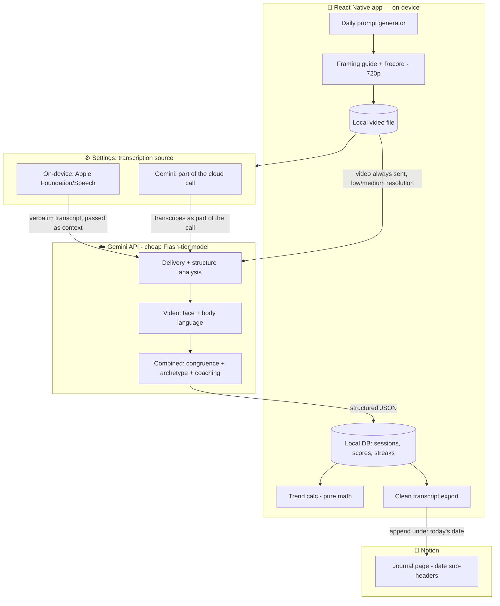
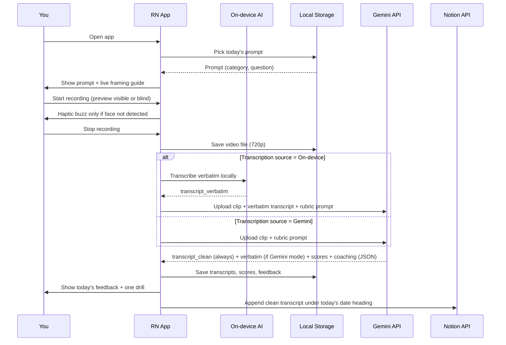
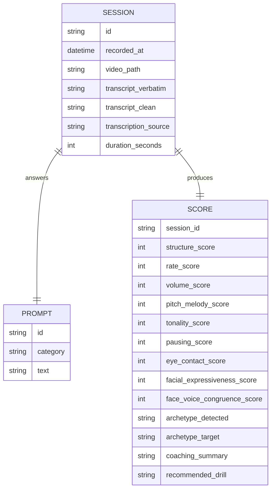

# Speaking Practice App — Project Plan

*A personal, unpublished React Native app for daily 1–5 minute speaking practice on random topics — recorded, transcribed to a journal, and graded on delivery and structure using Vinh Giang's and Matt Abrahams' speaking frameworks.*

Status: **draft v3** — keep editing this file as decisions get made.

Device this will run on: **iPhone 15 Pro, iOS 26.5.2** — relevant to §11 (on-device AI is genuinely available on this hardware).

---

## 1. Goals

- Record yourself daily for 1–5 minutes responding to a randomly generated topic.
- Get two versions of the transcript out automatically: a **verbatim** one (fillers, false starts, repetitions — for analysis) and a **cleaned** one (ready to paste into your journal).
- Get feedback on **delivery** (voice), **presence** (video), **structure** (content), and the **combination** of delivery + presence — not just a generic "you said um 8 times" scorecard.
- Ground the grading in two complementary frameworks (see §3): Vinh Giang on vocal/physical delivery, and Matt Abrahams (*Think Faster, Talk Smarter*) on structuring a spontaneous answer.
- Where it's genuinely viable, let processing run on-device instead of always hitting the cloud — controllable via a settings toggle, not hardcoded.
- Track progress over time.

## 2. Non-goals / constraints

- **Not publishing this.** No App Store review, no multi-tenant auth, no polish beyond "works reliably for me."
- Optimize for *you actually opening it every day* over feature completeness.
- Keep ongoing cost low — cents a month against Gemini, not dollars a day.
- **Worth building, but explicitly last in line** behind other things — this plan should stay ready to pick up whenever, not push you to start now.
- Expo's managed workflow with config plugins + EAS Build handles custom native modules cleanly now — no need to think in terms of "ejecting to bare."

## 3. Frameworks this app is grounded in

**Vinh Giang — delivery (voice + body)**
- Five vocal foundations: rate of speech, volume, pitch/melody, tonality, and pausing — vary these deliberately instead of defaulting to one setting.
- Tonality lives in the face as much as the voice — a flat face produces a flat, monotone voice. The "combined" grading pass checks whether facial expression and vocal tone are actually congruent.
- Four communication archetypes — Motivator, Educator, Coach, Friend — each with a different vocal/body signature. Strong communicators move between them deliberately based on what the moment calls for.
- His own recommended self-review process is exactly this app's shape: review audio, video, and transcript as separate passes to expose blind spots you'd miss watching the whole thing once through.

**Matt Abrahams, *Think Faster, Talk Smarter* — structure, specifically for the random-topic/spontaneous format**
- Structured spontaneity: a few flexible, memorized structures (a "what / why / how" framework, or a simple beginning-middle-end story arc) let you organize an answer on the fly without sounding scripted — like a jazz musician improvising within a known chord structure.
- Respond, don't react: pausing to think before answering isn't a failure, it's the skill.
- The "grandmother test": can you explain something in plain language, without jargon?
- His core thesis validates this whole project directly — repetition, reflection, and feedback are what actually build spontaneous-speaking skill. That's the loop this app is built around.

Together these give the rubric a fourth dimension, alongside delivery and presence: **does the response have a structure, or is it a ramble?** That's distinct from *how* it's delivered and worth scoring separately.

## 4. High-level architecture

Core design principle: **do it on-device if it's deterministic math, storage, or genuinely viable on-device AI (see §11); hand it to Gemini for anything that needs frontier-level judgment** (delivery, structure, presence, and the combined analysis).



## 5. On-device vs. cloud split

| Task | Where | Why |
|---|---|---|
| Recording, playback | On-device | Just camera/mic APIs |
| Live framing guide while recording | On-device | ML Kit face detection via a vision-camera frame processor, zero API cost |
| Random topic selection | On-device | Static curated list, no AI needed |
| Transcription — verbatim capture | **Toggle: On-device or Gemini** | Genuinely viable on-device now (see §11) — your choice |
| Transcription — clean rewrite | Gemini, always | Keeps journal-quality text consistent regardless of toggle (see §11) |
| Filler-word count, WPM | On-device | Once you have the verbatim transcript + duration, this is string math |
| Delivery read (rate/volume/pitch/tonality/pausing) | Gemini, always | Needs to actually listen and judge, not just measure |
| Structure read (Abrahams framework) | Gemini, always | Needs to understand the content, not just the audio signal |
| Facial expression, eye contact, body language | Gemini, always | Needs to actually watch the video |
| Face-voice congruence + archetype match + coaching writeup | Gemini, always | The genuinely novel part — needs to reason over both modalities together |
| Streaks, trend lines, week-over-week deltas | On-device | Pure math over stored scores, free and instant |
| Journal export/formatting | On-device | Text formatting before it's sent to Notion |

## 6. Recording UX

**Framing guide (before recording):** while you're getting ready, the front camera preview is live with a simple on-device face-detection overlay (a `vision-camera` frame processor + ML Kit face detector) — confirms you're centered and visible before you hit record. Fully on-device, zero API cost.

**During recording:** the guide doesn't nag continuously — it only surfaces a warning if a face isn't detected at all during the recording (e.g. you moved out of frame). The warning is a **haptic buzz** (decided) rather than a visual or audio cue — it works identically whether you're on the front or back camera, and needs no visible screen element at all, which is what makes it compatible with record-blind below.

**Record blind:** a toggle on the recording screen lets you hide the live self-view before you start — useful if watching yourself is distracting. The camera session and its frame processor keep running underneath regardless (recording + face detection don't stop) — the preview is just covered by an opaque view showing the prompt and a timer. Since the face-not-detected cue is haptic, it still reaches you even with nothing visible on screen.

## 7. Daily session flow



## 8. Data model



## 9. Grading rubric — JSON schema (all scores 1–10)

```json
{
  "transcript_verbatim": "string - includes filler words, false starts, repetitions (already filled in and passed as context if transcription_source = on-device)",
  "transcript_clean": "string - grammatically cleaned, ready for the journal (always produced by Gemini, regardless of transcription_source)",
  "duration_seconds": 0,
  "structure": {
    "score": 0,
    "structure_used": "what/why/how | story arc | none detected | other",
    "notes": ""
  },
  "delivery": {
    "rate":          { "score": 0, "wpm_avg": 0, "notes": "" },
    "volume":        { "score": 0, "notes": "" },
    "pitch_melody":  { "score": 0, "notes": "" },
    "tonality":      { "score": 0, "notes": "" },
    "pausing":       { "score": 0, "notes": "" }
  },
  "presence": {
    "eye_contact_score": 0,
    "facial_expressiveness_score": 0,
    "body_language_notes": ""
  },
  "combined": {
    "face_voice_congruence_score": 0,
    "archetype_detected": "Motivator | Educator | Coach | Friend",
    "archetype_fit_for_topic": "string",
    "overall_score": 0
  },
  "coaching": {
    "summary": "2-3 sentences",
    "top_strength": "string",
    "top_focus_area": "string",
    "recommended_drill": "string"
  }
}
```

The `combined` block is the part no existing off-the-shelf app does — checking whether facial tonality and vocal tonality actually match, and whether the archetype you defaulted to fits what the topic called for.

## 10. Gemini integration notes

- **Model choice — decided:** `gemini-flash-latest`, the auto-updating alias. Google hot-swaps it to the newest release in that tier, with a 2-week email notice before any breaking change — no manual upgrades needed. Real-world caveat: developers have reported the alias occasionally getting deprecated outright, or output quality shifting after Google moves it underneath you. Low-stakes for a personal daily app — if results ever feel off, that's the first thing to check.
- **One call per session, video attached directly** — Gemini takes native video+audio input. Send the clip with the rubric system prompt and a `responseSchema` matching §9.
- **Resolution — two separate settings:**
  - *Storage resolution* (what the RN app records/saves locally): 720p — plenty for reviewing your own practice videos, no reason to go higher.
  - *Analysis resolution* (the `media_resolution` parameter on the Gemini call): video bills at roughly 258 tokens/second at default sampling; `low` cuts that to roughly a quarter of the tokens per frame vs. `medium`/default. Since this task reads facial expression and body language, not fine text, `low` or `medium` should be plenty.
  - Rough math: a 5-minute clip ≈ 77K video tokens plus audio on top — comfortably under 100K total, landing at a few cents at most on a Flash-tier model.
- **Notion write:** needs a Notion integration token to append blocks under today's date heading on the existing journal page (see §12) — stored alongside the Gemini key, same "in-app for now" call for both.

## 11. On-device AI — status and the Settings toggle

You're on an **iPhone 15 Pro, iOS 26.5.2** — that's the exact minimum spec for Apple Intelligence (the A17 Pro chip is the floor Apple set for it), so the base on-device Foundation Models framework and on-device speech transcription are genuinely available to you, not hypothetical. Two things specific to your hardware, though:

- Apple's newer, more capable second on-device model (announced at WWDC 2026, aimed at deeper multimodal tasks) appears gated to a higher RAM tier than the 15 Pro has. You get the base ~3B on-device model — fine for transcription and simple text cleanup, not a substitute for Gemini's video-understanding quality.
- On-device speech-to-text (Apple's Speech framework) is mature and separate from the newer Foundation Models LLM — this is what actually produces the verbatim transcript, with Foundation Models optionally handling the verbatim→clean rewrite as a simple text task.

**The toggle, scoped correctly:** it should control **transcription only**, not the whole pipeline. Even with on-device transcription, the video still needs to go to Gemini for delivery, structure, presence, and combined-congruence scoring — that judgment isn't something a 3B on-device model can do.

- **Gemini mode (default):** one Gemini call does transcription + cleanup + all scoring, as in §10.
- **On-device mode:** Apple's on-device speech recognition produces `transcript_verbatim` locally (free, private, text never leaves the device for this step). The video clip and that verbatim transcript still get uploaded to Gemini afterward, which produces `transcript_clean` plus all the scoring blocks.

**Decided: the verbatim→clean rewrite always happens on Gemini, never on-device**, even in on-device mode. Reasoning: the on-device model is an untested ~3B model here — you don't yet know how accurate it is — while `transcript_clean` is the piece that actually lands permanently in your Notion journal. Keeping that specific step on the model already doing the scoring call (marginal cost is a few hundred extra output tokens, since that call is happening anyway) means journal quality never depends on the on-device model's rewriting ability. The on-device model's only job is the narrower, more forgiving task of capturing what you literally said — if it drops a word here or there, that mostly affects the verbatim-based filler-word/pace math, not what you read back later.

Net effect: the toggle saves some Gemini cost/latency on the transcription step and keeps the raw verbatim capture on-device, but it does **not** make the app fully offline — Gemini stays in the loop every session for the clean rewrite and all grading either way. Worth being upfront about that so the toggle doesn't overpromise.

**Library:** `@react-native-ai/apple` (Vercel AI SDK-compatible) exposes both transcription and text generation over Apple's on-device stack from React Native — this is the toggle's on-device implementation. Still preview-stage software (weeks old, requires React Native's New Architecture), so build the Gemini path first (Phase 1) and add the toggle once that's solid (Phase 2).

## 12. Tech stack

- **Framework:** Expo, managed workflow with config plugins + EAS Build. `prebuild` generates native iOS/Android projects from your config plugins on every build, so custom native modules just work without hand-maintained native folders.
- **Recording:** `react-native-vision-camera`, capped at 720p for stored files. The record-blind toggle (§6) is implemented as an opaque overlay view on top of the live `<Camera>` preview — the camera session and frame processor stay mounted and active either way, only the visual layer changes.
- **Framing guide / face detection:** `react-native-vision-camera` frame processor + `react-native-vision-camera-face-detector` (ML Kit) — on-device, before and during recording.
- **On-device transcription (toggle):** `@react-native-ai/apple` — see §11.
- **Local storage:** `expo-sqlite` (or WatermelonDB for reactive queries) for session/prompt/score records, storing `transcript_verbatim`, `transcript_clean`, and `transcription_source`; `expo-file-system` for the video files themselves.
- **Lightweight state (streaks, prefs, toggle setting):** `react-native-mmkv`.
- **Upload:** multipart upload of the clip to wherever the Gemini call is made from.
- **Journal export:** Notion API — append the clean transcript under a heading block for today's date (`YYYY-MM-DD`) on the existing journal page. Since it's one growing page (per your call in §14's predecessor), the app needs to check whether today's date heading already exists before creating a new one, in case of a second session in one day.
- **Secrets (Gemini key, Notion token):** embedded in-app for now — reasonable for a personal, unpublished app. Worth knowing both are technically extractable from the built app if it's ever handed off or decompiled, so don't treat them as unrecoverable secrets.

## 13. Phased roadmap

*Flagged as worth building but last in line — these phases assume you pick this up whenever that turn comes, not that it's imminent.*

| Phase | Scope |
|---|---|
| 1 | Recording UX (framing guide + record blind) → Gemini call for verbatim + clean transcript → save locally + append to Notion under today's date. Static curated topic list. |
| 2 | Settings toggle: on-device transcription (Apple) vs. Gemini, with automatic fallback if on-device isn't available. |
| 3 | Add the delivery block (rate/volume/pitch/tonality/pausing) and the structure block (Abrahams) to the Gemini call; store scores. |
| 4 | Add the presence block (facial expression, eye contact, body language) and the combined congruence/archetype block. |
| 5 | Trends/streaks/history view, weekly or monthly synthesis. |

## 14. Open questions

None outstanding right now — every question raised so far has a decision recorded in the relevant section above. Add new ones here as they come up.

## Changelog

- **2026-07-24** — Initial draft.
- **2026-07-24** — Added *Think Faster, Talk Smarter* as a second framework (structure dimension); dual verbatim/clean transcripts throughout; resolved decisions on topic bank, score scale, API key handling, journal destination (Notion), and manual video retention; added on-device AI research; corrected Expo native-module guidance; added Gemini model-alias and resolution/token-cost guidance.
- **2026-07-24** — Confirmed iPhone 15 Pro / iOS 26.5.2 supports on-device Apple Intelligence (it's the minimum spec); redesigned on-device/Gemini as a Settings toggle scoped to transcription only (§11); added Recording UX section (§6) covering the framing guide's before/during behavior and the new record-blind feature; resolved Notion page structure (date-based sub-headers) and Gemini model choice (auto-updating alias); reordered roadmap to bring the transcription toggle into Phase 2.
- **2026-07-24** — Resolved all open questions: face-not-detected warning is a haptic buzz (works for either camera, and needs no visible screen for record-blind); verbatim→clean rewrite always happens on Gemini even in on-device mode, so journal quality never depends on the untested on-device model; confirmed Notion date-based sub-headers means one growing page with a heading block per date.
